# NXERP application data isolation blueprint

> **Addendum 2026-11-19: production measured, assumptions A1 and A2 corrected.** A read-only look at the live host (details in `measurements.md`) shows: NXERP and Helpdesk are already **two separate Frappe sites** with separate databases and `localhost`-only logins; the host is **bare-metal systemd, not Docker**, shared with at least 8 other applications; MariaDB is 10.11 (pin: 11.8); the NXERP site holds almost no business data (0 customers, 0 invoices) while Helpdesk holds 53 tickets. Consequences: the "one shared database login" finding in Part 1 describes the staging-like Docker stack and the repository's bootstrap, not production; the Docker-specific parts of Phases 1, 5 and 8 (compose, `backup.sh`) need a bare-metal variant; Phases 2 to 4 (contracts, outbox, shared read layer) are unaffected. The HTML copy of this blueprint is not regenerated and is out of date on these points.

Branch `docs/architecture-isolation`, written 2026-11-03 against commit `83b19b95b` (on `develop` at `84905cec5`). Documentation only: no production code changed, nothing pushed.
Pins in force: Frappe v16.53.0, ERPNext v16.52.1, MariaDB 11.8, Redis 8.6 (`deploy/versions.env`, `deploy/apps.json`).

> **How to read the tags.** **FACT** = verified in this repository or from Frappe source, with a path or command. **EVIDENCE** = an official source I opened, with its URL. **JUDGMENT** = my conclusion, with its reasoning. **UNRESOLVED** = not verified; the check is given. **NEW** = does not exist yet; named to follow the repository's conventions.
> Docker was not running on the machine used, so no dev site existed: every database-level check is **UNRESOLVED** and has its command in the appendix.

## Summary (read this first)

| Item | Content |
| --- | --- |
| Problem | **FACT**: all apps share **one database and one database login** (the "Shared Database" or "Integration Database" pattern). RBAC works and stays, but it cannot limit what code can read. |
| **Selected architecture** | **Database per Application** (the "Database per Service" pattern), with **federated identity (single sign-on)** and **API-and-event integration**. Isolation style: the **bridge model**. |
| **Database sharing** | **UNSHARED.** Each app has its own database and its own database login. ERPNext's database also sits on its own server. Only the login service is shared, not a database. |
| **Scope** | Built for **5 applications**: Helpdesk and ERPNext today, HRMS, Project Management and Budget Management planned (shown dashed, never treated as built), plus one identity site. Every diagram shows all five. |
| Proof it is real | Used and documented by AWS, Microsoft (Azure and Power Platform), Shopify, Martin Fowler, microservices.io, and by Frappe itself (a database per site). See Section 3. |
| What stays | RBAC, Frappe `/login`, the launcher, the router and the `nxerp` gate keep working, now on each app's own site. |
| What changes | Three databases instead of one. Helpdesk stops writing into ERPNext and reads customer details over a versioned read-only API. Access grants are copied from the identity site to the apps. |
| How to deliver | Five phases (Part 3), each split into short Claude Code prompts plus a numbered checklist for the things only you can do. Part 4 describes the finished system. |

### Assumptions you can override

| ID | Assumption taken | Override if |
| --- | --- | --- |
| A1 | ~~Production runs one site with all six apps~~ **Measured 2026-11-19: production has two sites (NXERP and Helpdesk) on separate benches, each with its own database and login** | corrected |
| A2 | One organisation, **one bare-metal systemd host (no Docker) shared with other applications**, a handful of apps | multi-client SaaS or several hosts |
| A3 | Helpdesk becomes read-only toward ERPNext (no more writes to Customer) | support needs the two-way sync |
| A4 | Customers (portal users) log in at the identity site too | you accept local Helpdesk customer accounts |
| A5 | Business roles (`Agent`, `Sales User`) stay managed inside each app; the identity site grants only app access | you want one place for all roles |
| A6 | A freeze window of up to 2 hours is acceptable for the Helpdesk cutover | shorter window needed |
| A7 | `telephony` is used only by Helpdesk, so it lives in the Helpdesk stack | other apps need it |
| A8 | "nxerp" in your note means the ERP app (ERPNext) inside the NXERP platform, per `CLAUDE.md`; the platform app `nxerp` runs on the identity site | you meant something else |
| A9 | The three planned apps are HRMS, Project Management and Budget Management (named in `CLAUDE.md`); HRMS and Budget are classed **restricted** (employee and finance data), Project Management **standard** | other apps or other data classes |

---

# PART 1. The problem

## 1.1 The problem, stated with what the code shows

NXERP puts several applications behind one login. After login, `/nxerp/go` and `/nxerp/apps` use role grants to decide which app a user may open.
**That part works, and it is not the problem.** RBAC (role-based access control) is already implemented and clear. It stays.

**The problem is the shared database.** The apps run in the same Frappe process on the same site, so they use **one database and one database login**. RBAC checks who the user is. It cannot restrict what the code can read, because every RBAC check (`has_permission`, `permission_query_conditions`, the launcher) is Python running inside the same process as that one database connection.

Consequence (**JUDGMENT**, resting on the FACTs in 1.2): an injection bug, a vulnerable dependency, or a badly written report or API in the internet-facing Helpdesk gives an attacker the one database login of the site. That login can read every app's tables, including ERPNext's accounting, employee and operational records. Hiding an icon, or the `nxerp` gate, does not change that, because a flaw that runs SQL or Python bypasses Frappe's permission checks.

This setup has an established name: the **Shared Database** or **Integration Database** pattern, which architects advise avoiding (Section 3, sources S3 and S9). The fix, in Part 2, is the **Database per Application** pattern.

Be precise about what is **not** wrong today (**FACT**): none of Helpdesk's raw SQL touches ERPNext tables. Helpdesk has 8 `frappe.db.sql` calls outside patches and tests, all on `tabHD Ticket` or `tabCommunication` or install-time indexes (for example `apps/helpdesk/helpdesk/helpdesk/doctype/hd_ticket/hd_ticket.py:1484`, `apps/helpdesk/helpdesk/helpdesk/report/ticket_summary/ticket_summary.py:343`). The risk is the **capability** of the shared account, not a known misuse.

## 1.2 How many sites, databases and database accounts

| Question | Answer | Tag | Evidence |
| --- | --- | --- | --- |
| Product sites per environment | **1**, hosting frappe, payments, erpnext, telephony, helpdesk, nxerp | **FACT** | `deploy/bootstrap/bootstrap.sh:132-140`; `deploy/docker/compose/staging-like/compose.yaml:69-93` |
| Other sites | `nxerp-e2e.localhost` (throwaway browser-test site, same bench and MariaDB); `helpdesk.localhost` (legacy Frappe 15 sandbox with its own MariaDB 10.8, not part of the NXERP stack) | **FACT** | `apps/nxerp_platform/browser-tests/site.sh`; `deploy/docker/helpdesk-local-dev/init.sh:32-39` |
| Database instances | **1** `mariadb` service per compose file | **FACT** | `deploy/docker/compose/dev/compose.yaml:7`; `deploy/docker/compose/staging-like/compose.yaml:25` |
| Application databases | **1** per site, created by `bench new-site` with no `--db-name`, `--db-password` or `--db-host` | **FACT** | `deploy/bootstrap/bootstrap.sh:134-135` |
| Application database accounts | **1** per site (generated by bench), shared by all six apps | **FACT** (topology), **EVIDENCE** (Frappe creates it with database-level `ALL PRIVILEGES`) | `frappe/database/db_manager.py` and `frappe/database/mariadb/setup_db.py` at v16.53.0, read directly 2026-11-03 (see Section 3) |
| Who holds the MariaDB root password | an env var `NXERP_DB_ROOT_PASSWORD`; only the one-shot `create-site` receives it in staging-like, but the dev `bench` container holds it permanently | **FACT** | `deploy/docker/compose/staging-like/compose.yaml:81`; `deploy/docker/compose/dev/compose.yaml:39` |
| Redis | 2 services (`redis-cache`, `redis-queue`); the socket.io Redis defaults to the queue URL | **FACT** | `deploy/docker/entrypoint.sh:14` |
| Workers and scheduler | 1 `queue-worker` (`short,default,long`), 1 `scheduler`, shared by all apps | **FACT** | `deploy/docker/compose/staging-like/compose.yaml:113-123` |
| Network boundaries | none: no `networks:` key in either compose file | **FACT** | `grep -rn "^\s*networks:" deploy/docker/compose` returns 0 |
| Backups | one site, whole site only; includes `encryption_key`; scripts do not encrypt | **FACT** | `deploy/scripts/backup.sh` header |
| Production site count | not described in the repo | **UNRESOLVED** | owner command in the appendix (U1) |

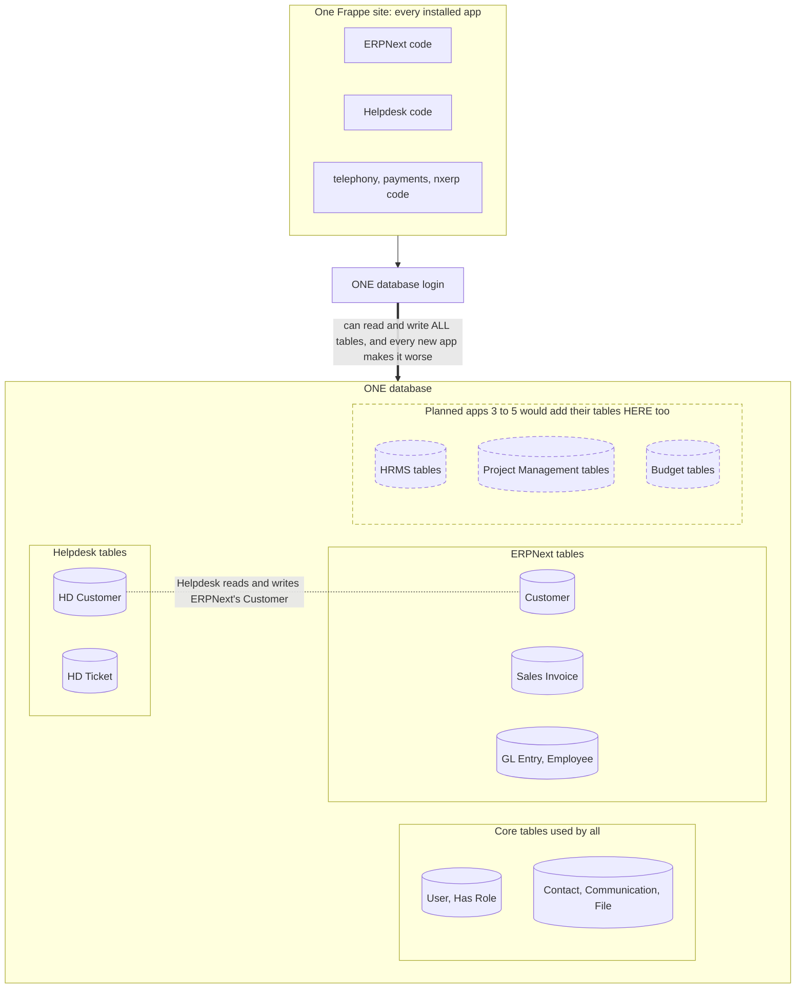

## 1.3 Concrete cross-app access today

| # | What | Where (path) | Type | Tag |
| --- | --- | --- | --- | --- |
| 1 | Helpdesk hooks fire on ERPNext's `Customer` (after_insert, on_update, before_rename, after_rename, on_trash) | `apps/helpdesk/helpdesk/hooks.py:82-88` to `apps/helpdesk/helpdesk/integrations/erpnext/customer.py:13-65` | code, data | **FACT** |
| 2 | Helpdesk hooks fire on **every** `User Permission` and `DocShare` and mirror rows between `HD Customer` and `Customer` | `hooks.py:89-100`; `apps/helpdesk/helpdesk/integrations/erpnext/user_permission.py`, `apps/helpdesk/helpdesk/integrations/erpnext/doc_share.py`, `apps/helpdesk/helpdesk/integrations/erpnext/mirror_sync.py:79-215` | permission | **FACT** |
| 3 | Helpdesk **creates and deletes ERPNext Customers** | `apps/helpdesk/helpdesk/helpdesk/doctype/hd_customer/hd_customer.py:376-434` | data | **FACT** (agent-read; `hd_customer.py:385` spot-checked) |
| 4 | Helpdesk writes a custom field onto ERPNext's schema (`Customer.hd_customer`) and sets it with `db.set_value` | `apps/helpdesk/helpdesk/integrations/erpnext/utils.py:25-61` | schema, data | **FACT** |
| 5 | Bulk sync reads `get_all("Customer")` and inserts both sides with `ignore_permissions` | `apps/helpdesk/helpdesk/integrations/erpnext/api.py:59` (`sync_all_customers`) | data | **FACT** |
| 6 | The feature switch is "is the app on this site": `"erpnext" in frappe.get_installed_apps()` | `apps/helpdesk/helpdesk/integrations/erpnext/utils.py:19-22` | configuration | **FACT** |
| 7 | Helpdesk's ticket timeline and list code read telephony's `TP Call Log`; `required_apps = ["telephony"]` | `apps/helpdesk/helpdesk/hooks.py:9`; `apps/helpdesk/helpdesk/api/doc.py`; `apps/helpdesk/helpdesk/helpdesk/doctype/hd_ticket/api.py` | data, code | **FACT** |
| 8 | Raw SQL and reports in Helpdesk (shared-table reads: `tabHD Ticket`, `tabCommunication`) | `hd_ticket.py:1484-1498`; reports under `apps/helpdesk/helpdesk/helpdesk/report/` | data | **FACT** |
| 9 | Both Helpdesk and the platform overwrite the same Single (`Portal Settings`) | `apps/helpdesk/helpdesk/setup/install.py:232-249`; `apps/nxerp_platform/nxerp/install.py:25-36` | configuration | **FACT** (agent-read) |
| 10 | The platform gate decides ownership by DocType to module to app **on the local site**; a DocType not on the site is treated as shared and ungated | `apps/nxerp_platform/nxerp/registry.py:132-144`; `apps/nxerp_platform/nxerp/enforcement.py:155-170` | permission | **FACT** (agent-read) |
| 11 | The grant-migration tool scans `DocPerm` of the owned apps in the one database | `apps/nxerp_platform/nxerp/migration.py:27-88` | permission | **FACT** (agent-read) |
| 12 | ADR-003 records the Helpdesk-to-ERPNext Customer bridge as an exception, and that role separation works only because role names are disjoint | `docs/adr/ADR-003-access-model.md:10,48` | permission | **FACT** (agent-read) |
| 13 | Backup, restore and rollback are all-or-nothing for the whole site | `deploy/scripts/backup.sh`, `restore.sh`, `rollback.sh` | operations | **FACT** |
| 14 | Anyone who can create a Query Report or Server Script with SQL on the site can read any table (Frappe feature; not tested here) | n/a | permission | **UNRESOLVED** (check: Frappe docs on Query Report; test on a dev site) |

## 1.4 Coupling table (app by app)

Row app depends on column app. `FW` = Frappe core tables every site has (User, Contact, Communication, File, Email Account, Comment, ToDo).

| from \ to | ERPNext | Helpdesk | telephony | FW tables | Notes |
| --- | --- | --- | --- | --- | --- |
| **Helpdesk** | 1 opt-in feature, about 20 touch points (rows 1-6 above) | n/a | 1 hard (required app) plus about 10 data and UI touch points (row 7) | very many (`User`, `Contact`, `Communication`, `File`, `Email Account`, `Assignment Rule`) | 0 imports of `erpnext` or `telephony` in Python (**FACT**: `grep -rnE "^\s*(import\|from)\s+(erpnext\|telephony)" apps/helpdesk/helpdesk` returns 0) |
| **nxerp** | none by name; indirect through `Module Def` and SQL on `tab<DocType>.module` | same | same | `User`, `Has Role`, `Role`, `Portal Settings`, `Navbar Settings` | `required_apps = []` (`apps/nxerp_platform/nxerp/hooks.py:18`) |
| **ERPNext** | n/a | not inspected (ERPNext is upstream, not in the repo) | not inspected | n/a | whether ERPNext reads Helpdesk data is **UNRESOLVED**, command U6 |

**JUDGMENT:** the code coupling to ERPNext is small and removable. The expensive dependencies are identity (one `User` table) and operations (one backup, one deploy, one set of credentials).

---

---

# PART 2. The analysis

## Section 1. Solution: remove the shared database

### 1.1 What already works, and what the real problem is

You already have RBAC (role-based access control) and it is clear and working. It stays. The problem is a different layer, and it is the **shared database**.

| Layer | Question it answers | Status | What we do |
| --- | --- | --- | --- |
| Authentication (login) | Who are you? | Works (Frappe `/login`) | Keep |
| **Authorization, RBAC** | What may this user open or change? | Works (roles, DocType permissions, the `nxerp` gate, `apps/nxerp_platform/nxerp/enforcement.py`) | **Keep, unchanged** |
| Application visibility | Which apps do you see? | Works (launcher, router) | Keep |
| **Data storage** | **Where does each app's data live, and who can reach it?** | **PROBLEM: one shared database, one shared database login** | **Fix: this is the whole point of this plan** |

Why RBAC cannot fix the data layer: RBAC is a check written in application code. It answers "may this user do this?". It cannot answer "which tables can this code reach?". Because every app runs with the same database login, any flaw in any app (an injection bug, a vulnerable library, a badly written report) bypasses RBAC and sees every table. The database itself has no wall.

This problem has an established name. It is the **Shared Database** pattern, also called the **Integration Database**, and it is documented as something to avoid. Martin Fowler: "integration databases should be avoided" because "the database becomes a point of coupling between the applications that access it." (**EVIDENCE**, Section 3, source S3.) microservices.io lists its costs: schema changes must be coordinated across teams, and "all services access the same database [so] they can potentially interfere with one another" (**EVIDENCE**, S9).

### 1.2 The solution in one sentence

**Give every application its own database and its own database login (the "Database per Application" pattern), keep RBAC and the one login on top, and let applications exchange data only through APIs and events, never through the database.**

### 1.3 How the solution fixes the shared database, in the database itself

| Shared-database problem today (**FACT**, Part 1) | What changes in the database layer |
| --- | --- |
| One database holds every app's tables side by side (and every new app would add more) | **One database per app, plus the identity database**: three today (identity, Helpdesk, ERPNext), six with the three planned apps. An app's tables exist only in its own database. |
| One database login can read and write all of them | **One login per database**, allowed on that database only. Helpdesk's login cannot even see ERPNext's database. |
| Helpdesk code reads and writes ERPNext's `Customer` table directly (`apps/helpdesk/helpdesk/hooks.py:82-88`) | **No cross-database access at all.** Helpdesk keeps a small copy of customer names in its own database and asks ERPNext's API for details. |
| One shared user table | **One master user table (identity database)**, copied without passwords to each app's own database |
| One backup and one restore for everything | **One backup and restore per database** |
| A schema change in one app can break another | Each app migrates **only its own database**; the API between apps is versioned |
| Finance data and an internet-facing app on one database server | ERPNext's database on **its own server** |

### 1.4 The steps, and which phase does each

| Step | What we do (plain words) | Phase |
| --- | --- | --- |
| 1 | Measure the real shared database on a copy; fix cheap risks (encrypted backups, restore test) | 1 |
| 2 | Create three empty, separate environments with their own databases and logins | 2 |
| 3 | Make the one login work across them, and copy "who may open which app" to each | 3 |
| 4 | Replace Helpdesk's direct reach into ERPNext with a read-only API and signed events | 4 |
| 5 | Move the live data into the separate databases in a short freeze window, with a rehearsed way back | 5 |

### 1.5 What stays the same, what changes

| Stays the same | Changes |
| --- | --- |
| Users type their password once, at Frappe's `/login` | That page lives on the identity site only |
| RBAC: roles, permissions, the `nxerp` gate, the launcher | The same code runs on each app's own site |
| ERPNext and Helpdesk screens and data | Each app has its own web address and its own database |
| Roles such as Agent or Sales User, assigned inside each app | Access to an app is granted on the identity site and copied to the app |
| Everything you can do in ERPNext and Helpdesk today | Helpdesk can **read** ERPNext customer details but no longer **writes** to ERPNext |

## Section 2. Chosen architecture

### 2.1 The selected architecture, by name

| | |
| --- | --- |
| **Selected architecture** | **Database per Application** (the "Database per Service" pattern applied to NXERP's applications), also called **siloed data** or shared-nothing data ownership |
| **Database sharing** | **No. UNSHARED.** Each application has its own database and its own database login. No shared tables, no shared schema, no shared database account, no cross-database query. |
| **Database server sharing** | Partly, and that is allowed. Databases of normal business data (identity, Helpdesk, and later Project Management) are separate databases on one "standard" MariaDB server. Databases of finance and HR data (ERPNext, and later HRMS and Budget) are separate databases on a second, "restricted" server. Within a server every database has its own login. Microsoft's guidance: "Services can safely share the same physical database server. Problems occur when services share the same schema, or they read and write to the same set of database tables." (**EVIDENCE**, S2) |
| **The one shared thing** | The **login**, not a database: **Federated Identity / Single Sign-On** (OAuth 2.0 authorization-code flow, as in OpenID Connect). The identity site's database holds only users and access grants. |
| **How apps exchange data** | **API with published versioned contracts** (reads) and **event-carried state transfer** (signed webhooks that keep a small local copy). Never database access. |
| **Overall isolation style** | The **Bridge model** (AWS SaaS Lens): the data tier is siloed per application; identity and operations are shared. |
| **Authorization** | **RBAC**, unchanged, now running inside each application. |

The four levels of database sharing, and where each part of NXERP sits:

| Level | Description | Used by |
| --- | --- | --- |
| 0 | Shared tables, one database, one login (the Integration Database) | **Today, all apps** (we leave this) |
| 1 | Separate databases and separate logins on one server | **Chosen** inside each tier: identity, Helpdesk and Project Management on the standard server; ERPNext, HRMS and Budget on the restricted server |
| 2 | Separate database servers | **Chosen** between the two tiers: finance and HR data never share a server with the rest |
| 3 | Separate machines | Future option when a trigger in 2.10 is met |

**Scope: this is built for five applications, not two.** Two applications are installed today. Three more are planned, and the design treats every application the same way.

| # | Application | Status | Data class (assumption A9) | Database server |
| --- | --- | --- | --- | --- |
| 1 | Helpdesk (with telephony) | installed today | standard | standard |
| 2 | ERPNext (the ERP app inside NXERP; you call it "nxerp", see assumption A8) | installed today | restricted (finance) | restricted |
| 3 | HRMS | **planned, not installed** | restricted (employee data, payroll) | restricted |
| 4 | Project Management | **planned, not installed** | standard | standard |
| 5 | Budget Management | **planned, not installed** | restricted (finance) | restricted |
| | Identity site (the platform app `nxerp`) | built in Phases 2 and 3 | standard (users, passwords) | standard |

**Engine.** The database engine stays MariaDB 11.8 (ADR-002). The pattern is the same on PostgreSQL (separate databases, one role each, `CONNECT` revoked from `PUBLIC`), but changing engine is not part of this plan.

**Prerequisite.** This design needs separate databases and logins to exist. If only one database and one login are allowed, it cannot be delivered (Section 5).

Planned apps appear in every diagram with a **dashed outline** and the word "planned". Nothing is built, installed or shown to users for them (the repository rule in `CLAUDE.md`); the design only guarantees that adding each one repeats the same short routine (Section 2.8) and touches no existing app.

### 2.2 The named concepts we use, and where each appears

| # | Concept | One-line meaning | Where it is in our design | Source |
| --- | --- | --- | --- | --- |
| 1 | **Database per Service (Database per Application)** | each application stores its data in a private database that only it can reach | three databases, three logins | S1, S2, S11 |
| 2 | **Shared Database / Integration Database** (the thing we leave) | many applications use one database | today's setup | S3, S9 |
| 3 | **Silo, pool and bridge models** | silo = dedicated resources, pool = shared, bridge = mix per component | data siloed; identity and operations pooled | S12 |
| 4 | **Federated identity and Single Sign-On** (OAuth 2.0, OpenID Connect) | one login service vouches for the user to other applications | identity site and Social Login Keys | S8 |
| 5 | **RBAC** | access decided by roles | unchanged `nxerp` gate and Frappe permissions | existing code |
| 6 | **Least privilege** | each account may do only what it needs | one database login per database, no root in app containers | S18 |
| 7 | **API contract, API Composition** | other apps ask the owner's API instead of its tables | `nxerp.bridge.v1` | S10, S1 |
| 8 | **Event-carried state transfer** | the owner announces changes; receivers keep their own copy | signed webhook that updates a small customer mirror in Helpdesk | S7 |
| 9 | **Single source of truth (system of record)** | exactly one owner for each kind of data | identity owns users, ERPNext owns customers, Helpdesk owns tickets | S2 |
| 10 | **Network segmentation (defence in depth)** | an app can only talk to the networks it needs | private database networks, one app-to-app network | S17 |
| 11 | **Data classification tiers** | group data with similar security needs | standard and restricted database servers | S13 |
| 12 | **Outbox and reconciliation** | record a message with the data change, deliver it reliably, and compare both sides regularly | access grants from identity to apps (a standard messaging pattern; **JUDGMENT**, not researched here) | none |

### 2.3 The decision, in the standard decision-record format

| Part | Content |
| --- | --- |
| **Context** | **FACT**: six apps share one site, one database and one database login (Part 1). RBAC works, but it cannot limit what code can read. A flaw in the internet-facing Helpdesk reaches every table. |
| **Decision** | **JUDGMENT**: adopt **Database per Application**. Add a federated identity site. Put ERPNext's database on a separate server. Exchange data only by versioned APIs and signed events. |
| **Consequences** | A flaw in Helpdesk exposes only Helpdesk's database. There are more things to run (three sites, two database servers). Helpdesk can no longer write into ERPNext. Backups, restores and schema changes become per application. |
| **Alternatives considered** | Section 2.11. |

### 2.4 The system: the full picture first, then simpler views

**The full picture.** Read it from top to bottom: each horizontal band is a **layer**, and each column is a **site**. Bold arrows are database logins (one per site). Thin lines are caches and files. Dashed arrows between sites are the only app-to-app channels (A = access grants, C = a read-only contract). Dashed outlines are **planned** apps (3 to 5). The columns are grouped by database tier, so the two database servers sit side by side. The picture is generated from the list of apps, so adding an app adds a column. Notice what repeats for every app: its own site, its own Redis cache and queue, its own database and login, its own files volume.


**Life of a request through the layers** (the numbered circles on the Helpdesk column of the picture):

| # | Step | Layer | What happens |
| --- | --- | --- | --- |
| 1 | A user opens a web address | Access | HTTPS reaches the host proxy, then the edge proxy |
| 2 | The edge routes by address | Access to application | the request goes to that app's site only |
| 3 | The app checks access | Application | the RBAC gate: signed in, enabled, has the role for this app |
| 4 | The app checks its own cache | Cache and queue | its own Redis cache; no other app's cache is reachable |
| 5 | The app reads or writes its data | Databases | with its own login, on its own database only |
| 6 | The app reads or stores files | Files and secrets | its own volume |
| 7 | Slow work is queued | Cache and queue | a job in the app's own Redis queue; its own worker runs it and writes to its own database |

**What each layer is, and how it changes**

| Layer | What it contains | Today (one shared setup) | After (this design) |
| --- | --- | --- | --- |
| 1 Access | browsers, HTTPS certificates, the edge proxy | one proxy pinned to one site | one edge proxy routing by web address to any number of sites (stateless; shared) |
| 2 Identity plane | login, OAuth provider, access grants | inside the one site | one identity site, no business data |
| 3 Applications | web app, websocket, worker, scheduler | one process runs every app | one site per app: 5 apps and 6 sites in all |
| 4 Cache and queue | Redis cache, Redis queue | **one cache, one queue, one worker, one scheduler for everything** | **one cache and one queue per site**, never shared |
| 5 Databases | MariaDB servers, databases, logins | **one database, one login, one server** | **one database and one login per site; two servers by data class** |
| 6 Files and secrets | uploads, search index, `site_config`, passwords | one shared volume | one volume per site |
| 7 Operations | backup, secrets, monitoring, deploy | one backup of everything | per database and per site |

**Zoom: inside one app's stack, the database and cache path.** Every application, today's and planned, has exactly this inside. Only the database server (standard or restricted) differs.


| Component | What it holds | Survives a restart? | Today | After | Evidence |
| --- | --- | --- | --- | --- | --- |
| MariaDB server | databases | yes (disk volume) | 1 server for everything | 2 servers: standard and restricted | **FACT**: one `mariadb` service in `deploy/docker/compose/staging-like/compose.yaml:25` |
| App database | every table of one app | yes | 1 database for all apps | 1 per app, plus the identity database | **FACT**: `deploy/bootstrap/bootstrap.sh:134-135` |
| Database login | the rights to that database | n/a | 1 login for all | 1 per database, database-level grant only | **EVIDENCE**: Frappe source (S14) |
| Redis cache | Frappe's cache. Keys are prefixed by the database name on one Redis, so a prefix is not a boundary. Whether user sessions live here is unverified | no (memory only) | 1 shared | 1 per site | **FACT**: `redis-cache` has no persistence in the compose file; prefix behaviour is agent-read from Frappe source; sessions are **UNRESOLVED** (appendix U7) |
| Redis queue | background jobs (queues `short`, `default`, `long`) and live-update messages (socket.io uses this Redis unless another is configured) | yes (`--appendonly yes`) | 1 shared | 1 per site | **FACT**: `deploy/docker/compose/staging-like/compose.yaml:47-52`, `deploy/docker/entrypoint.sh:14` |
| Background worker | runs the queued jobs for every site of the bench | n/a | 1 for everything | 1 per site | **FACT**: `compose.yaml:113-117` |
| Scheduler | timed jobs; Frappe runs one scheduler process per bench | n/a | 1 for everything | 1 per site | **FACT**: `compose.yaml:119-123`; per-bench behaviour is agent-read from Frappe source |
| Files and secrets volume | uploads, search index, `site_config.json` with the database password and `encryption_key` | yes | 1 shared volume | 1 per site | **FACT**: `compose.yaml:19,141` |
| Customer-details cache (NEW) | a 5-minute copy of a small ERPNext answer | no | n/a | in Helpdesk's own Redis cache | design (Phase 4) |
| Outbox table (NEW) | access-grant messages waiting for delivery | yes | n/a | in the identity database | design (Phase 3) |

**The system and the people who use it, with all five apps**

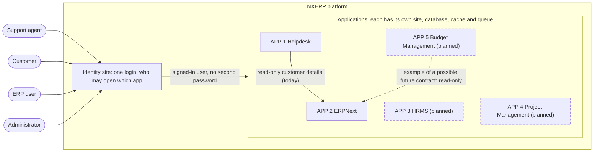

**The parts inside, with their databases, for all five apps**

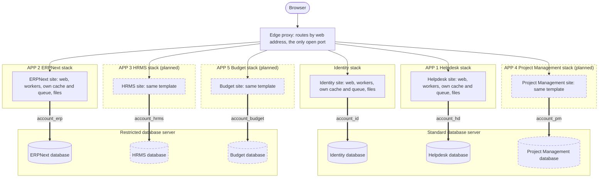

Plain reading: each app site talks to exactly one database, with exactly one login (bold arrows). Both database servers sit on private networks with no route to the internet or to other stacks. Each stack also has its own cache, files and passwords. The only app-to-app channels (grants, read-only contracts, signed events) are in the full picture above and in the flows in 2.7.

### 2.5 The database layer in detail

**Which login may use which database.** The **database access control matrix** (this is the shared-database fix, shown as a table). It has one row and one column per site. A new app adds one row and one column, denied for everyone else.

| Database login | Identity | Helpdesk | ERPNext | HRMS (planned) | Project Mgmt (planned) | Budget (planned) |
| --- | --- | --- | --- | --- | --- | --- |
| `account_id` (identity site) | **ALL (own)** | denied | denied | denied | denied | denied |
| `account_hd` (Helpdesk site) | denied | **ALL (own)** | denied | denied | denied | denied |
| `account_erp` (ERPNext site) | denied | denied | **ALL (own)** | denied | denied | denied |
| `account_hrms` (HRMS site) | denied | denied | denied | **ALL (own)** | denied | denied |
| `account_pm` (Project Mgmt site) | denied | denied | denied | denied | **ALL (own)** | denied |
| `account_budget` (Budget site) | denied | denied | denied | denied | denied | **ALL (own)** |
| database root (admin) | held only by a one-time "create site" run and by the infrastructure owner; **not in any running app container** | same | same | same | same | same |

("ALL (own)" means all privileges on that one database and no global privilege. Frappe creates exactly this when it creates a site: **EVIDENCE**, source S14. Real account names are generated; `account_*` is a label. The identity, Helpdesk and Project Management databases sit on the standard server and the other three on the restricted server, so a login from one server's tier is also unreachable from the other tier's network.)

**Rules that keep the matrix true**

| Rule | How it is enforced |
| --- | --- |
| A login works only on its own database | Frappe's `GRANT ... ON <db>.*` (database level, no `*.*`) plus the login is allowed only from that stack's network range (`--mariadb-user-host-login-scope`) |
| The database servers are not reachable from other stacks | each server sits on a private Docker network (`internal: true`) that only its own stacks join |
| No running app container holds the database admin password | admin credentials exist only in a one-time run (today the dev `bench` container keeps them: `deploy/docker/compose/dev/compose.yaml:39`) |
| Apps never reach each other's database, cache or workers | only an app-to-app network carrying web requests to the backends joins them |

### 2.6 The databases, table by table

Each diagram shows the tables a database owns, with their key columns. These are **simplified** (key columns only). Helpdesk names were read from the DocType files in `apps/helpdesk/helpdesk/helpdesk/doctype/`; ERPNext names are standard ERPNext names to confirm against v16.52.1 (**UNRESOLVED**, appendix U3 and U5).

**Identity database** (owned by the identity site)

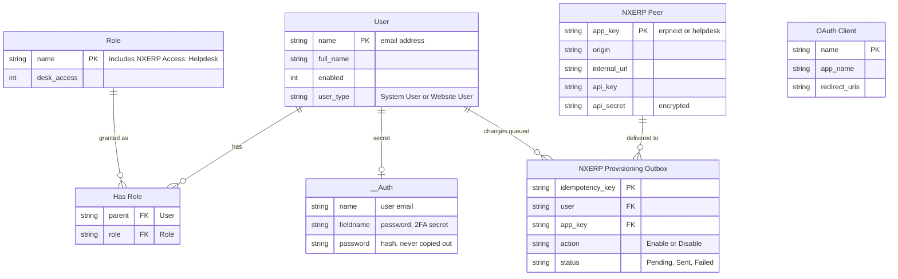

**Helpdesk database** (owned by the Helpdesk site)

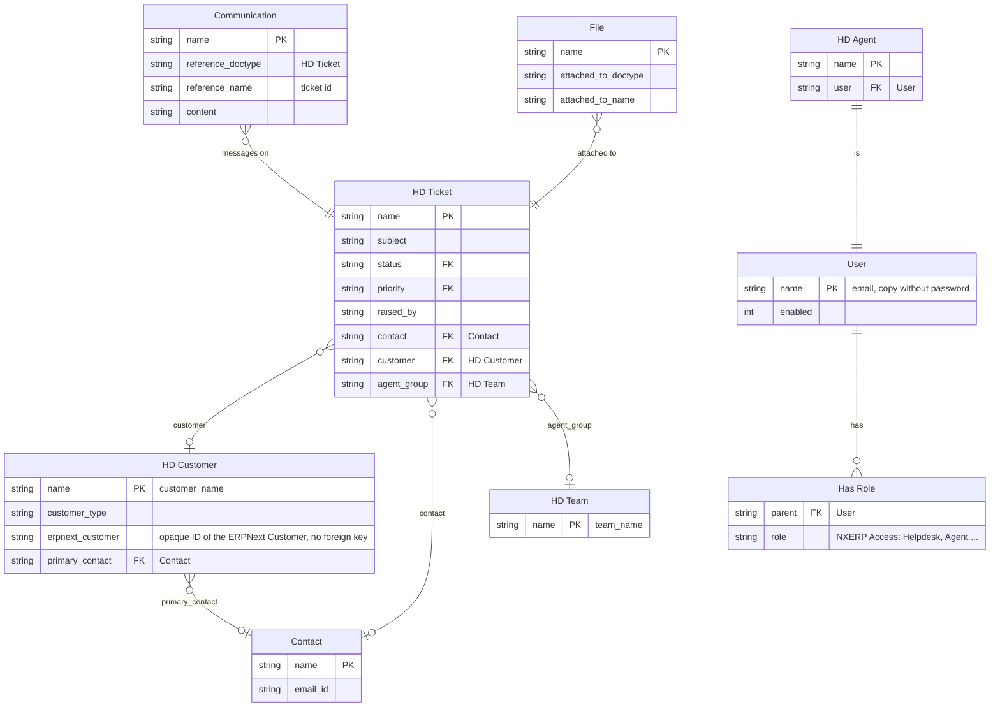

**ERPNext database** (owned by the ERPNext site; relevant tables only)

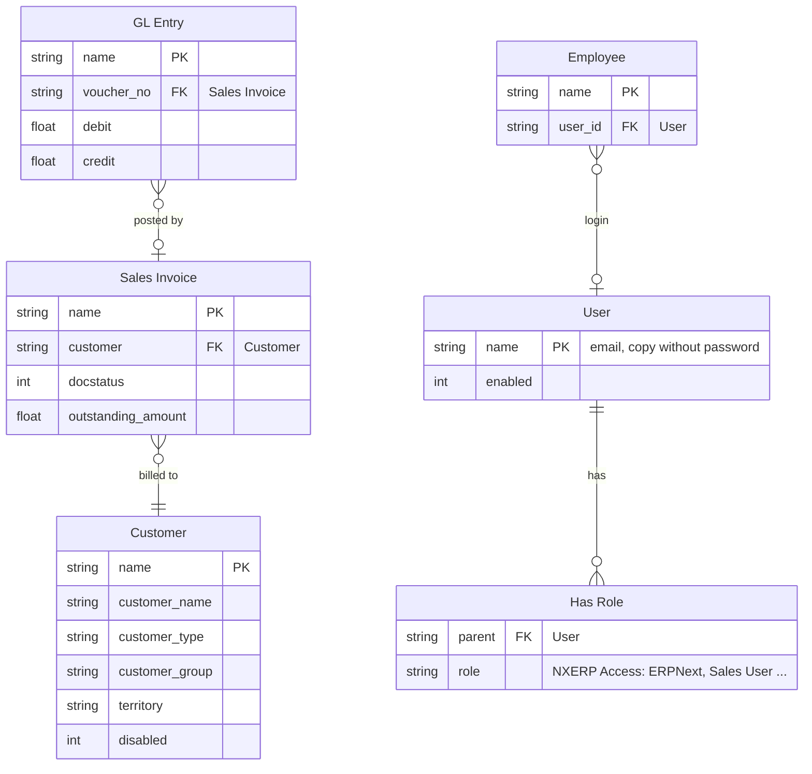

**Every planned app repeats this pattern.** A future app's database holds its own business tables, a copy of the users (no passwords) with their roles, and, only where a contract exists, a small local copy of another app's record with that record's plain ID.

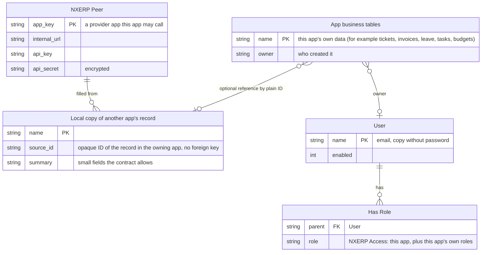

**What links the databases?** Not foreign keys, and not queries. Only **identifiers stored as plain values** and resolved through an API:

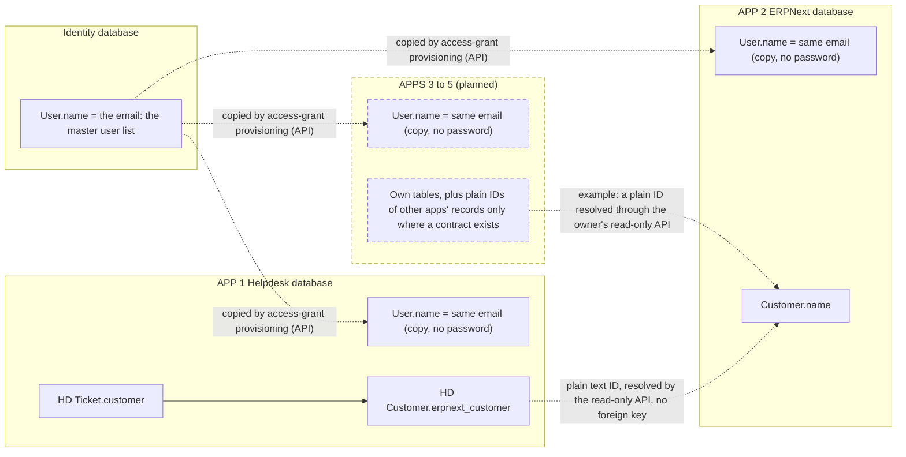

**Who owns each kind of data (single source of truth)**

| Data | Owner | Stored in | Everyone else gets it by |
| --- | --- | --- | --- |
| Users, passwords, 2FA secrets | identity site | identity database | a copy of the user (no password) pushed to each app |
| "May open Helpdesk or ERPNext" | identity site | identity database (a role) | the same role copied to the app's user |
| Customer master, invoices, ledger | ERPNext site | ERPNext database | Helpdesk: read-only API and a signed-event mirror |
| Customer name and type, as seen by Helpdesk | ERPNext (source), Helpdesk keeps a copy | Helpdesk database (`HD Customer`) | n/a |
| Tickets, messages, attachments, SLAs | Helpdesk site | Helpdesk database | nobody |
| Employees, leave, payroll (planned) | HRMS site | HRMS database | other apps only through a registered read-only contract |
| Projects and tasks (planned) | Project Management site | Project Management database | same |
| Budgets and approvals (planned) | Budget site | Budget database | same |
| Contacts used in tickets | Helpdesk site (its own `Contact` table) | Helpdesk database | nobody |

Note: Frappe creates its core tables (`User`, `Contact`, `Communication`, `File`) in every database. They have the same names and different rows in each database; none of them is shared.

### 2.7 How data flows, end to end

**The big picture: a data-flow diagram.** Rounded shapes are people and outside systems, boxes are processes, and cylinders are the three databases. **A process reads and writes only its own site's database.** Flows between sites go from process to process, over an API (bold arrows A, C, D, E; dashed arrow B). The dashed box is the same pattern repeated for each planned app. There is no arrow from any process to another site's database, because no such path exists.

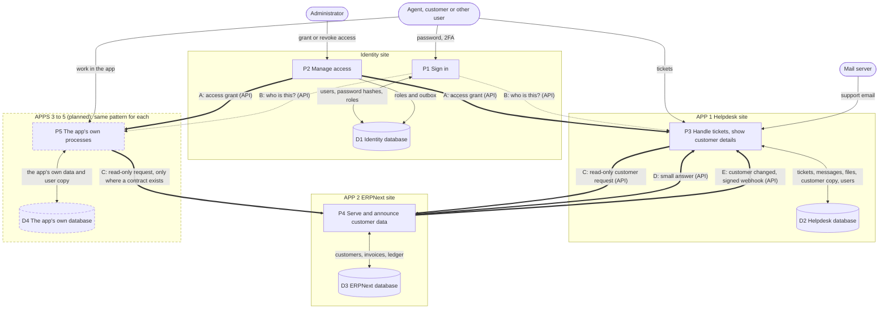

**Flow 1. Give someone access to an app (shown for any app: Helpdesk, ERPNext or a planned one).** The change is written in the identity database, queued, and delivered to the Helpdesk database through the Helpdesk site's API.

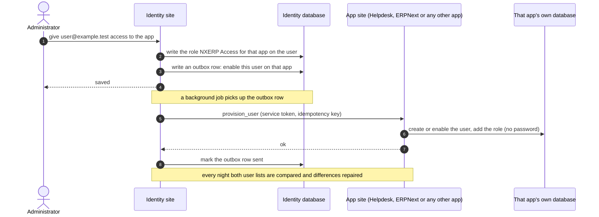

**Flow 2. Sign in once, open any app.** The password is checked only against the identity database. That app's database is asked only "is this user enabled here, with which roles?"

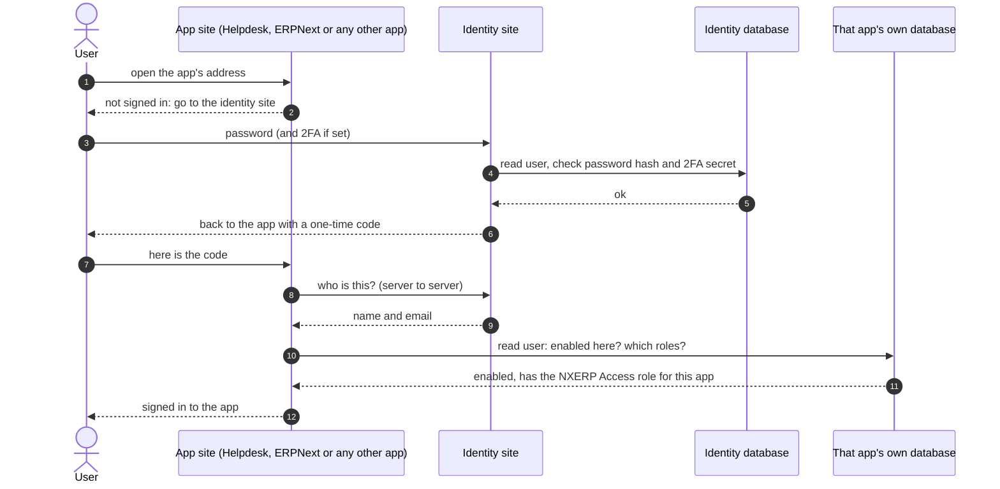

**Flow 3. A customer emails support.** Everything stays inside the Helpdesk database. No other database is touched.

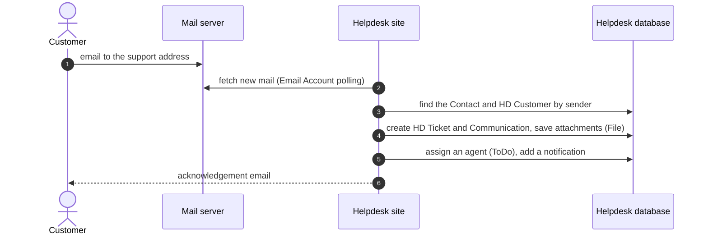

**Flow 4. An agent opens a ticket and needs customer details from ERPNext.** The only cross-application read today, and it goes through an API. Any future pair of apps would follow this same pattern, and only after a contract is registered (the matrix in 2.8).

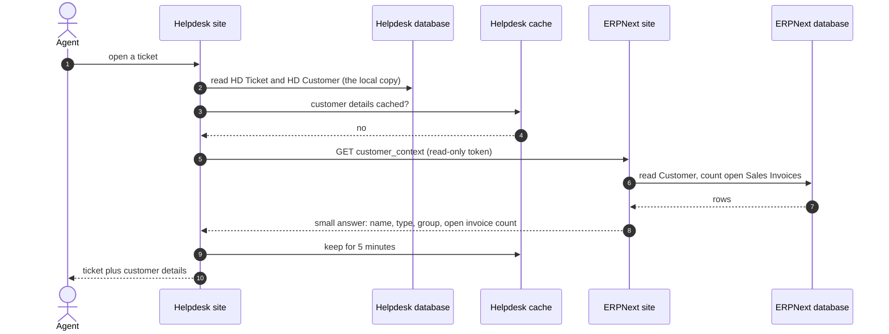

If ERPNext is down, step 5 fails and the agent sees the customer name from the local copy, with a note. No ticket is lost.

**Flow 5. A customer is created or changed in ERPNext.** ERPNext announces the change; Helpdesk updates its own copy. Helpdesk never writes to ERPNext.

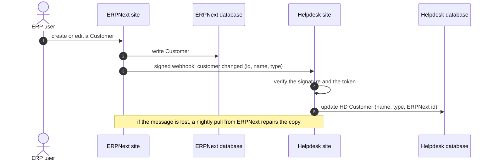

**Flow 6. A new app joins (apps 3 to 5, and any later app).** This is how the design stays cheap to extend: the same few steps, and nothing existing changes.

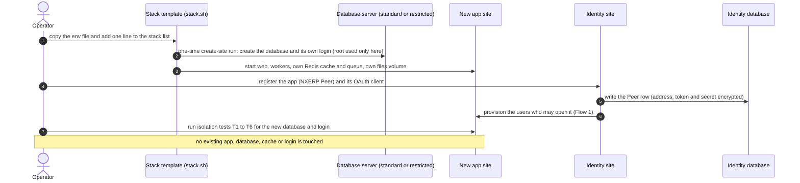

**Summary of the six flows: what is read and written where**

| Flow | Reads from | Writes to | Crosses a database boundary? |
| --- | --- | --- | --- |
| 1 Grant access | identity database | identity database (role, outbox), then Helpdesk database (user, role) | Yes, by API only, never by a database connection |
| 2 Sign in | identity database, Helpdesk database | identity cache, Helpdesk cache | Yes, "who is this?" by API |
| 3 Ticket from email | Helpdesk database | Helpdesk database | No |
| 4 Customer details | Helpdesk database, ERPNext database | Helpdesk cache | Yes, one read-only API call |
| 5 Customer changed | ERPNext database | ERPNext database, then Helpdesk database (the copy) | Yes, signed message |
| 6 A new app joins | identity database (register the app) | the new app's own database and files, and the identity database (the Peer row) | No existing database is touched |

**Backups follow the same boundaries.** Each database gets its own encrypted backup and its own restore. Restoring Helpdesk never touches ERPNext (Phase 1 and Section 6).

### 2.8 How a new app is added (apps 3, 4, 5 and beyond)

The routine is the same for every app, and **no existing app, database, cache or login is touched**. (Flow 6 in 2.7 shows it as a picture.)

| Step | What you do | Where |
| --- | --- | --- |
| 1 | Name the app and choose its tier from 2.10 (standard or restricted) | one new line in `deploy/env/isolated/stacks.list` (NEW) |
| 2 | Copy the generic template and fill in the site name, the apps to install, the database server and fresh passwords | `deploy/env/isolated/app.env.example` (NEW) to `deploy/env/isolated/<name>.env` |
| 3 | Create the site and start it | `deploy/scripts/stack.sh <name> create-site`, then `up` |
| 4 | Regenerate the edge proxy configuration and reload it (no hand edits) | `deploy/scripts/edge-gen.sh` (NEW), then `stack.sh edge up` |
| 5 | Add one entry to the app registry; register the app and its OAuth client on the identity site | `apps/nxerp_platform/nxerp/registry.py`; the NXERP Peer screen |
| 6 | Grant access (Flow 1) | the identity site |
| 7 | Run the isolation tests T1 to T6; the new login appears as a new row and column in the matrix in 2.5 | `scripts/isolation_audit.sh` |
| 8 | Add the app's backup schedule and monitoring | per database |

**What each app gets, and what is shared**

| Each app has its own (never shared) | Shared by all apps |
| --- | --- |
| site and web address; database and database login; Redis cache; Redis queue; background worker; scheduler; websocket; files and secrets volume; backup job; NXERP Peer record; OAuth client; registry entry | the edge proxy; the identity site; a database **server** within its tier (not a database); the host machine |

**Footprint: what it costs as apps are added.** A site runs 6 long-running containers (web, websocket, worker, scheduler, Redis cache, Redis queue; **FACT**: the services in `deploy/docker/compose/staging-like/compose.yaml`). These counts are **JUDGMENT** (arithmetic from that file):

| | Today (staging-like) | After, 2 apps | After, 5 apps |
| --- | --- | --- | --- |
| Sites (including the identity site) | 1 | 3 | 6 |
| App containers (6 per site) | 6 | 18 | 36 |
| Database servers | 1 | 2 | 2 |
| Edge proxy | 1 | 1 | 1 |
| Long-running containers in total | 8 | 21 | 39 |
| Databases and database logins | 1 and 1 | 3 and 3 | 6 and 6 |

The cost grows in a straight line, about 6 containers and 1 database per app. The sources say the same: the pattern trades more things to run for isolation and loose coupling (S1, S11). If memory becomes a problem the answer is container limits first, and only later a bigger host or an extra machine (2.10). Do not share Redis between apps to save memory: that is how the cache layer stops being a boundary.

**App-to-app contract matrix.** An app may call another only through a **registered, versioned, read-only contract**. Every other cell stays empty until someone deliberately adds one (owner approval, a written contract, tests).

| Consumer \ Provider | Helpdesk | ERPNext | HRMS | Project Mgmt | Budget |
| --- | --- | --- | --- | --- | --- |
| Helpdesk | n/a | `customer_context` v1 and customer events (read-only) | employee list, read-only HTTP client seen on branch `feature/helpdesk-tasks-module` (not merged; to be registered as a contract) | projects from a Project Budgeting Tool, read-only, same branch (**UNRESOLVED** whether this is the planned app) | none |
| ERPNext | none | n/a | none | none | none |
| HRMS (planned) | none | none | n/a | none | none |
| Project Mgmt (planned) | none | none | none | n/a | none |
| Budget (planned) | none | none | none | none | n/a |

### 2.9 What can go wrong, and what is not protected

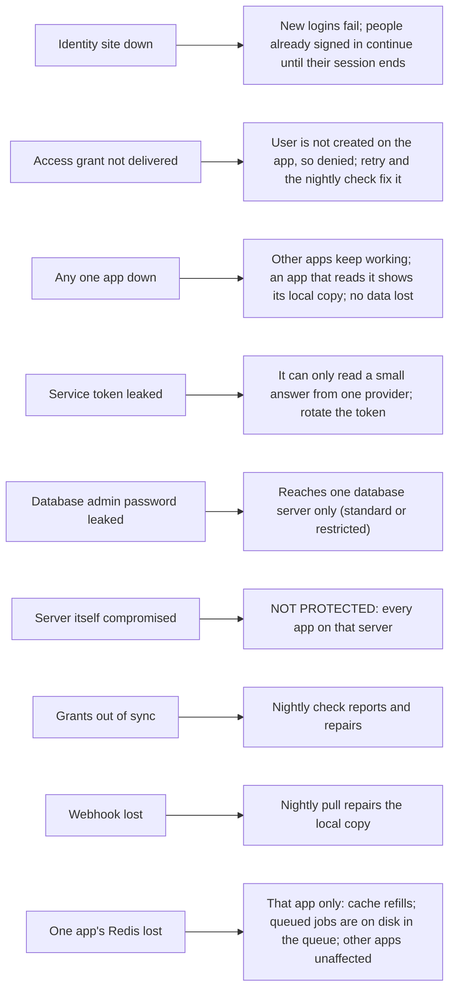

| Not protected | Why | What reduces the risk |
| --- | --- | --- |
| Someone taking over the **server or Docker itself** | all apps run on one machine by default | move an app to its own machine when a trigger in 2.10 is met |
| Someone taking over the **identity site** | it decides who may open what | it holds no business data; admins use 2FA; grants are logged |
| A **valid user misusing** their own access | access is by role | RBAC, audit, the `nxerp` gate |
| An **infrastructure admin** who holds database admin passwords or backups | they exist | separate custodians; backup key kept apart |
| A bug in **Frappe itself** | the same code runs in every app | each app yields only its own database; pinned versions; upstream-security runbook |
| **Overload** of the shared machine or a database server | no resource limits today | container limits, connection limits, the two tiers; more apps mean more containers (2.8) |
| **Stolen backups** | backups hold data and `encryption_key` | encrypted backups (Phase 1) |

### 2.10 When an app should move to stronger separation

| Level | Move an app here when |
| --- | --- |
| 1: own database on the standard server (default) | normal business data. In this plan: identity, Helpdesk, Project Management |
| 2: the restricted server | it holds payroll, tax, bank or other regulated data, or is internet-facing and holds finance data, or needs a different restore time. In this plan: ERPNext now; HRMS (employee data) and Budget Management (finance) when they arrive |
| 3: own machine | a client or regulator demands physical separation, or a separate admin team runs it, or it needs more resources than limits can give |

### 2.11 Alternatives we rejected

| Alternative | Why not | What would make us reconsider |
| --- | --- | --- |
| **Keep the shared database and rely on RBAC** | RBAC does not limit what code can read; this is the problem | none |
| **Shared database with separate schemas or table prefixes per app** | still one database and one login (or logins that Frappe cannot use per app); non-standard for Frappe; Azure's multitenancy guidance lists table-based isolation inside one database as an antipattern (S13), and the same reasoning applies | none |
| Several database logins inside one site | Frappe uses one database login per site connection | an upstream feature |
| Views or grants across databases, patching Frappe's database layer, shared logins | reintroduce the shared-database coupling; excluded by your brief | none |
| One site per app, but all on one shared environment | still share the cache, workers, scheduler and the file holding every site's passwords | accepting that exposure to save effort |
| ERPNext site as the login provider (no identity site) | one fewer thing to run, but login would depend on the finance system | you accept that |
| A separate machine per app now | cost and work not justified by the risks on record | the triggers in 2.10 |
| Rewrite apps as services or use Virtual DocTypes | big effort; no isolation gain over a read API | live cross-app joins needed |
| An external login system (Keycloak) or SAML now | Frappe v16.53.0 has no native SAML; one more service. Keycloak can be added later through the same Social Login Key | enterprise single sign-on requirement |

### 2.12 Terms used

| Term | Meaning |
| --- | --- |
| **Site** | One Frappe website with its own database |
| **Stack** | One site together with its own containers, cache and passwords |
| **Database login (account)** | A username and password that may use a database; each app has its own |
| **Identity site** | The site that holds users, passwords and "who may open which app" |
| **Federated identity / SSO** | One login service vouches for the user to other applications |
| **System of record** | The one place that owns a kind of data |
| **Token** | A key for a program (not a person) to call an API |
| **Webhook** | A message sent automatically when something changes, signed so it can be checked |
| **Tier** | A class of database server: standard or restricted |

## Section 3. Proof: where this architecture is used in the real world

This section answers one question: **is "Database per Application, with one federated login and API-only integration" a real, proven approach, used to solve the same kind of problem?** Every source below was opened on 2026-11-03. I say what each source actually says, who published it, and how strong it is as proof. Where evidence is thin I say so (3.4).

### 3.1 What is being proven

| Claim | Meaning |
| --- | --- |
| **A** | Giving each application its own private database (instead of sharing one) is the standard, documented answer to the shared-database problem. |
| **B** | It works together with **one shared login**: you do not need a shared database to have single sign-on. |
| **C** | Applications should exchange data through **APIs and events**, not through each other's tables. |
| **D** | Two databases on the **same server** is acceptable, as long as they do not share schemas or tables. |
| **E** | The **shared database** is the recognised problem, and the cause of the symptoms in Part 1. |
| **F** | The pattern **scales to many applications** (we plan five, and more later), with a cost that grows per application. |

### 3.2 The real-world evidence

| ID | Who and what, and where I read it | What it actually says or does | Matches our design | Strength |
| --- | --- | --- | --- | --- |
| **S1** | **Amazon Web Services**, Prescriptive Guidance: "Database-per-service pattern" Source: `docs.aws.amazon.com/prescriptive-guidance/latest/modernization-data-persistence/database-per-service.html` | Microservices "don't share a data layer"; "individual data stores cannot be directly accessed by other microservices, and persistent data is accessed only by APIs"; use it when services "have different compliance or security requirements for their databases"; IAM policies "ensure that data is kept private". Costs: queries that span services are hard; you manage several databases; you need API composition, CQRS or event sourcing for cross-service queries. | **A, C**; least privilege; our API window and mirror | Official vendor guidance |
| **S2** | **Microsoft**, Azure Architecture Center: "Data considerations for microservices" Source: `learn.microsoft.com/en-us/azure/architecture/microservices/design/data-considerations` | "Two services shouldn't share a data store. Each service manages its own private data store, and other services can't access it directly." The rule prevents coupling through shared schemas. "**Services can safely share the same physical database server.** Problems occur when services share the same schema, or they read and write to the same set of database tables." Use "a single source of truth"; other services may hold their own eventually consistent copy; use events to build a materialized view. | **A, C, D**; our standard server; single owner per data; the customer copy in Helpdesk | Official vendor guidance |
| **S3** | **Martin Fowler** (ThoughtWorks), bliki: "Integration Database" Source: `martinfowler.com/bliki/IntegrationDatabase.html` | "integration databases should be avoided"; "the database becomes a point of coupling between the applications that access it"; this "significantly increases the risk involved in changing those applications". | **E**; names today's setup | Respected practitioner |
| **S4** | **Martin Fowler and James Lewis**, "Microservices" Source: `martinfowler.com/articles/microservices.html` | Enterprises often share one database across many applications, frequently for licensing reasons; "Microservices prefer letting each service manage its own database", as separate instances of the same technology or another system. Consistency across services is usually eventual. | **A, E** | Respected practitioners (the section heading was partly cut in the copy I read) |
| **S5** | **Microsoft**, Power Platform: "Environments overview" (Dataverse) Source: `learn.microsoft.com/en-us/power-platform/admin/environments-overview` | An environment is "a container to separate apps that might have different roles, security requirements, or target audiences". Every environment can have its own Dataverse database. An app "is only permitted to connect to the data sources that are also deployed in that same environment", for example a Test app cannot connect to the Dev database. All environments sit under **one Microsoft Entra tenant**, the shared identity. | **A, B**: data silo per environment, one shared identity | Official product documentation (a line-of-business platform) |
| **S6** | **Shopify Engineering**: "A Pods Architecture To Allow Shopify To Scale" Source: `shopify.engineering/a-pods-architecture-to-allow-shopify-to-scale` | After sharding they "needed to fully isolate each shard so a failure couldn't spiral out into a platform outage." "A pod consists of a set of shops that live on a fully isolated set of datastores." Shared resources "can only ever communicate to a single pod at a time. We don't allow any actions to reach across pods." Job workers, app servers and load balancers stay shared. | **A**; the blast-radius reason; a shared layer over isolated data | The company's own design claim (not independent) |
| **S7** | **Martin Fowler**, "What do you mean by Event-Driven?" Source: `martinfowler.com/articles/201701-event-driven.html` | Event-carried State Transfer: update clients "in such a way that they don't need to contact the source system"; "What we gain is greater resilience, since the recipient systems can function." Down-side: "lots of data schlepped around and lots of copies." | **C**; our signed-event customer copy in Helpdesk | Respected practitioner |
| **S8** | **OpenID Foundation**, "OpenID Connect Core 1.0" Source: `openid.net/specs/openid-connect-core-1_0.html` | "a simple identity layer on top of the OAuth 2.0 protocol." It "enables Clients to verify the identity of the End-User based on the authentication performed by an Authorization Server." The Authorization Code flow returns an authorization code that is exchanged for tokens. | **B**: one login service vouches for the user to other applications | Open standard (only the first part of the specification was read) |
| **S9** | **Chris Richardson**, microservices.io: "Shared database" pattern Source: `microservices.io/patterns/data/shared-database.html` | One database shared by services where each "freely accesses data owned by other services using local ACID transactions." Drawbacks: schema changes must be coordinated with every team; "all services access the same database [so] they can potentially interfere with one another"; long transactions in one service can block another. | **E** | Practitioner reference (author of the book Microservices Patterns) |
| **S10** | microservices.io: "API Composition" Source: `microservices.io/patterns/data/api-composition.html` | Once each service has its own database, "it is no longer straightforward to implement queries that join data from multiple services"; the answer is an API composer that calls each owner and joins in memory. Drawback: inefficient for large datasets. | **C**: how we read ERPNext details from Helpdesk | Practitioner reference |
| **S11** | microservices.io: "Database per service" Source: `microservices.io/patterns/data/database-per-service.html` | Options: private tables, a private schema, or a database server per service (the heavier option for services that need it); recommends barriers such as separate database accounts and grants, because developers otherwise tend to bypass service APIs. Drawbacks: cross-service queries and consistency; operating several databases. | **A, D**; our three levels in 2.1; one login per database | Practitioner reference |
| **S12** | **AWS**, Well-Architected SaaS Lens: "Silo, pool, and bridge models" Source: `docs.aws.amazon.com/wellarchitected/latest/saas-lens/silo-pool-and-bridge-models.html` | Silo = dedicated resources (for example a separate database or stack); pool = shared; bridge = a mix chosen per component by "the regulatory profile of a service's data". A silo "still relies on a shared identity, onboarding, and operational experience". | **B**: data siloed, identity shared; the ERPNext server tier | Official vendor guidance |
| **S13** | **Microsoft**, Azure Architecture Center: "Storage and data in multitenant solutions" Source: `learn.microsoft.com/en-us/azure/architecture/guide/multitenant/approaches/storage-data` | A dedicated database per tenant isolates data; isolate when tenants need their own keys or individual backup and restore policies; **"Table-based isolation"** inside one database is listed as an **antipattern**; mix patterns, for example shared for most and dedicated for those with unusual requirements. | **A**; rules out "separate tables or prefixes inside one database"; the restricted tier | Official vendor guidance |
| **S14** | **Frappe Framework** v16.53.0 (your pinned version), source Source: `raw.githubusercontent.com/frappe/frappe/v16.53.0/frappe/database/db_manager.py and mariadb/setup_db.py` | `bench new-site` creates one database and one database account per site: `CREATE USER ...` and `GRANT {ALL PRIVILEGES or a list} ON <db>.* TO ...`, a database-level grant, no global privilege. Frappe's own isolation unit is the **site with its own database**. | **A**: our design uses Frappe's native unit, not a workaround | Primary source (the code you run) |
| **S15** | **Odoo**, deployment documentation Source: `odoo.com/documentation/18.0/administration/on_premise/deploy.html` | "a single Odoo system may run and serve a number of database instances"; the `dbfilter` setting selects the database by host name and "is an important part of securing your deployment". | **A, D** (weak): an ERP serving several separate databases by host name | Official, but states no isolation guarantee, and the security section was cut off in my copy |
| **S16** | **Kubernetes**, "Multi-tenancy" Source: `kubernetes.io/docs/concepts/security/multi-tenancy/` | Namespaces give logical isolation. "Hard" multi-tenancy (tenants that do not trust each other) needs extra isolation of the data plane; "in more extreme cases" each tenant gets a dedicated cluster or even hardware, weighed against cost. | **D** limit: why a shared machine remains a stated residual risk | Official project documentation (page partly read) |
| **S17** | **Docker**, Compose file reference: networks Source: `docs.docker.com/reference/compose-file/networks/` | `internal: true` makes "an externally isolated network"; services talk only on networks they share ("The proxy service is isolated from the db service, because they do not share a network in common"). | the private database networks | Official documentation |
| **S18** | **MariaDB**, GRANT reference Source: `mariadb.com/docs/server/reference/sql-statements/account-management-sql-statements/grant` | Privileges can be given at global, database, table and column level; accounts can require TLS and be limited in connections. | one login per database, no global grant | Official documentation (version applicability to 11.8 assumed) |

### 3.3 How the evidence supports each claim

| Claim | Sources | Verdict |
| --- | --- | --- |
| **A.** Database per application is the standard answer | S1, S2, S4, S5, S6, S11, S13, S14 | **Strongly supported**: official guidance from two major cloud vendors, a product platform, a large company design, and the framework you already run |
| **B.** It works with one shared login | S5, S8, S12 | **Supported**: Dataverse (silo databases under one Entra tenant), the SaaS Lens ("a silo still relies on a shared identity") and the OpenID Connect standard |
| **C.** Exchange data through APIs and events | S1, S2, S7, S10 | **Supported** |
| **D.** Same server is fine, shared schema is not | S2, S11 | **Supported** by one official source and one practitioner source; our restricted ERPNext server follows S11's "server per service" |
| **E.** The shared database is the recognised problem | S3, S4, S9 | **Supported** |
| **F.** It scales to many apps | S1, S2, S6, S11 | **Supported, with a stated cost**: the sources describe the pattern for any number of services and Shopify runs many isolated pods; they also name the cost (more databases to operate, harder cross-app queries), which Section 2.8 quantifies for five apps |

### 3.4 Where the evidence is thin, and what does not transfer

- **Most sources are about microservices and cloud services, not ERPs on Frappe.** ERP-class evidence is thinner: Frappe itself (S14), Odoo (S15, weak) and Power Platform (S5). I did not open SAP, Oracle or Dynamics 365 material.
- **Vendor documents and company blogs are design claims, not proof of outcomes.** S1, S2, S5, S6, S12 and S13 say what to do and why; none gives failure statistics.
- **The sources prove the pattern, not our implementation.** Section 3.5 gives the tests that prove it for NXERP.
- **The pattern has costs** (S1, S9, S10, S11): joining data across applications is harder and you run more databases. We accept that and use API composition (S10) and a small event-fed copy (S7).
- **Not used, because they did not support a claim:** the Atlassian Jira database page (opened, states no rule about separate databases), the AWS "Implementing Microservices on AWS" page (returned only a title), Frappe Cloud isolation claims (marketing or snippet only).
- **Not researched:** Amazon's and Netflix's internal practice, secrets managers, the OAuth security best-current-practice document, and the Kubernetes sandboxing sections (the page was cut off).

### 3.5 Tests you can run yourself to prove isolation in NXERP

Run them on a **staging copy or throwaway stacks** after Phase 2, never on production. Replace placeholders; never paste secrets into a ticket. `bench --site <site> mariadb` opens a SQL client as that site's own account without printing the password (**UNRESOLVED**: it needs the `mysql` client inside the image; if absent, use `docker compose exec` into the database server with a test account created for this purpose).

| # | What it proves | Command (run from the repository root unless stated) | Expected result |
| --- | --- | --- | --- |
| T1 | Helpdesk's DB account cannot read ERPNext's tables | `docker compose -p nxerp-hd exec backend bash -lc 'cd /home/frappe/frappe-bench && bench --site hd.<domain> mariadb -e "SELECT 1 FROM <erp_db_name>.tabCustomer LIMIT 1;"'` (find `<erp_db_name>` with T3 on the erp stack; it is not a secret) | `ERROR 1142` or `1044` (command denied), not a row |
| T2 | it cannot write there either | same, with `DELETE FROM <erp_db_name>.tabCustomer WHERE 1=0;` | `ERROR 1142`/`1044` |
| T3 | the account has exactly one database grant | `docker compose -p nxerp-hd exec backend bash -lc 'cd /home/frappe/frappe-bench && bench --site hd.<domain> mariadb -e "SHOW GRANTS FOR CURRENT_USER;"'` | one line `GRANT ALL PRIVILEGES ON <its own db>.* TO ...`; no `*.*`, no `GRANT OPTION`, host is not `%` |
| T4 | no long-running app container holds the DB root password | `for s in backend websocket queue-worker scheduler; do docker compose -p nxerp-hd exec -T $s bash -c 'printenv NXERP_DB_ROOT_PASSWORD \| wc -c'; done` | `0` for every service (prints a count, never the value) |
| T5 | the Helpdesk stack cannot reach the other stacks' databases or Redis | `docker compose -p nxerp-hd exec backend bash -c 'for h in mariadb-restricted redis-cache-erp; do timeout 3 bash -c "</dev/tcp/$h/3306" && echo "$h REACHABLE" \|\| echo "$h blocked"; done'` | `blocked` for both (name does not resolve or connection fails) |
| T6 | only the edge publishes a port | `docker ps --format '{{.Names}} {{.Ports}}' \| grep -- '0.0.0.0'` | only the edge container |
| T7 | a direct password login on an app site is refused | `curl -s -o /dev/null -w '%{http_code}\n' -c /tmp/j -d 'usr=<test-user>' -d 'pwd=<test-password>' https://hd.<domain>/api/method/login; grep -c sid /tmp/j` (**UNRESOLVED**: exact status code unknown) | no `sid` cookie issued |
| T8 | a grant revoked at `id` removes access on the app | revoke in the UI or with `set_app_access` (Phase 3), then request `https://hd.<domain>/helpdesk/home` with the user's old session | 403 or redirect to `/nxerp/no-access` within the reconcile bound |
| T9 | the bridge refuses callers without a valid token | `curl -s -o /dev/null -w '%{http_code}\n' "http://erp-backend:8000/api/method/nxerp.bridge.v1.customer_context?customer=TEST"` from inside the hd backend container, once with no token and once with the token of a different service user | `401`/`403` both times |
| T10 | a webhook with a bad signature is refused | `curl -s -o /dev/null -w '%{http_code}\n' -X POST -H 'X-Frappe-Webhook-Signature: bad' -d '{}' http://hd-backend:8000/api/method/helpdesk.integrations.erpnext.events.receive_customer_event` from inside the erp backend container | `401`/`403`; and nothing written |
| T11 | per-app backup and restore works alone | take a backup of one stack, restore it into a throwaway project (`deploy/scripts/restore.sh --yes <dir>` with `NXERP_COMPOSE_PROJECT=nxerp-scratch`), run `deploy/scripts/healthcheck.sh` | restore exits 0, health passes, other stacks untouched |
| T12 | no secrets in git or images | `gitleaks detect --source . --no-banner` and `docker history --no-trunc <image> \| grep -ci password` | zero findings, `0` |

### 3.6 Frappe facts this design depends on (mechanism, not real-world proof)

| Fact | Why it matters | Source |
| --- | --- | --- |
| Several sites on one bench share `common_site_config.json`, the Redis servers (cache keys are only prefixed by the database name), the worker pool, one scheduler process per bench, and the `sites/` volume that holds every site's passwords | a separate database is not enough; each app also needs its own stack | Frappe v16.53.0: `frappe/config.py`, `frappe/utils/redis_wrapper.py`, `frappe/utils/background_jobs.py`, `frappe/utils/scheduler.py` (read through a summarising fetch tool) |
| Frappe can act as an OAuth 2.0 provider (`authorize`, `get_token`, `openid_profile`) and a `Social Login Key` of provider "Frappe" can accept it; no JWKS function and no native SAML were found | single sign-on is possible with built-in features; the Phase 3 spike confirms the details | Frappe v16.53.0: `frappe/integrations/oauth2.py`, `oauth2_logins.py` (summarised) |
| `System Settings.disable_user_pass_login` exists and warns to configure a Social Login Key first | the lockout rule in Phase 3 | `frappe/core/doctype/system_settings/system_settings.json` (read directly) |
| `Webhook` can sign the body with HMAC-SHA256 (`X-Frappe-Webhook-Signature`), tries 3 times, and only logs after that | signed events, plus the nightly pull | `frappe/integrations/doctype/webhook/webhook.py` (read directly) |

## Section 4. Codebase impact: the development strategy, and where each change lands

This section answers two things: **how** the work is built, and **where in the repository** each change goes. Paths were found in the repository at commit `84905cec5`; items marked NEW do not exist yet and follow the repository's naming. Statements about size and risk are **JUDGMENT**.

### 4.1 The development strategy in eight rules

| # | Rule | Why | Evidence |
| --- | --- | --- | --- |
| 1 | **Additive first.** New environments are built next to the old stack. The old stack is not edited, except for one hardening line (Phase 1). | the live system keeps working while we build and test | Phases 1 to 4 never touch live data |
| 2 | **Every new behaviour is off by default.** Three site settings switch it on: `nxerp_site_role` (Phase 3), `nxerp_bridge_mode` (Phase 4), `nxerp_cutover_allowed` (Phase 5). Unset means today's behaviour. | merging code cannot change production by accident; the existing test suites prove it | tests run with each setting unset |
| 3 | **One prompt is one branch, one pull request, one small review.** 17 prompts in 5 phases. | small changes are reviewable and reversible | Part 3 |
| 4 | **Platform code goes in `apps/nxerp_platform/nxerp/`; app code stays in that app.** Apps never import each other; the platform never imports an app. ERPNext is never edited. | repository rules ADR-005 and `CLAUDE.md`; ERPNext and Frappe are pinned upstream tags | `scripts/check_architecture.py` |
| 5 | **Reuse Frappe's mechanisms before building anything.** Multi-site, per-site database login, OAuth provider, Social Login Key, Webhook with HMAC, REST tokens, `System Settings.disable_user_pass_login`. | less new code to get wrong | Section 3.6 |
| 6 | **Tests come with the change.** Each prompt lists the tests it must run and says UNVERIFIED for any it could not run. | nothing is claimed that was not run | the prompts |
| 7 | **Every patch is idempotent and listed in `patches.txt`; code follows the local style** (tabs in Python, ruff, commits written `type: summary`). | repository rules | `CLAUDE.md` |
| 8 | **Nothing is pushed or merged without the owner**; production is never touched by Claude Code. | safety | the safety block in every prompt |

### 4.2 Where the changes land (by area of the repository)

| Area | Where | What happens there | Phases |
| --- | --- | --- | --- |
| Deployment files | `deploy/docker/compose/isolated/` (NEW), `deploy/env/isolated/` (NEW), `deploy/scripts/stack.sh`, `edge-gen.sh`, `cutover.sh` (NEW) | the database servers, the reusable app stack, the generated edge proxy, one command per stack, the cutover tool | 1, 2, 5 |
| Existing deploy scripts | `deploy/scripts/backup.sh`, `restore.sh`, `healthcheck.sh`, `lib.sh` | encrypted backups; per-stack use through environment variables they already read | 1, 2 |
| Platform app: access and routing | `apps/nxerp_platform/nxerp/registry.py`, `apps/nxerp_platform/nxerp/routing.py`, `apps/nxerp_platform/nxerp/launcher.py`, `apps/nxerp_platform/nxerp/www/login.py`, `apps/nxerp_platform/nxerp/www/nxerp/go.py`, `apps/nxerp_platform/nxerp/www/nxerp/apps.py`, `apps/nxerp_platform/nxerp/api/access.py`, `apps/nxerp_platform/nxerp/hooks.py`, `apps/nxerp_platform/nxerp/install.py` | apps carry their own address; redirects allowed only to exact registered addresses; SSO button; grants enqueue provisioning | 3 |
| Platform app: new packages | `apps/nxerp_platform/nxerp/federation/`, `bridge/`, `cutover.py`, two new DocTypes (`NXERP Peer`, `NXERP Provisioning Outbox`) under `apps/nxerp_platform/nxerp/nxerp_platform/doctype/` | grant delivery, the read-only customer API, migration tools | 3, 4, 5 |
| Helpdesk app | `apps/helpdesk/helpdesk/hooks.py`, `apps/helpdesk/helpdesk/integrations/erpnext/`, `apps/helpdesk/helpdesk/helpdesk/doctype/hd_customer/hd_customer.py`, `apps/helpdesk/hd-frontend/src/components/erpnext-integration/ERPNextIntegrationSettings.vue` | the old direct sync becomes a bridge client and receiver; deleted in Phase 5 after the decision point | 4, 5 |
| Scripts | `scripts/isolation_audit.sh` (NEW) | the repeatable proof that the walls hold | 1, 2 |
| Tests | `apps/nxerp_platform/nxerp/tests/` (`test_scaffold.py`, `test_registry.py`, `test_routing.py`, `test_unified_experience.py`, new `test_federation.py`, `test_bridge.py`, `test_cutover.py`), Helpdesk's own tests | each prompt adds the tests for its own change | 3, 4, 5 |
| CI | `.github/workflows/ci.yml`, `deploy-staging.yml`, `deploy-production.yml` | config checks for the new compose files; a `stack` input (no workflow has ever run on GitHub) | 2, 5 |
| Documents | `docs/adr/ADR-008-application-isolation.md` (NEW), `docs/runbooks/`, `docs/architecture/`, `docs/PROGRESS.md` | decisions, runbooks, the bridge contract | all |

### 4.3 Unchanged

| Item | Why it stays | Evidence |
| --- | --- | --- |
| `apps/nxerp_platform/nxerp/enforcement.py`, `access.py`, `guard.py` | role-based, in-process, per site: they run unchanged on each app site against that site's own users | **FACT** (agent-read): `access.py:29-70`, `guard.py:168-220` |
| `apps/nxerp_platform/nxerp/www/login.py` | Frappe's own `/login`, now served by the identity site | `apps/nxerp_platform/nxerp/www/login.py:194,219` |
| `apps/helpdesk/helpdesk/auth.py` | local `auth_hook` only | `apps/helpdesk/helpdesk/hooks.py:162` |
| `scripts/check_architecture.py` | apps never import each other: still the right guard | ADR-005 |
| `deploy/scripts/migrate.sh`, `rollback.sh`, `deploy.sh`, `smoke.sh` | parameterised by `NXERP_SITE`, `NXERP_COMPOSE_FILE`, `NXERP_COMPOSE_PROJECT`, `NXERP_ENV_FILES`: run once per stack | **FACT**: `deploy/scripts/lib.sh` header |
| Image build (`deploy/docker/Dockerfile`, `install_apps.sh`) | one image can serve every stack at first: Frappe loads an app's hooks only on sites where it is installed (**UNRESOLVED**: appendix U12) | **JUDGMENT** |
| `deploy/versions.env`, `deploy/apps.json` pins | no new dependency, so no ADR-002 update | **FACT** |
| The database engine | MariaDB 11.8 stays (ADR-002). The pattern is identical on PostgreSQL (separate databases, one role each), but changing engine is not part of this plan | `deploy/versions.env` |

### 4.4 Adapt

| Item | Change | Risk |
| --- | --- | --- |
| `apps/nxerp_platform/nxerp/registry.py:109-112` | an app is active when installed **or** when the site is the identity site; new `AppEntry.origin`; the registry works for any number of apps (tested with three test-only extra entries) | **High**: core gate predicate |
| `apps/nxerp_platform/nxerp/routing.py` (`safe_target`, lines 31-64) and `launcher.py:336-368` | exact-match allowlist of app origins; tiles link to origins | **High**: open-redirect defence |
| `apps/nxerp_platform/nxerp/api/access.py:53` (`set_app_access`) | enqueue provisioning after a grant change | Medium |
| `apps/nxerp_platform/nxerp/hooks.py:82-87` | add the provisioning hook to the existing `User` events and two scheduler entries | Medium |
| `apps/nxerp_platform/nxerp/install.py`, `apps/nxerp_platform/nxerp/patches/create_access_roles.py` | roles per site: all on the identity site, only the app's own on an app site; new roles `NXERP Provisioner`, `NXERP Bridge Reader` | Low |
| `apps/helpdesk/helpdesk/hooks.py:82-100`, `apps/helpdesk/helpdesk/integrations/erpnext/` (all files), `apps/helpdesk/helpdesk/helpdesk/doctype/hd_customer/hd_customer.py:376-434` | behind `nxerp_bridge_mode`, the write paths become no-ops; deleted in Phase 5 | **High**: behaviour change |
| `apps/helpdesk/helpdesk/integrations/erpnext/utils.py:19-22` (`should_sync`) | today false whenever ERPNext is not on the same site, so the sync would **silently stop** at cutover; replaced by "bridge configured" | **High**: silent failure |
| `apps/helpdesk/hd-frontend/src/components/erpnext-integration/ERPNextIntegrationSettings.vue:166` | `window.apps?.includes("erpnext")` is false on the Helpdesk site; use the bridge status | Medium |
| `deploy/docker/compose/staging-like/compose.yaml:83-93` (`create-site`) | stays as the old stack; the new isolated files do the per-stack install | Low |
| `deploy/scripts/backup.sh`, `restore.sh` | optional `age` encryption and decryption | Medium |
| `.github/workflows/deploy-staging.yml`, `deploy-production.yml`, `ci.yml` | a `stack` input; config checks for the new files (none has run on GitHub: **FACT**) | Medium |
| `apps/nxerp_platform/nxerp/tests/utils.py:89-90`, `test_access_matrix.py`, `test_erpnext_smoke.py`, `test_unified_experience.py`, `apps/nxerp_platform/browser-tests/site.sh` | one base URL becomes several origins | Medium |
| `docs/adr/ADR-003-access-model.md`, `docs/architecture/overview.md:14`, `adding-an-app.md`, `docs/PROGRESS.md` | "one site" becomes "one identity, one stack per app" | Low |

### 4.5 Replace

| Item | Replaced by |
| --- | --- |
| Helpdesk `doc_events` on `Customer`, `User Permission`, `DocShare` (`apps/helpdesk/helpdesk/hooks.py:82-100`) and `mirror_sync.py`, `user_permission.py`, `doc_share.py` | a signed-webhook receiver and a read-only pull client (the old code is deleted only after decision point D, on a separate branch) |
| The single `mariadb` service and shared `redis-*` services in `deploy/docker/compose/staging-like/compose.yaml` | per-stack Redis and two MariaDB servers (the old services stay until the cutover, so rollback stays possible) |
| `docs/architecture/adding-an-app.md` steps | the stack-template procedure (Section 2.8) |

### 4.6 New

| Item | Path (NEW, follows existing naming) |
| --- | --- |
| Isolated deploy files | `deploy/docker/compose/isolated/` (`db.compose.yaml`, `stack.compose.yaml`, `edge.compose.yaml`, `edge/nginx.conf.template`, `edge/server.block.template`, `legacy-erp.override.yaml`), `deploy/env/isolated/` (`db.env.example`, `edge.env.example`, `id.env.example`, `erp.env.example`, `hd.env.example`, `app.env.example` for any further app, `stacks.list.example`) |
| One command per stack, and the generated edge | `deploy/scripts/stack.sh`, `deploy/scripts/edge-gen.sh`, `deploy/scripts/cutover.sh` |
| Federation (platform code) | `apps/nxerp_platform/nxerp/federation/` (`api.py`, `outbox.py`, `reconcile.py`, `setup.py`) and the DocTypes `NXERP Provisioning Outbox` and `NXERP Peer` under `apps/nxerp_platform/nxerp/nxerp_platform/doctype/` |
| ERP bridge, provider side | `apps/nxerp_platform/nxerp/bridge/` (`v1.py`, `setup.py`); no import of `erpnext`, the rule Helpdesk follows today |
| Helpdesk consumer | `apps/helpdesk/helpdesk/integrations/erpnext/events.py`, `apps/helpdesk/helpdesk/integrations/erpnext/bridge_client.py` |
| Cutover tooling | `apps/nxerp_platform/nxerp/cutover.py` |
| Audit and tests | `scripts/isolation_audit.sh`, `apps/nxerp_platform/nxerp/tests/test_federation.py`, `test_bridge.py`, `test_cutover.py` |
| Documents | `docs/adr/ADR-008-application-isolation.md`, `docs/architecture/bridge-v1.md`, `docs/runbooks/isolation-cutover.md`, `docs/runbooks/isolation-rollback.md` |

### 4.7 What changed in this plan since the first version

| Topic | Now |
| --- | --- |
| Number of applications | designed for **five** plus the identity site: Helpdesk and ERPNext today; HRMS, Project Management and Budget Management planned (dashed in every diagram, never treated as built) |
| Naming | the architecture is **Database per Application**; the database is **unshared**; only the login is shared (single sign-on) |
| Database servers | two tiers: standard (identity, Helpdesk, Project Management) and restricted (ERPNext, HRMS, Budget). Many databases per server is allowed; sharing schemas or tables is not |
| Cache and queue | one Redis cache and one queue per site, never shared; the cache layer is no longer a shared dependency |
| Adding an app | a template: one env file, one line in `stacks.list`, one registry entry; the edge configuration is **generated** by `edge-gen.sh`; proven in Phase 2 with three throwaway stand-in apps |
| A hard prerequisite | the company must allow **separate databases and logins**, on its database server or on servers we run. With a single database and a single login the isolation goal cannot be met (Section 5) |
| Engine | MariaDB 11.8 is kept; PostgreSQL would follow the same rule but is not planned |
| Phases | every phase now shows what exactly happens, a before and after with an example, a code walk-through, and a manual checking guide |

### 4.8 Related work already on another branch

The shared working copy contains the branch `feature/helpdesk-tasks-module`, not part of the commit analysed above (**FACT**: seen in the git index on 2026-11-03, read-only). It adds:

| Item (NEW relative to the analysed commit) | What it means for this plan |
| --- | --- |
| `HD Task` and related DocTypes under `apps/helpdesk/helpdesk/helpdesk/doctype/` (for example `hd_task`, `hd_task_project`) and new hooks for them | more Helpdesk-owned tables; the Phase 5 clone carries them. Re-run appendix queries U3 and U5 after that branch merges |
| (NEW) Read-only HTTP clients `apps/helpdesk/helpdesk/integrations/external/hrms.py` (employees) and `pbt.py` (projects of a Project Budgeting Tool), on a shared `client.py` that reads `HRMS_API_BASE_URL`, `HRMS_API_KEY`, `PBT_API_BASE_URL`, `PBT_API_KEY` from the environment or the site config | this is the **API-only integration style** this design asks for. Their keys belong to the Helpdesk stack's own secrets, and each should be registered as a contract in the matrix in 2.8 |
| Whether those two outside systems are the planned HRMS and Project Management or Budget apps | **UNRESOLVED**: if they are, they are the first apps 3 to 5 and the template applies as written |

### 4.9 Gate 5 summary

Unchanged: about 8 groups. Adapt: 13. Replace: 3. New: 9 groups. Highest-risk items: the registry predicate, the redirect allowlist, the Helpdesk sync replacement and its silent failure, the compose topology, and the cutover tooling.

## Section 5. Risks

| Risk | Likelihood and impact (**JUDGMENT**) | Mitigation |
| --- | --- | --- |
| Customer sync silently stops after the split (`should_sync` is same-site) | high, medium | Phase 4 replaces the predicate; a contract test fails if no event arrives |
| Open redirect through the new cross-origin allowlist | medium, high | exact-match origins from the registry only; keep the 35 hostile payloads in `test_routing.py`; add cross-origin cases; two reviewers (CODEOWNERS) |
| Lockout: app login disabled before `id` login works | medium, high | break-glass `Administrator` per app; follow `docs/runbooks/login-recovery.md`; never set `disable_user_pass_login` before T7 and a working SSO test |
| Provisioning drift (user can sign in at `id` but not exist on the app, or the reverse) | medium, medium | deny by default; outbox with retry; nightly reconcile; alert on non-zero drift |
| `uninstall-app erpnext` on the cloned Helpdesk site fails or leaves rows | medium, high | rehearse (Phase 5); fallback is a documented prune script |
| ERP personal data left in `hd` core tables (Contact, Communication, File) | medium, medium | classification decision (A-owner); prune script; reconciliation report |
| Real people emailed from a rehearsal clone | medium, high | neutralise the clone first (mute emails, disable scheduler, clear Email Account credentials) |
| Duplicate tickets from two mailbox pollers | medium, medium | one site polls at a time; duplicate check on `message_id` |
| Old bookmarks and emails point at `/helpdesk/...` on the old host | high, low | edge 301 to the `hd` origin |
| Sessions: users must sign in again at `id` after cutover | certain, low | announce; SSO afterwards |
| Helpdesk search index and scheduled jobs after restore | medium, low | `after_migrate` rebuilds the index (`hooks.py:25-28`); run the migration step; check SLA jobs |
| Shared host remains a single failure and compromise domain | certain, medium | stated in 2.8; dedicated-host trigger |
| Work needs production access only a human has | certain | USER-ACTION-REQUIRED steps in every phase |

## Section 6. Production data migration and rollback

**Approach (JUDGMENT): extract and load per app with a short freeze; no dual-run.** The only two-way write path between Helpdesk and ERPNext is the feature being removed; Frappe has no multi-master replication, so dual-run would need a hand-built two-way sync of tickets, emails and files.
**Which app moves first:** Helpdesk and identity are extracted from the existing site; the existing site keeps serving ERPNext (as the interim `erp` site, attached to the identity site) until M6, when its data is restored into the new `erp` stack on the restricted instance. ERPNext holds the larger and more sensitive data, so its site stays untouched until the new topology has proven itself.
**How Helpdesk is extracted:** restore a full backup of the live site into the new `hd` site, then run `bench --site hd.<domain> uninstall-app erpnext` (and `payments`) and prune orphaned core rows. Frappe has no per-app export, so this keeps record names, creation and modified stamps, Versions, comments, assignments, email threads (`Communication`), attachments (`File` rows plus the file tree) and `Dynamic Link` rows exactly (**UNRESOLVED** until rehearsed).
**How `id` is built:** a fresh site with `nxerp` only, then an identity-only copy of `User`, `Has Role`, `Role`, `Role Profile` and the user rows of `__Auth` (password hashes and 2FA secrets), so logins and 2FA keep working without a forced reset (**UNRESOLVED**: `__Auth` layout in v16.53.0 to confirm).
**Users on the app sites** keep their rows (ownership and audit links need them); the identity site is the source of truth for who is enabled.

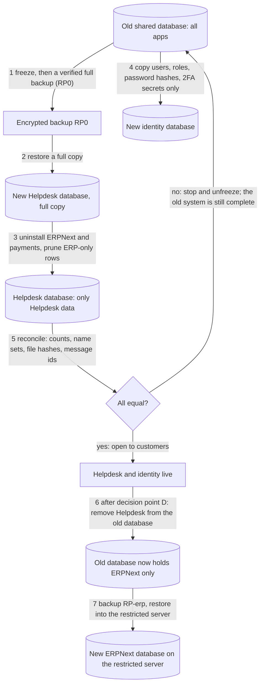

The same movement as a picture: the old database is never changed until step 6, which is why rollback is real until the decision point D.

| What to preserve | Mechanism | Check |
| --- | --- | --- |
| Records and identifiers | whole-backup restore | row count and `name` set equality per Helpdesk DocType, source vs `hd` |
| Relationships | same | every Link in Helpdesk DocTypes resolves in `hd` |
| History, comments, assignments, tags | same | counts per reference DocType in `Version`, `Comment`, `ToDo` |
| Email threads | `Communication` | counts for `reference_doctype = 'HD Ticket'`; `message_id` set equality; sample 20 threads |
| Attachments | `File` rows plus the file tree | SHA-256 manifest of referenced files equal on both sides |
| In-flight mail | polling on one side at a time; flush the outgoing queue before the freeze | zero duplicate tickets |
| Logins and 2FA | identity-only copy | a test user per role signs in; the 2FA user is prompted |
| SLA timers | `hourly_long` job only on `hd` after cutover | open-ticket SLA status equal within one cycle |
| ERP untouched | n/a | ERP counts for Customer, Sales Invoice, GL Entry unchanged |

| Step | Action | Rollback at this step |
| --- | --- | --- |
| M0 | harden the current site (Phase 1) | revert configuration |
| M1 | build empty stacks, run T1 to T6 (Phase 2) | discard the new stacks; the old stack never stopped |
| M2 | federation and bridge on staging with fake users (Phases 3 and 4) | discard |
| M3 | dress rehearsal on a restored, neutralised copy, twice clean (Phase 5) | discard |
| M4 | production window: freeze, backup RP0, restore into `hd` and `id`, prune, reconcile, **agent-only canary**, open to customers | below |
| M5 | after decision point D: remove Helpdesk and telephony from the `erp` site | forward-fix only |
| M6 | restore the `erp` data (after Helpdesk removal) into the new `erp` stack on the restricted instance, then flip the edge | restore point RP-erp; the old stack is kept stopped for 30 days |

**Rollback is real only because the original site is untouched until D.** Reverting code does not reverse database changes, so rollback means pointing users back at a database that was never modified, plus replaying writes made elsewhere.

| Phase | State | Action | What can be lost |
| --- | --- | --- | --- |
| before the canary opens | source untouched except maintenance mode | re-enable polling on the source, lift maintenance, point the edge back, discard `hd` and `id` | nothing |
| canary to D | customers and email write to `hd`; the source Helpdesk data is frozen at T0 | maintenance on `hd`; **delta export** (`modified > T0` for every Helpdesk DocType plus `Communication`, `File`, `Comment`, `ToDo` and new files) imported into the source; lift the source freeze; flip the edge | naming-series collisions (mitigation: reserve a series offset on `hd` at cutover); rehearsed |
| after D | Helpdesk removed from the `erp` site | **no rollback**; forward-fix on `hd`; a backup restore is disaster recovery only | every change after the backup |

D = the earlier of 7 days after opening to customers or the owner's sign-off after one full business cycle, always preceded by RP-final (full backups of `erp` and `hd`, restore drill passed). Restore points: RP0 (source at T0), RP1 (`hd` after prune), RP2 (daily on `hd`), RP-final (before M5), RP-erp (before M6). Divergent writes exist only between the canary and D; the delta tool (NEW `nxerp/cutover.py`) handles them and is a hard prerequisite of M4.

## Section 7. Unverified items, with the check

See the appendix at the end of the document: every item there has a command. The summary:

| Item | Why it matters |
| --- | --- |
| Production site count and layout (U1) | scope of Phase 5 |
| Tables by owning app, cross-app Link fields, grants of the live account (U2 to U5) | turns Part 1 from static analysis into measured facts |
| Whether ERPNext reads Helpdesk data (U6) | hidden coupling |
| Sessions in Redis cache; role mapping from login claims; `__Auth` layout (U7 to U9) | federation and migration design |
| `uninstall-app` on a restored copy; identity-only copy keeps logins (U10, U11) | migration feasibility |
| One image serving three stacks (U12) | whether Phase 2 needs a build change |

**Parallel work not analysed here.** When this document was finished, the shared working copy had been switched to the branch `feature/helpdesk-tasks-module` with someone else's staged changes (an `HD Task` module and HTTP clients to external HRMS and PBT services, for example `apps/helpdesk/helpdesk/integrations/external/hrms.py`; **FACT**: seen in the git index on 2026-11-03, read-only, not part of the analysed commit). Two consequences (**JUDGMENT**): the clients call the other systems over HTTP with an API key, which fits this design (API only, no shared tables) provided the key lives in the `hd` stack's secrets; and the new `HD Task` DocTypes add Helpdesk-owned tables that the Phase 5 clone must carry. Re-run Appendix U3 and U5 after that branch merges, and check that Phase 4's "Helpdesk only reads other systems" rule still holds for it.

---

# PART 3. Implementation phases

## The route: five phases, clearly separated

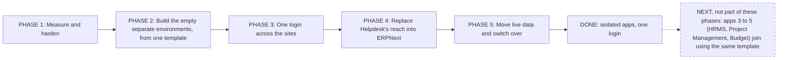

Phases 1 to 4 never touch the live system's data. They build and prove the new design next to the old one. **Only Phase 5 changes what your users and clients use**, and it has a rehearsed way back until the decision point D.

| Phase | Name | After it, you have | Claude Code does | You do | Proof it worked | Touches the live system? | Can you undo it? |
| --- | --- | --- | --- | --- | --- | --- | --- |
| **1** | Measure and harden | the real facts about today's database; encrypted, tested backups; the decisions written down | audit script, backup encryption, decision record, templates | take a backup copy, restore it on a scratch machine, run the queries, schedule backups, confirm decisions | baseline audit output; a passed restore drill | only a nightly backup job | yes, remove the job |
| **2** | Build the empty separate environments | three empty sites (identity, ERPNext, Helpdesk), two database servers, private networks, one edge proxy, **and a reusable template** proven with three throwaway stand-in apps, so apps 3 to 5 join without touching anything | compose files, `stack.sh`, edge config, isolation tests | server, DNS names, certificates, firewall, secrets, start everything | tests T1 to T6 pass | no: new things beside the old | yes, stop the new things |
| **3** | One login across the sites | the identity site; single sign-on; access grants copied to app sites | federation code, registry and routing changes, tests | service users and keys, OAuth client, test user, switch off local login last | tests T7 and T8 pass | no: staging only | yes, one setting switches it off |
| **4** | Replace Helpdesk's reach into ERPNext | read-only customer API and signed change events; Helpdesk no longer writes to ERPNext | bridge code on both sides, contract tests | service users and keys, install webhooks, test with a fake customer | tests T9 and T10 pass | no: staging only | yes, one setting switches it off |
| **5** | Move live data and switch over | Helpdesk and identity live on the new sites; ERPNext on its own database server; old shared setup retired | migration tools, runbooks, redirect rules, retirement of old code | rehearsals, announcement, the cutover, canary, decision point D, ERP move | reconciliation PASS; T1 to T6 on production | **yes: this is the cutover** | until D; after D only forward |

## What each phase changes, in one table

| Phase | Before | After | You can see it by |
| --- | --- | --- | --- |
| 1 | plain backups, no restore drill, claims not measured | encrypted backups, a proven restore, measured facts | `ls backups/` shows a `.tar.age` file; the restore drill passes; SQL block U3 lists several apps in one database |
| 2 | one stack; the one database login can read every table | three empty stacks; Helpdesk's login is refused on ERPNext's database | `SELECT COUNT(*) FROM tabCustomer` works before and is denied after |
| 3 | one sign-in; roles on one user record | one sign-in at the identity site; access copied to each app | tick a role on the identity site and the user appears on the app within a minute |
| 4 | Helpdesk edits and deletes ERPNext customers directly | Helpdesk only reads; ERPNext sends signed updates | edit or delete an `HD Customer`: ERPNext no longer changes |
| 5 | one database and one address hold everything | separate databases and addresses, same data | ticket and ledger counts equal before and after; the old link answers 301; tests T1 to T6 pass on production |

Each phase panel below starts with its own before-and-after table, a walk-through of what happens in the code, and ends with a hands-on checking guide.

## Prerequisites

| # | Prerequisite | Needed for |
| --- | --- | --- |
| P1 | **Permission to create separate databases and logins**, on the company database server or on database servers we run ourselves. This is the one hard requirement: with a single database and a single login the isolation goal cannot be met | Phase 2 onward |
| P2 | A machine with Docker for dev and staging, and a scratch machine for rehearsals | Phases 1 to 5 |
| P3 | A copy of a production backup, kept on an encrypted disk | Phases 1 and 5 |
| P4 | A domain with names for the identity site and each app (three now, one more per future app) | Phase 2 onward |
| P5 | The owner's confirmation of assumptions A1 to A9 | Phase 1 |

## How the work is built, and where

Changes are **additive and off by default**: new environments are built next to the old stack, and each new behaviour is switched on by a site setting (`nxerp_site_role`, `nxerp_bridge_mode`, `nxerp_cutover_allowed`), so merging code does not change production. Each prompt is one branch and one pull request. Platform code goes in `apps/nxerp_platform/nxerp/`, Helpdesk code only in Helpdesk's own integration files, deployment in `deploy/`. Section 4.1 lists the eight rules and Section 4.2 maps every area of the repository to the phases that touch it.

## What each phase must deliver toward the goals

These are the six results you expect at the end. Every phase has a part in at least one.

| Goal | Plain statement | Phase 1 | Phase 2 | Phase 3 | Phase 4 | Phase 5 | Final proof |
| --- | --- | --- | --- | --- | --- | --- | --- |
| **G1** | A flaw in one app cannot read another app's data | measures it | builds the walls | keeps them | removes cross-app writes | moves live data behind the walls | T1 to T6 on production |
| **G2** | One login and role-based app access still work | records how it works | n/a | builds the cross-site login | n/a | switches users over | T7, T8 and a user-by-user sign-in check |
| **G3** | Apps exchange data only through controlled channels | n/a | creates the private channel | grants channel | customer-details channel | removes old hooks | T9, T10 |
| **G4** | Live data is kept, and the switch can be undone until D | tests restore | n/a | n/a | n/a | rehearsed cutover, delta rollback | reconciliation PASS twice |
| **G5** | Per-app, encrypted, tested backups | encrypts and drills | per-app backup command | n/a | n/a | restore points and drills | T11 per app |
| **G6** | Apps 3 to 5 and beyond can be added without touching the others | n/a | stack template proven with three throwaway apps | registry works for 5 apps | n/a | updated procedure | the add-an-app test in `test_add_app_checklist.py` and the Phase 2 stand-in apps |

## What Claude Code can do, and what only you can do

**One prompt per phase is not enough, and it is not the only work.** Each phase below has **several short prompts** (17 in total). One prompt is one sitting and one pull request; run them in order, and read each report before the next.

| Claude Code can | Claude Code cannot |
| --- | --- |
| write and change code, scripts, Docker Compose files, configuration templates | rent or log in to your servers |
| write tests and run them on a dev site, if Docker is available there | create DNS records or certificates |
| write runbooks, decision records and checklists | hold or create your real passwords and keys |
| create branches and commits (never push or merge unless you ask) | take a production backup or touch production |
| research and read Frappe source in the bench | choose a maintenance window, or make business choices |

So every phase has two kinds of work, shown in different boxes: **PROMPTS** (Claude Code does it) and **WHAT I MUST DO MYSELF** (you do it, with exact commands).

## How to run a phase

1. Open the phase tab. Read **Part 1** (goal and done-when) and the **At a glance** table.
2. Paste the **prompts** one at a time, in order, into Claude Code. Each one stops by itself and reports. If it says a step needs you, it writes it under `USER-ACTION-REQUIRED`.
3. Do **What I must do myself** while or after the prompts run.
4. Check the **verification** list in Part 8. Only then start the next phase.
5. If something goes wrong, use the **rollback** in Part 8 of that phase.

## Glossary (terms you will meet in the steps)

| Term | Meaning |
| --- | --- |
| **Docker / container / image** | Docker runs programs in isolated boxes called containers. An image is the frozen recipe a container starts from. |
| **Docker Compose / project / service** | Compose starts several containers from one YAML file. A project is one running copy of that file (named with `-p`); a service is one container definition inside it. |
| **Volume** | Storage that survives when a container is deleted. `docker compose down -v` deletes volumes, and with them the data. |
| **Docker network, `internal`** | A private virtual network between containers. An `internal` network has no route to the outside world. Two containers talk only if they share a network. |
| **Frappe site / bench** | A site is one Frappe installation with its own database. A bench is the folder that holds Frappe's code and many sites. `bench` is the command-line tool. |
| **MariaDB, database, account, root** | MariaDB is the database server. A database holds tables. An account is a login with listed rights. Root is the all-powerful account; its password must never sit in an app container. |
| **Grant** | A right given to an account, for example "everything on database X and nothing else". `SHOW GRANTS` lists them. |
| **Redis** | A fast in-memory store Frappe uses for cache, background-job queues and live updates. |
| **Reverse proxy / edge** | A web server in front of the apps that receives all browser traffic and forwards it to the right app by host name. Here: nginx. |
| **DNS A record** | A public entry that maps a name such as `id.example.test` to your server's IP address. |
| **TLS certificate / HTTPS** | The file that lets browsers talk to your server encrypted. Let's Encrypt issues them free with the `certbot` tool. |
| **Environment file (`.env`)** | A text file of `NAME=value` lines holding passwords. Never commit it; set permission 600 (only you can read it). |
| **Secret** | Any password, key or token. Generate with `python3 -c 'import secrets; print(secrets.token_urlsafe(24))'`. |
| **age** | A small free tool that encrypts files with a public key; only the matching private key opens them. |
| **Backup, restore, restore drill** | A backup is a copy; a restore puts it back; a drill proves the restore works by doing it on a scratch copy. |
| **OAuth / SSO / Social Login Key** | OAuth lets one site vouch for a user to another. SSO means signing in once. In Frappe, a Social Login Key is the setting that tells a site to accept logins from another provider. |
| **API key and secret / token** | A pair that lets a program (not a person) call Frappe's API; sent as `Authorization: token key:secret`. |
| **Webhook / HMAC** | A webhook is a message one system posts to another when something changes. HMAC is a signature computed with a shared secret so the receiver can reject forgeries. |
| **Provisioning / reconcile** | Provisioning creates or disables a user on another site. Reconcile compares both sides and repairs differences. |
| **Maintenance mode** | A Frappe site setting that answers "under maintenance" instead of serving users. |
| **Freeze window, canary** | A freeze window is a short agreed period when nobody writes. A canary is a first small group (here: agents only) that uses the new system before everyone. |
| **Restore point (RP)** | A named, verified backup you can return to. |

## The safety block (inside every prompt)

```
SAFETY (applies to everything below)
- Work on a NEW git branch off the current branch (name given below). Never push, merge, force-push or rewrite history.
- Never connect to or change production, and never run `bench migrate`, `bench restore`, `bench backup` or schema changes against any shared or live database. Database work only on a throwaway dev site or a restored COPY that you state in writing before touching it.
- Never print, log or commit secrets (passwords, tokens, site_config.json values, encryption_key). Use [REDACTED]; report key NAMES and paths only.
- Use fake data such as user@example.test. Do not copy customer or employee personal data into files.
- Do not claim anything works unless you ran it and saw it work; quote the command and redacted output. Label statements FACT, EVIDENCE, JUDGMENT or UNRESOLVED.
- Do NOT stop to ask for approval. If a human must do something (servers, DNS, certificates, production backups, secret storage, maintenance windows), write it under a heading USER-ACTION-REQUIRED in the phase document, mark the dependent checks UNVERIFIED with the exact command, and continue.
- Follow CLAUDE.md: tabs in Python, ruff config in pyproject.toml, small commits "type: summary", every patch idempotent and listed in patches.txt, update docs/PROGRESS.md.
- Commit message trailer: Co-Authored-By: Claude Sonnet 5.5 <noreply@anthropic.com>
```

## Phase 1: Decide, measure and harden the current site

### 1. Goal, completion criteria and risks

**Phase 1 at a glance**

| | |
| --- | --- |
| **Outcome** | You know the real facts of today's database, backups are encrypted and a restore has been proven, and the decisions are written down |
| **Claude Code does** | 3 prompts: audit script, encrypted backup and restore, decision record and templates |
| **You do** | 11 steps: install `age`, take a backup copy, build a scratch copy, neutralise it, run queries, record, schedule backups, run a restore drill, confirm decisions |
| **Exit test** | the audit baseline is saved; one restore drill from an encrypted backup passed; ADR-008 accepted |
| **Touches live?** | only a nightly backup job on the production host |
| **Rollback** | remove the cron line; revert code (the new options are off unless set) |

#### What exactly happens in this phase: before and after

Nothing about the running system changes in this phase. You gain facts, encrypted backups and a proven restore. A concrete example: **take one backup of a restored copy** and compare.

| | Before Phase 1 | After Phase 1 |
| --- | --- | --- |
| A backup looks like | a plain folder such as `backups/20261105T020000Z-<site>/` holding `*-database.sql.gz`, file archives, `SHA256SUMS`, `MANIFEST`; the copy of the site config inside it contains the `encryption_key` (**FACT**: `deploy/scripts/backup.sh` header) | with `NXERP_BACKUP_AGE_RECIPIENT` set, a single file `backups/20261105T020000Z-<site>.tar.age`, unreadable without the private key. With `NXERP_BACKUP_DELETE_PLAINTEXT=1` the plain folder is removed |
| Restoring | works from a plain folder; no drill has ever been recorded | works from the `.tar.age` file; one drill done on a scratch copy, with the time it took written down |
| What we know about the database | the claims in Part 1 are from reading code | measured on a restored copy: which apps' tables are in the one database, and what the one login may do (saved in `docs/architecture-isolation/measurements.md`) |
| Containers | may gain extra privileges | `security_opt: no-new-privileges` on the shared anchor of `deploy/docker/compose/staging-like/compose.yaml` |
| Decisions | assumptions A1 to A9 open | each confirmed or changed in `docs/adr/ADR-008-application-isolation.md` |
| What users see | | **nothing changes** |

**How it works in the code (walk-through)**

1. `deploy/scripts/backup.sh` (existing) runs the site backup and verifies it (`gzip -t`, table count, `tar -t`, `SHA256SUMS`).
2. NEW branch in the same script: if `NXERP_BACKUP_AGE_RECIPIENT` is set, it runs `tar -C <dir> -cf - . | age -r "$NXERP_BACKUP_AGE_RECIPIENT"` and writes `<dir>.tar.age` plus its SHA-256.
3. `deploy/scripts/restore.sh` (existing) now accepts a `.tar.age`: it needs `NXERP_BACKUP_AGE_IDENTITY` (the private key file), decrypts into a mode-700 temporary folder, verifies `SHA256SUMS`, then runs its existing steps (safety backup, maintenance mode, `bench restore`, health check) and removes the temporary folder.
4. NEW `scripts/isolation_audit.sh` uses the helpers in `deploy/scripts/lib.sh` (`inbench`, `dc`) to run SQL as the site's own database login and to list container environments and published ports.
5. NEW documents record the result: `docs/architecture-isolation/measurements.md` and `docs/adr/ADR-008-application-isolation.md`.

**Goal:** turn the unverified parts of Part 1 into measured facts, record the owner decisions, and remove the cheap exposures on the stack that exists today. No architecture change yet.

| Done when | Evidence |
| --- | --- |
| Decisions A1 to A7 are confirmed or changed in `docs/adr/ADR-008-application-isolation.md` (NEW) | ADR status changes from Proposed to Accepted by the owner |
| Appendix queries U1 to U5 have been run on a restored copy and the redacted output sits in `docs/architecture-isolation/measurements.md` (NEW) | table filled, no secrets |
| Backups are encrypted with `age`; a restore drill from an encrypted backup passed | drill log with timings |
| A nightly backup runs on the production host | `crontab -l` line and a first encrypted file |
| `scripts/isolation_audit.sh` (NEW) exists and its baseline output on today's single site is recorded | PASS/FAIL table |

**Risks:** a restored production copy puts personal data on a machine (encrypt the disk, delete afterwards); losing the `age` private key makes every backup unreadable (keep two offline copies); a backup taken at peak hours slows users (run off-peak).

### 2. Prompts to paste into Claude Code

Three prompts, run in order. Each is one sitting and one branch. Branch names are inside the prompts.

#### Prompt 1A: audit script and cheap container hardening

**Run after:** nothing. **Produces:** `scripts/isolation_audit.sh`. **Time:** one sitting.

```prompt
OBJECTIVE
Phase 1, prompt 1A of the NXERP application-data-isolation plan: add a repeatable audit script that measures how isolated the database logins and containers are today, and add one cheap container hardening option. No architecture change. Branch name: phase-1a/isolation-audit (create it from the current branch).

SAFETY (applies to everything below)
- Work on a NEW git branch off the current branch (name given below). Never push, merge, force-push or rewrite history.
- Never connect to or change production, and never run `bench migrate`, `bench restore`, `bench backup` or schema changes against any shared or live database. Database work only on a throwaway dev site or a restored COPY that you state in writing before touching it.
- Never print, log or commit secrets (passwords, tokens, site_config.json values, encryption_key). Use [REDACTED]; report key NAMES and paths only.
- Use fake data such as user@example.test. Do not copy customer or employee personal data into files.
- Do not claim anything works unless you ran it and saw it work; quote the command and redacted output. Label statements FACT, EVIDENCE, JUDGMENT or UNRESOLVED.
- Do NOT stop to ask for approval. If a human must do something (servers, DNS, certificates, production backups, secret storage, maintenance windows), write it under a heading USER-ACTION-REQUIRED in the phase document, mark the dependent checks UNVERIFIED with the exact command, and continue.
- Follow CLAUDE.md: tabs in Python, ruff config in pyproject.toml, small commits "type: summary", every patch idempotent and listed in patches.txt, update docs/PROGRESS.md.
- Commit message trailer: Co-Authored-By: Claude Sonnet 5.5 <noreply@anthropic.com>

READ FIRST
1. CLAUDE.md and docs/PROGRESS.md
2. docs/architecture-isolation/NXERP_Isolation_Blueprint.md (Part 1 and Section 3.5 tests T1-T6)
3. deploy/scripts/lib.sh (the helpers dc, inbench, bench; variables NXERP_SITE, NXERP_COMPOSE_FILE, NXERP_COMPOSE_PROJECT, NXERP_ENV_FILES), deploy/scripts/healthcheck.sh (style to copy)
4. deploy/docker/compose/staging-like/compose.yaml

DELIVERABLES (exact)
1. scripts/isolation_audit.sh (NEW): bash, `set -euo pipefail`, same style as deploy/scripts/healthcheck.sh, reusing deploy/scripts/lib.sh. Subcommands:
   - `grants`: through `bench --site "$NXERP_SITE" mariadb` inside the bench service run `SHOW GRANTS FOR CURRENT_USER;` and `SELECT user, host FROM mysql.user;` (feed the SQL on standard input so backticks stay literal). PASS only if the app account has exactly one database-level grant and no global privilege, no host `%`, no GRANT OPTION; print counts, never passwords.
   - `root-env`: for each of backend websocket queue-worker scheduler print PASS if NXERP_DB_ROOT_PASSWORD is absent from the container environment (print only a character count, never the value).
   - `ports`: list published ports; PASS only if exactly one service publishes a port.
   - `all`: run the three and exit non-zero if any FAIL.
   Output lines are `PASS name` or `FAIL name reason`. Never print secrets.
2. deploy/docker/compose/staging-like/compose.yaml: add `security_opt: ["no-new-privileges:true"]` to the shared x-nxerp anchor only. Change nothing else in this file.
3. docs/PROGRESS.md: a short entry for this prompt.

TESTS TO RUN
- `bash -n scripts/isolation_audit.sh`; `shellcheck` if installed.
- `docker compose -f deploy/docker/compose/staging-like/compose.yaml config -q` with dummy env values (NXERP_IMAGE_TAG, NXERP_SITE, NXERP_DB_ROOT_PASSWORD, NXERP_ADMIN_PASSWORD set to placeholders).
- If Docker is available: start the DEV stack (not production), run `scripts/isolation_audit.sh all` and quote the output. Expect `grants` to show ONE account for all apps (that is the measured problem). If Docker is not available mark the run UNVERIFIED with the exact command.

USER-ACTION-REQUIRED
Write docs/architecture-isolation/phase-1-user-actions.md (create it, or append if it exists) with a heading for this prompt: running the audit against the scratch copy (blueprint Phase 1 steps 1.4 to 1.8).

DO NOT WAIT FOR APPROVAL. Report: files changed, command output (redacted), UNVERIFIED items.
```

#### Prompt 1B: encrypted backups and restore

**Run after:** 1A merged or on the same branch line. **Produces:** `age` encryption in `backup.sh` and decryption in `restore.sh`.

```prompt
OBJECTIVE
Phase 1, prompt 1B of the NXERP isolation plan: make backups encrypted (optional, off unless configured) and make restore accept an encrypted backup. Existing behaviour must not change when the new variables are unset. Branch name: phase-1b/encrypted-backups.

SAFETY (applies to everything below)
- Work on a NEW git branch off the current branch (name given below). Never push, merge, force-push or rewrite history.
- Never connect to or change production, and never run `bench migrate`, `bench restore`, `bench backup` or schema changes against any shared or live database. Database work only on a throwaway dev site or a restored COPY that you state in writing before touching it.
- Never print, log or commit secrets (passwords, tokens, site_config.json values, encryption_key). Use [REDACTED]; report key NAMES and paths only.
- Use fake data such as user@example.test. Do not copy customer or employee personal data into files.
- Do not claim anything works unless you ran it and saw it work; quote the command and redacted output. Label statements FACT, EVIDENCE, JUDGMENT or UNRESOLVED.
- Do NOT stop to ask for approval. If a human must do something (servers, DNS, certificates, production backups, secret storage, maintenance windows), write it under a heading USER-ACTION-REQUIRED in the phase document, mark the dependent checks UNVERIFIED with the exact command, and continue.
- Follow CLAUDE.md: tabs in Python, ruff config in pyproject.toml, small commits "type: summary", every patch idempotent and listed in patches.txt, update docs/PROGRESS.md.
- Commit message trailer: Co-Authored-By: Claude Sonnet 5.5 <noreply@anthropic.com>

READ FIRST
1. CLAUDE.md, docs/PROGRESS.md
2. deploy/scripts/backup.sh, restore.sh, lib.sh, rollback.sh, migrate.sh (how they call backup and restore)
3. docs/runbooks/backup-restore.md, deploy/env/staging-like/.env.example, deploy/env/production/production.env.example

DELIVERABLES (exact)
1. deploy/scripts/backup.sh: when NXERP_BACKUP_AGE_RECIPIENT is set, after the existing verification create <backup-dir>.tar.age with `tar -C <backup-dir> -cf - . | age -r "$NXERP_BACKUP_AGE_RECIPIENT" -o <backup-dir>.tar.age`, write its SHA-256 to <backup-dir>.tar.age.sha256, and delete the plaintext directory ONLY when NXERP_BACKUP_DELETE_PLAINTEXT=1. Fail clearly if `age` is missing. Document both variables in the script header. The last line printed on stdout must stay the path other scripts capture (print the .tar.age path when encryption is on and the plaintext is deleted).
2. deploy/scripts/restore.sh: accept a path ending in .tar.age. Then require NXERP_BACKUP_AGE_IDENTITY (path to the private key file), verify the .sha256 file, decrypt into a mode-700 temporary directory, continue exactly as for a plain directory (checksums, safety backup, maintenance mode, bench restore), and remove the temporary directory in a trap even on failure. Plain directories behave as before.
3. deploy/env/staging-like/.env.example and deploy/env/production/production.env.example: add NXERP_BACKUP_AGE_RECIPIENT, NXERP_BACKUP_AGE_IDENTITY (path only), NXERP_BACKUP_DELETE_PLAINTEXT as commented lines with explanations and NO values.
4. docs/runbooks/backup-restore.md: add "Encrypted backups" (generate a key pair with age-keygen, where the private key must live: offline, two copies, never on the host that holds the backups) and "Restore drill" (steps, what to record).
5. docs/PROGRESS.md entry.

TESTS TO RUN
- `bash -n` and `shellcheck` (if installed) on both scripts.
- A script-level test with a fake backup directory (no Docker): create a directory with dummy files and a SHA256SUMS file, run the encryption branch with a throwaway age key pair generated in a temporary directory, then run the decryption branch up to (not including) the bench call, and show the decrypted files are identical. If `age` is not installed, mark UNVERIFIED with the exact commands.
- If Docker is available: backup.sh then restore.sh against the DEV stack into a scratch compose project (NXERP_COMPOSE_PROJECT=nxerp-scratch), then deploy/scripts/healthcheck.sh. Quote results.

USER-ACTION-REQUIRED
Append to docs/architecture-isolation/phase-1-user-actions.md: install age, generate and store the key pair, take the production backup copy, schedule the nightly job, run the restore drill (blueprint Phase 1 steps 1.2, 1.3, 1.9, 1.10).

DO NOT WAIT FOR APPROVAL. Report: files changed, test output (redacted), UNVERIFIED items.
```

#### Prompt 1C: decision record and measurement templates

**Run after:** 1A and 1B. **Produces:** `ADR-008` (Proposed), `measurements.md` template.

```prompt
OBJECTIVE
Phase 1, prompt 1C of the NXERP isolation plan: write the decision record and the template where the measured facts will be recorded. Documentation only. Branch name: phase-1c/decision-record.

SAFETY (applies to everything below)
- Work on a NEW git branch off the current branch (name given below). Never push, merge, force-push or rewrite history.
- Never connect to or change production, and never run `bench migrate`, `bench restore`, `bench backup` or schema changes against any shared or live database. Database work only on a throwaway dev site or a restored COPY that you state in writing before touching it.
- Never print, log or commit secrets (passwords, tokens, site_config.json values, encryption_key). Use [REDACTED]; report key NAMES and paths only.
- Use fake data such as user@example.test. Do not copy customer or employee personal data into files.
- Do not claim anything works unless you ran it and saw it work; quote the command and redacted output. Label statements FACT, EVIDENCE, JUDGMENT or UNRESOLVED.
- Do NOT stop to ask for approval. If a human must do something (servers, DNS, certificates, production backups, secret storage, maintenance windows), write it under a heading USER-ACTION-REQUIRED in the phase document, mark the dependent checks UNVERIFIED with the exact command, and continue.
- Follow CLAUDE.md: tabs in Python, ruff config in pyproject.toml, small commits "type: summary", every patch idempotent and listed in patches.txt, update docs/PROGRESS.md.
- Commit message trailer: Co-Authored-By: Claude Sonnet 5.5 <noreply@anthropic.com>

READ FIRST
1. CLAUDE.md, docs/PROGRESS.md
2. docs/architecture-isolation/NXERP_Isolation_Blueprint.md (Part 2 Sections 1, 2 and 6; Appendix U1-U14; assumptions A1-A7)
3. docs/adr/ADR-002-version-matrix.md and ADR-003-access-model.md (copy their format and tone), docs/adr/README.md

DELIVERABLES (exact)
1. docs/adr/ADR-008-application-isolation.md (NEW): status Proposed; sections Context, Decision, Consequences, Alternatives rejected, Assumptions A1-A7 each marked "owner to confirm", Open points (hosting, data classification, compliance, customers on the identity site). Add it to docs/adr/README.md.
2. docs/architecture-isolation/measurements.md (NEW): headings U2 to U5 and U9, each with the exact command from the blueprint appendix, and an empty results table with columns: date, database touched, redacted output, interpretation. Leave results empty: a human fills them. Add a top line "Database touched: [fill in]" and a Phase 2 section "Tests T1 to T6" with an empty table.
3. docs/architecture-isolation/phase-1-user-actions.md: make sure it lists, in order, the 11 human steps of blueprint Phase 1 section 3, each with its command (copy them; replace secrets with placeholders).
4. docs/PROGRESS.md entry for Phase 1.

TESTS TO RUN
- Markdown only: check every path cited exists (`ls`) or is marked NEW; run `python -I scripts/check_architecture.py` to prove nothing else changed.

USER-ACTION-REQUIRED
The decisions themselves: you must confirm or change A1 to A7 in the ADR and mark it Accepted. Write that as the first item in phase-1-user-actions.md.

DO NOT WAIT FOR APPROVAL. Report: files, UNVERIFIED items.
```

### 3. What I must do myself

These steps use the existing stack in `deploy/docker/compose/staging-like/compose.yaml` (the "old stack"). Replace `<...>` placeholders. Run commands from the repository root unless stated.

#### Step 1.1 Check Docker works

Docker runs the stack. You need Docker Desktop (Windows or macOS) or Docker Engine (Linux), running.

```
docker version
docker compose version
```

**Expected:** both print a client and server version with no error. **Check:** `docker ps` prints a header line. **Undo:** nothing to undo.

#### Step 1.2 Install `age` and make the backup key pair

`age` encrypts a file so only the holder of the private key can open it.

```
# Linux (Debian/Ubuntu):   sudo apt install age
# macOS:                   brew install age
# Windows:                 winget search age   (install the entry from FiloSottile), or scoop install age
age --version
age-keygen -o nxerp-backup.key
```

**Expected:** `age-keygen` prints `Public key: age1...`. The file `nxerp-backup.key` holds the private key. **Check:** `age --version` prints a version. **Do now:** copy `nxerp-backup.key` to two offline places (an encrypted USB stick and a password manager attachment) and then delete it from the working folder. Write the `age1...` public key into your notes: this is `<age-public-key>`.
**Undo:** you cannot undo key loss. **Warning:** if every copy of the private key is lost, every backup encrypted with it is permanently unreadable.

#### Step 1.3 Take a production backup copy (read-only on the data, but it loads the server)

A backup is a copy of the database and files. Run it off-peak. This is the only step that touches the production host, and it only reads data.

```
# on the production host, in the deployment directory (for example /opt/nxerp)
NXERP_ENV_FILES=.env NXERP_BACKUP_DIR=/var/backups/nxerp deploy/scripts/backup.sh
```

**Expected:** the last line printed is a directory such as `/var/backups/nxerp/<UTC stamp>-<site>`. **Check:** the directory holds `*-database.sql.gz`, file archives, `SHA256SUMS`, `MANIFEST`. After Phase 1's code is merged you can instead set `NXERP_BACKUP_AGE_RECIPIENT=<age-public-key>` to get an encrypted `.tar.age`.
Copy it to the scratch machine encrypted in transit: `scp -r <user>@<prod-host>:/var/backups/nxerp/<dir> ./scratch-backup/`.
**Undo:** delete the backup directory when finished (`rm -rf`). It contains personal data and `encryption_key`; keep it only on an encrypted disk.

#### Step 1.4 Build a scratch copy of the old stack

This is a separate, disposable copy of the stack (project name `nxerp-scratch`) on your scratch machine, with its own database. It never talks to production.

```
cp deploy/env/staging-like/.env.example deploy/env/staging-like/.env
# edit .env: set NXERP_IMAGE_TAG to the tag you run in production, NXERP_SITE=<production site name>,
# and generate NXERP_DB_ROOT_PASSWORD and NXERP_ADMIN_PASSWORD with:
python3 -c 'import secrets; print(secrets.token_urlsafe(24))'
chmod 600 deploy/env/staging-like/.env

export NXERP_COMPOSE_PROJECT=nxerp-scratch NXERP_ENV_FILES=deploy/env/staging-like/.env NXERP_HTTP_PORT=18080
docker compose -p nxerp-scratch --env-file deploy/env/staging-like/.env -f deploy/docker/compose/staging-like/compose.yaml up -d mariadb redis-cache redis-queue configurator
docker compose -p nxerp-scratch --env-file deploy/env/staging-like/.env -f deploy/docker/compose/staging-like/compose.yaml --profile init run --rm create-site
docker compose -p nxerp-scratch --env-file deploy/env/staging-like/.env -f deploy/docker/compose/staging-like/compose.yaml up -d
```

**Expected:** `create-site` ends without error; `docker compose -p nxerp-scratch ps` shows the services running. **Check:** `curl -s http://localhost:18080/api/method/ping` prints `{"message":"pong"}`. **Undo:** `docker compose -p nxerp-scratch down -v` (this deletes the scratch data, which is the point).

#### Step 1.5 Restore the production copy into the scratch stack

```
NXERP_SITE=<production site name> NXERP_COMPOSE_PROJECT=nxerp-scratch NXERP_ENV_FILES=deploy/env/staging-like/.env \
  deploy/scripts/restore.sh --yes ./scratch-backup/<dir>
```

**Expected:** the script verifies checksums, takes a safety backup, restores, and runs a health check. **Check:** it exits 0. If encrypted passwords do not decrypt afterwards, copy the backup's `encryption_key` into the scratch site (this puts a secret in the container's process list on a scratch machine only):

```
docker compose -p nxerp-scratch --env-file deploy/env/staging-like/.env -f deploy/docker/compose/staging-like/compose.yaml \
  cp ./scratch-backup/<dir>/<stamp>-<site>-site_config_backup.json backend:/tmp/site_config_backup.json
docker compose -p nxerp-scratch --env-file deploy/env/staging-like/.env -f deploy/docker/compose/staging-like/compose.yaml \
  exec -T backend bash -lc 'cd /home/frappe/frappe-bench && key=$(python3 -c "import json;print(json.load(open(\"/tmp/site_config_backup.json\"))[\"encryption_key\"])") && bench --site <production site name> set-config encryption_key "$key" && rm /tmp/site_config_backup.json'
```

**Undo:** `docker compose -p nxerp-scratch down -v` and re-run Step 1.4.

#### Step 1.6 Neutralise the scratch copy so it cannot contact real people

A restored copy still holds real email settings and webhooks. Without this step it could email customers or call external systems.

```
S="docker compose -p nxerp-scratch --env-file deploy/env/staging-like/.env -f deploy/docker/compose/staging-like/compose.yaml exec -T backend bash -lc"
$S 'cd /home/frappe/frappe-bench && bench --site <site> set-config mute_emails 1 && bench --site <site> disable-scheduler'
$S 'cd /home/frappe/frappe-bench && bench --site <site> mariadb' <<'SQL'
UPDATE `tabEmail Account` SET enable_incoming=0, enable_outgoing=0;
UPDATE tabWebhook SET enabled=0;
SELECT COUNT(*) AS active_email_accounts FROM `tabEmail Account` WHERE enable_incoming=1 OR enable_outgoing=1;
SQL
```

**Expected:** the last query prints `0`. **Check:** same. **Undo:** discard the scratch copy; never re-enable on it. (**UNRESOLVED:** `bench ... mariadb` needs the MariaDB client in the image; if the command fails, run the SQL with `docker compose -p nxerp-scratch exec -T mariadb mariadb -uroot` using `MYSQL_PWD` set from your env file.)

#### Step 1.7 Run the measurement queries (Appendix U2 to U5) and record them

Run each query in the appendix against the scratch copy and paste the redacted output into `docs/architecture-isolation/measurements.md`. State at the top: "Database touched: scratch copy of production backup `<stamp>`, project `nxerp-scratch`". Replace real names with placeholders, for example `[Customer Name]`.
**Expected:** a table of DocTypes per app, cross-app Link counts, the single per-site account with one `ALL PRIVILEGES` grant on its own database. **Check:** the grant line has no `*.*`, no `GRANT OPTION`, and a host that is not `%` (if it is `%`, write that down: it is a finding). **Undo:** nothing changes in the database.

#### Step 1.8 Record the baseline isolation result

```
NXERP_SITE=<site> NXERP_COMPOSE_PROJECT=nxerp-scratch NXERP_ENV_FILES=deploy/env/staging-like/.env scripts/isolation_audit.sh all
```

**Expected:** `grants` shows one account for all six apps (the problem, measured); `root-env` PASS; `ports` PASS (only the proxy publishes). **Check:** save the output in `measurements.md`. **Undo:** none.

#### Step 1.9 Schedule the nightly encrypted backup on the production host

```
crontab -e
# add one line (the host's own scheduler; 02:15 every night):
15 2 * * * cd /opt/nxerp && NXERP_ENV_FILES=.env NXERP_BACKUP_DIR=/var/backups/nxerp NXERP_BACKUP_AGE_RECIPIENT=<age-public-key> NXERP_BACKUP_DELETE_PLAINTEXT=1 NXERP_BACKUP_KEEP_DAYS=30 deploy/scripts/backup.sh >> /var/log/nxerp-backup.log 2>&1
```

**Expected:** tomorrow `/var/backups/nxerp` holds a `.tar.age` and no plaintext directory. **Check:** `ls -l /var/backups/nxerp` and `tail /var/log/nxerp-backup.log`. Copy backups off the host (set `NXERP_BACKUP_UPLOAD_CMD`, for example an `rclone` wrapper; the choice of storage is yours). **Undo:** `crontab -e` and delete the line.

#### Step 1.10 Run a restore drill from an encrypted backup

```
NXERP_BACKUP_AGE_IDENTITY=./nxerp-backup.key NXERP_SITE=<site> NXERP_COMPOSE_PROJECT=nxerp-scratch \
  NXERP_ENV_FILES=deploy/env/staging-like/.env deploy/scripts/restore.sh --yes ./scratch-backup/<dir>.tar.age
deploy/scripts/healthcheck.sh
```

**Expected:** restore exit 0 and health pass. Write down how long it took: that is your real recovery time. **Undo:** `docker compose -p nxerp-scratch down -v`.

#### Step 1.11 Confirm the decisions

Open `docs/adr/ADR-008-application-isolation.md`, and for each of A1 to A7 write "confirmed" or your change. Record the hosting and data-classification decisions in the same file. **Check:** status set to Accepted by you. **Undo:** edit the ADR.

#### Step 2.9 Prove the template with three throwaway apps (recommended)

This proves that apps 3 to 5 can join with no change to anything else. The stand-ins are empty (only the platform gate is installed), named `app3`, `app4`, `app5`, and are deleted afterwards. They are never shown to users and no HRMS, Project Management or Budget software is installed.

```
for n in app3 app4 app5; do cp deploy/env/isolated/app.env.example deploy/env/isolated/$n.env; chmod 600 deploy/env/isolated/$n.env; done
# edit each file: NXERP_SITE=$n.<domain>, NXERP_STACK_APPS=nxerp, fresh passwords,
# NXERP_DB_HOST/NXERP_DB_NETWORK: standard for app3 and app4, restricted for app5
printf 'app3 app3 standard\napp4 app4 standard\napp5 app5 restricted\n' >> deploy/env/isolated/stacks.list
for n in app3 app4 app5; do deploy/scripts/stack.sh $n create-site; deploy/scripts/stack.sh $n up; done
deploy/scripts/edge-gen.sh && deploy/scripts/stack.sh edge up
scripts/isolation_audit.sh all
```

**Expected:** six sites answer `pong`; the audit shows every login denied on every other database (the 6 by 6 matrix in Section 2.5). **Check:** `docker ps` shows about 39 long-running containers (see the footprint table in 2.8). **Undo:** `for n in app3 app4 app5; do NXERP_ALLOW_DESTROY=1 deploy/scripts/stack.sh $n down -v; done`, remove the three lines from `deploy/env/isolated/stacks.list`, delete the three env files, run `deploy/scripts/edge-gen.sh` and `deploy/scripts/stack.sh edge up` again.

### 4. Files changed

| Path | What changes | Why |
| --- | --- | --- |
| `deploy/scripts/backup.sh` | optional `age` encryption (`NXERP_BACKUP_AGE_RECIPIENT`, `NXERP_BACKUP_DELETE_PLAINTEXT`) | backups hold personal data and `encryption_key` and are unencrypted today |
| `deploy/scripts/restore.sh` | accepts `.tar.age` with `NXERP_BACKUP_AGE_IDENTITY` | restore must work from encrypted backups |
| `deploy/docker/compose/staging-like/compose.yaml` | `security_opt: no-new-privileges` on the shared anchor | cheap container hardening |
| `deploy/env/staging-like/.env.example`, `deploy/env/production/production.env.example` | new variable names, commented | documentation of the new options |
| `docs/runbooks/backup-restore.md` | encrypted backups and restore drill sections | the runbook says no drill has been done |
| `docs/PROGRESS.md` | phase entry | repository rule |

### 5. Files added

| Path | Purpose |
| --- | --- |
| `scripts/isolation_audit.sh` | repeatable grant, root-credential and port checks (NEW) |
| `docs/architecture-isolation/measurements.md` | where you record the measured facts (NEW) |
| `docs/architecture-isolation/phase-1-user-actions.md` | the human checklist (NEW) |
| `docs/adr/ADR-008-application-isolation.md` | the decision record (NEW) |

### 6. Endpoints modified

None.

### 7. Endpoints created

None.

### 8. Check it yourself, configuration, verification and rollback

#### Check it yourself: before and after

Do each **before** check first on the scratch copy (Phase 1 steps 1.4 to 1.6) and write the result down, then run the **after** check. Nothing here touches production.

#### Check 1.1 A backup is encrypted

```
ls backups/*/                                  # the BEFORE view: plain files
NXERP_BACKUP_AGE_RECIPIENT=<age-public-key> NXERP_BACKUP_DELETE_PLAINTEXT=1 deploy/scripts/backup.sh
ls backups/
```

**Before:** a folder containing `*-database.sql.gz` and `site_config_backup.json`. **After:** one `<stamp>-<site>.tar.age` file and no plain folder. **Check:** the last line the script prints is the `.tar.age` path.

#### Check 1.2 The wrong key cannot open it

```
age-keygen -o wrong.key
age -d -i wrong.key backups/<stamp>-<site>.tar.age > /dev/null
```

**Expected:** an error that no identity matched, and no output file content. **Undo:** `rm wrong.key`.

#### Check 1.3 A restore from the encrypted backup works

```
NXERP_BACKUP_AGE_IDENTITY=./nxerp-backup.key NXERP_SITE=<site> NXERP_COMPOSE_PROJECT=nxerp-scratch \
  NXERP_ENV_FILES=deploy/env/staging-like/.env deploy/scripts/restore.sh --yes backups/<stamp>-<site>.tar.age
deploy/scripts/healthcheck.sh
```

**Expected:** the restore exits 0 and the health check passes. **Check:** write down how long it took. **Undo:** `docker compose -p nxerp-scratch down -v`.

#### Check 1.4 See the shared database for yourself (the "before picture" for the whole project)

Run SQL blocks U3 and U4 from the appendix on the scratch copy.

**Expected:** U3 lists several apps (for example `erpnext`, `helpdesk`, `frappe`) **inside this one database**, and U4 shows one login with `ALL PRIVILEGES` on that one database. **Check:** save both outputs in `measurements.md`. After Phase 5 the same queries on each new database show one app only.

#### Check 1.5 Containers are not carrying the database root password

```
NXERP_SITE=<site> NXERP_COMPOSE_PROJECT=nxerp-scratch NXERP_ENV_FILES=deploy/env/staging-like/.env scripts/isolation_audit.sh root-env
docker inspect <backend container> --format '{{.HostConfig.SecurityOpt}}'
```

**Expected:** `PASS` for backend, websocket, queue-worker and scheduler, and `[no-new-privileges:true]`. **Pass rule for the phase:** checks 1.1 to 1.5 recorded, one restore drill passed, ADR-008 confirmed.

#### Configuration, verification and rollback

**Config and infrastructure:** new env variable names `NXERP_BACKUP_AGE_RECIPIENT`, `NXERP_BACKUP_AGE_IDENTITY`, `NXERP_BACKUP_DELETE_PLAINTEXT`; a cron entry on the production host; an `age` key pair held offline; a scratch Docker project `nxerp-scratch`.
**How to verify the phase worked:** `bash -n` and `shellcheck` clean; an encrypted backup exists and a restore drill from it passed; `measurements.md` has real outputs; `scripts/isolation_audit.sh all` output recorded; ADR-008 Accepted.
**How to roll back:** revert the commits (code only); remove the cron line; plaintext backups continue to work because the new variables are optional. Reverting code does not reverse database changes; this phase makes none.

---

## Phase 2: Stack template, database tiers and network boundaries

### 1. Goal, completion criteria and risks

**Phase 2 at a glance**

| | |
| --- | --- |
| **Outcome** | Three empty, separate sites (identity, ERPNext, Helpdesk), two database servers, private networks and one edge proxy exist and pass the isolation tests |
| **Claude Code does** | 3 prompts: database servers and networks; the app stack template and `stack.sh`; edge proxy, isolation tests and docs |
| **You do** | 9 steps: DNS, firewall, certificates, secret files, start database servers, create sites, start the edge, run tests T1 to T6, prove the template with three throwaway apps |
| **Exit test** | T1 to T6 pass on the new environments **and on three throwaway stand-in apps made from the template**; the old stack still passes `healthcheck.sh` |
| **Touches live?** | no: the new environments are empty and run beside the old one |
| **Rollback** | stop the new projects; remove DNS records |

#### What exactly happens in this phase: before and after

You build the new separate environments **next to** the old one, with no data in them. The live system is not touched. A concrete example: **ask Helpdesk's database login to read an ERPNext table.**

| | Before Phase 2 (the old stack) | After Phase 2 (the new stacks, empty) |
| --- | --- | --- |
| Containers | 8 in one project: backend, websocket, queue-worker, scheduler, redis-cache, redis-queue, mariadb, proxy (**FACT**: `deploy/docker/compose/staging-like/compose.yaml`) | the old project unchanged, plus projects `nxerp-db` (2 MariaDB), `nxerp-id`, `nxerp-erp`, `nxerp-hd` (6 containers each) and `nxerp-edge` (1) |
| Databases | one app database | three empty ones: identity and Helpdesk on the standard server, ERPNext on the restricted server |
| Database logins | one | three, plus the admin password used only inside the one-time create-site run |
| Redis | one cache and one queue | one pair per site |
| Networks | none defined | `nxerp-db-standard` and `nxerp-db-restricted` (internal, no internet), `nxerp-api`, one private network per stack |
| Open ports | the proxy on 8080 | only the edge proxy, on `127.0.0.1` (the host proxy faces the internet) |
| **Example: read `tabCustomer` as Helpdesk's login** | works: it is the same database (returns a number) | **ERROR 1142 or 1044, denied**: that database is not even visible |
| Adding another app | would mean touching shared things | one env file plus one line in `deploy/env/isolated/stacks.list`, then `stack.sh <name> create-site` |

**How it works in the code (walk-through)**

1. `deploy/scripts/stack.sh hd create-site` (NEW) sets `NXERP_COMPOSE_FILE`, `NXERP_COMPOSE_PROJECT=nxerp-hd`, `NXERP_ENV_FILES=deploy/env/isolated/hd.env` and calls the one-time `create-site` service in `deploy/docker/compose/isolated/stack.compose.yaml` (NEW), the only place the database admin password is given.
2. That service runs `bench new-site ... --mariadb-user-host-login-scope "$NXERP_DB_USER_SCOPE"`. Frappe's own `setup_database` then runs `CREATE USER`, `CREATE DATABASE` and `GRANT ALL PRIVILEGES ON <db>.*` for that one site (**EVIDENCE**: `frappe/database/db_manager.py`).
3. The same service installs only the apps in `NXERP_STACK_APPS` (for Helpdesk: `telephony helpdesk nxerp`) and runs `bench use`.
4. The stack file attaches the database containers to the internal network `nxerp-db-standard` (or `-restricted`) and gives the backend a unique name on `nxerp-api` (for example `hd-backend`), so no stack can see another stack's Redis or database.
5. `deploy/scripts/edge-gen.sh` (NEW) reads `stacks.list` and writes the edge proxy configuration and its network list; `stack.sh edge up` starts it.
6. `scripts/isolation_audit.sh` (NEW) proves the walls: cross-database read and write, network reach, root password, published ports.

**Goal:** stand up three **empty** stacks (`id`, `erp`, `hd`), two MariaDB instances (standard and restricted) and one edge proxy, so the isolation controls can be tested before any data moves. The old stack keeps running untouched.

| Done when | Evidence |
| --- | --- |
| Each stack has its own site, database, database account, Redis and secrets volume | `deploy/scripts/stack.sh <stack> bench list-apps` per stack; `docker volume ls` shows one `sites` volume per project |
| `erp` is on the restricted instance; `id` and `hd` share the standard instance with separate accounts | `docker ps` shows two MariaDB containers; Appendix U4 per stack |
| Tests T1 to T6 pass | `measurements.md` section "Phase 2 tests" with outputs |
| Three throwaway stand-in apps (`app3` to `app5`) made from the template pass the same tests, then are removed | `isolation_audit.sh all` output for six sites |
| `https://id.<domain>`, `erp.<domain>`, `hd.<domain>` each answer `ping` | `curl` outputs |
| The old stack is unchanged and healthy | `deploy/scripts/healthcheck.sh` against it |

**Risks:** Docker adds each service name as an alias on every network it joins, so identical names (`backend`) on a shared network collide: the stack file must give unique aliases (the prompt says how). One image serving three stacks is assumed (Appendix U12): if Frappe loads an app's hooks on a site that does not have it installed, a build change is needed. A host-scoped database account depends on the Docker subnet you choose.

### 2. Prompts to paste into Claude Code

Three prompts, run in order. The three are separate because each produces files you can test on its own.

#### Prompt 2A: the two database servers and their private networks

**Run after:** Phase 1 done. **Produces:** `db.compose.yaml` and its env template.

```prompt
OBJECTIVE
Phase 2, prompt 2A of the NXERP isolation plan: define the two MariaDB servers (standard and restricted) on private Docker networks. Do not touch the existing staging-like stack or anything under apps/. Branch name: phase-2a/database-tiers (from the branch that contains Phase 1, or the current branch).

SAFETY (applies to everything below)
- Work on a NEW git branch off the current branch (name given below). Never push, merge, force-push or rewrite history.
- Never connect to or change production, and never run `bench migrate`, `bench restore`, `bench backup` or schema changes against any shared or live database. Database work only on a throwaway dev site or a restored COPY that you state in writing before touching it.
- Never print, log or commit secrets (passwords, tokens, site_config.json values, encryption_key). Use [REDACTED]; report key NAMES and paths only.
- Use fake data such as user@example.test. Do not copy customer or employee personal data into files.
- Do not claim anything works unless you ran it and saw it work; quote the command and redacted output. Label statements FACT, EVIDENCE, JUDGMENT or UNRESOLVED.
- Do NOT stop to ask for approval. If a human must do something (servers, DNS, certificates, production backups, secret storage, maintenance windows), write it under a heading USER-ACTION-REQUIRED in the phase document, mark the dependent checks UNVERIFIED with the exact command, and continue.
- Follow CLAUDE.md: tabs in Python, ruff config in pyproject.toml, small commits "type: summary", every patch idempotent and listed in patches.txt, update docs/PROGRESS.md.
- Commit message trailer: Co-Authored-By: Claude Sonnet 5.5 <noreply@anthropic.com>

READ FIRST
1. CLAUDE.md, docs/PROGRESS.md
2. docs/architecture-isolation/NXERP_Isolation_Blueprint.md (Sections 2.4, 2.5, 2.10; Phase 2)
3. deploy/docker/compose/staging-like/compose.yaml (copy the mariadb service: image variable, command flags, healthcheck, env style), deploy/env/staging-like/.env.example, deploy/versions.env

DELIVERABLES (exact)
1. deploy/docker/compose/isolated/db.compose.yaml (NEW), project name nxerp-db: services mariadb-standard and mariadb-restricted (image ${MARIADB_IMAGE:-mariadb:11.8}, same command flags and healthcheck as staging-like), separate named volumes, root passwords from NXERP_DB_ROOT_PASSWORD_STANDARD and NXERP_DB_ROOT_PASSWORD_RESTRICTED (both required, `:?` syntax), `security_opt: no-new-privileges`. Two user-defined networks named nxerp-db-standard and nxerp-db-restricted, both `internal: true`, with fixed ipam subnets taken from variables NXERP_DB_SUBNET_STANDARD (default 172.30.10.0/24) and NXERP_DB_SUBNET_RESTRICTED (default 172.30.20.0/24). Publish NO ports.
2. deploy/env/isolated/db.env.example (NEW): the variables above with CHANGE_ME placeholders and comments only.
3. deploy/docker/compose/isolated/README.md (NEW): a section "Database tiers" explaining which stack uses which server, why the networks are internal, and how to check them.
4. Confirm the real env files are git-ignored: run `git check-ignore -v deploy/env/isolated/db.env` and quote the rule (the root .gitignore ignores .env and .env.*).
5. docs/PROGRESS.md entry.

TESTS TO RUN
- `docker compose -f deploy/docker/compose/isolated/db.compose.yaml config -q` with dummy env values.
- If Docker is available on a DEV machine: `docker compose -p nxerp-db --env-file <dummy env> -f deploy/docker/compose/isolated/db.compose.yaml up -d`, wait healthy, then `docker network inspect nxerp-db-restricted --format '{{.Internal}}'` (expect true) and `docker ps --format '{{.Names}} {{.Ports}}'` (expect no published port), then tear down with `down -v` (DEV only). Otherwise mark UNVERIFIED with these commands.

USER-ACTION-REQUIRED
Create docs/architecture-isolation/phase-2-user-actions.md with a heading for this prompt: creating the real db.env with generated passwords and starting the database servers (blueprint Phase 2 steps 2.4 and 2.5).

DO NOT WAIT FOR APPROVAL. Report: files, command output (redacted), UNVERIFIED items.
```

#### Prompt 2B: the app stack template and the `stack.sh` command

**Run after:** 2A. **Produces:** `stack.compose.yaml`, three env templates, `stack.sh`.

```prompt
OBJECTIVE
Phase 2, prompt 2B of the NXERP isolation plan: one reusable app stack file, instantiated three times (identity, erp, hd), plus a single command to drive it. Do not change the existing staging-like stack. Branch name: phase-2b/stack-template (from the branch containing 2A, or the current branch).

SAFETY (applies to everything below)
- Work on a NEW git branch off the current branch (name given below). Never push, merge, force-push or rewrite history.
- Never connect to or change production, and never run `bench migrate`, `bench restore`, `bench backup` or schema changes against any shared or live database. Database work only on a throwaway dev site or a restored COPY that you state in writing before touching it.
- Never print, log or commit secrets (passwords, tokens, site_config.json values, encryption_key). Use [REDACTED]; report key NAMES and paths only.
- Use fake data such as user@example.test. Do not copy customer or employee personal data into files.
- Do not claim anything works unless you ran it and saw it work; quote the command and redacted output. Label statements FACT, EVIDENCE, JUDGMENT or UNRESOLVED.
- Do NOT stop to ask for approval. If a human must do something (servers, DNS, certificates, production backups, secret storage, maintenance windows), write it under a heading USER-ACTION-REQUIRED in the phase document, mark the dependent checks UNVERIFIED with the exact command, and continue.
- Follow CLAUDE.md: tabs in Python, ruff config in pyproject.toml, small commits "type: summary", every patch idempotent and listed in patches.txt, update docs/PROGRESS.md.
- Commit message trailer: Co-Authored-By: Claude Sonnet 5.5 <noreply@anthropic.com>

READ FIRST
1. CLAUDE.md, docs/PROGRESS.md
2. docs/architecture-isolation/NXERP_Isolation_Blueprint.md (Sections 2.4 to 2.7; Phase 2)
3. deploy/docker/compose/staging-like/compose.yaml (the pattern to copy: shared anchor, configurator, create-site with profile init, backend, websocket, queue-worker, scheduler, redis), deploy/docker/entrypoint.sh, deploy/docker/install_apps.sh
4. deploy/scripts/lib.sh, healthcheck.sh, deploy.sh, backup.sh, restore.sh (they are parameterised by NXERP_SITE, NXERP_COMPOSE_FILE, NXERP_COMPOSE_PROJECT, NXERP_ENV_FILES, NXERP_SERVICE, NXERP_EXPECT_APPS: reuse them, do not fork them)

DELIVERABLES (exact)
1. deploy/docker/compose/isolated/stack.compose.yaml (NEW): a copy of the staging-like file WITHOUT mariadb and WITHOUT proxy, instantiated per project (nxerp-id, nxerp-erp, nxerp-hd). Variables: NXERP_STACK (id, erp or hd), NXERP_SITE, NXERP_DB_HOST, NXERP_DB_NETWORK (nxerp-db-standard or nxerp-db-restricted), NXERP_DB_USER_SCOPE (for example 172.30.10.%), NXERP_STACK_APPS (space-separated apps to install, in order), NXERP_IMAGE_TAG.
   - Networks: the default project network; `db` = external network ${NXERP_DB_NETWORK}, joined ONLY by configurator, create-site, backend, queue-worker, scheduler; `api` = external network nxerp-api, joined ONLY by backend.
   - Unique aliases (Compose adds the service name as an alias on every network, which would collide on shared networks): give backend the alias ${NXERP_STACK}-backend on the default and api networks, and websocket the alias ${NXERP_STACK}-websocket on the default network.
   - create-site: like staging-like, but install only $NXERP_STACK_APPS, pass --mariadb-user-host-login-scope "$NXERP_DB_USER_SCOPE", then set-config host_name from NXERP_PUBLIC_URL and `bench use`. The DB root password is given ONLY to create-site, never to a long-running service.
   - `security_opt: no-new-privileges` on the shared anchor. Publish no port.
2. deploy/env/isolated/id.env.example, erp.env.example, hd.env.example (NEW): CHANGE_ME placeholders and comments only; sensible defaults for NXERP_STACK, NXERP_DB_HOST (mariadb-standard for id and hd, mariadb-restricted for erp), NXERP_DB_NETWORK, NXERP_DB_USER_SCOPE, NXERP_STACK_APPS (id: nxerp; erp: payments erpnext nxerp; hd: telephony helpdesk nxerp) and NXERP_EXPECT_APPS.
   Also deploy/env/isolated/app.env.example (NEW): the GENERIC template for any further app (apps 3 to 5 are planned: HRMS, Project Management, Budget; none is installed or built), and deploy/env/isolated/stacks.list.example (NEW): one line per stack, `<name> <host-prefix> <tier>` with tier standard or restricted, for example `id id standard`, `hd hd standard`, `erp erp restricted`. Adding an app must need only a new env file and one line in stacks.list.
3. deploy/scripts/stack.sh (NEW): usage `stack.sh <stack-name|db|edge> <up|down|ps|logs|create-site|bench ARGS...|health|backup>`. A stack name is any name listed in deploy/env/isolated/stacks.list that has deploy/env/isolated/<name>.env. It sets NXERP_COMPOSE_FILE (stack.compose.yaml, db.compose.yaml or edge.compose.yaml), NXERP_COMPOSE_PROJECT (nxerp-<stack>), NXERP_ENV_FILES (deploy/env/isolated/<stack>.env), NXERP_SERVICE=backend and NXERP_EXPECT_APPS (read from that env file, NOT hard-coded), then calls docker compose or the existing deploy/scripts/*.sh. `down` must refuse `-v` unless NXERP_ALLOW_DESTROY=1. `bench ARGS` runs bench for the stack's site through lib.sh. Support an optional NXERP_PASSTHROUGH variable: names of environment variables to forward into `bench execute` (names only, never values on the command line). Reject a stack name that is not in stacks.list.
4. docs/PROGRESS.md entry.

TESTS TO RUN
- `docker compose -f deploy/docker/compose/isolated/stack.compose.yaml config -q` for each of the three env files with dummy values; `bash -n` and `shellcheck` on stack.sh.
- If Docker is available on a DEV machine: start nxerp-db (2A), create `nxerp-api` (`docker network create nxerp-api`), create the three sites with throwaway passwords, run `deploy/scripts/stack.sh <stack> bench list-apps` per stack and compare with the expected lists. Settle blueprint Appendix U12: with ONE image, show that the erp site does not load Helpdesk hooks and say so. Quote results; tear down with NXERP_ALLOW_DESTROY=1 (DEV only). Otherwise mark UNVERIFIED with these commands.

USER-ACTION-REQUIRED
Append to docs/architecture-isolation/phase-2-user-actions.md: creating the real id/erp/hd env files and the nxerp-api network, creating the sites, checking list-apps (blueprint Phase 2 steps 2.4 and 2.6).

DO NOT WAIT FOR APPROVAL. Report: files, command output (redacted), U12 result, UNVERIFIED items.
```

#### Prompt 2C: edge proxy, isolation tests and runbook

**Run after:** 2B. **Produces:** `edge.compose.yaml`, nginx template, extra audit tests, docs.

```prompt
OBJECTIVE
Phase 2, prompt 2C of the NXERP isolation plan: the single edge proxy that routes by host name, the isolation tests T1 to T6 as a script, and the operator documentation. Branch name: phase-2c/edge-and-tests (from the branch containing 2B, or the current branch).

SAFETY (applies to everything below)
- Work on a NEW git branch off the current branch (name given below). Never push, merge, force-push or rewrite history.
- Never connect to or change production, and never run `bench migrate`, `bench restore`, `bench backup` or schema changes against any shared or live database. Database work only on a throwaway dev site or a restored COPY that you state in writing before touching it.
- Never print, log or commit secrets (passwords, tokens, site_config.json values, encryption_key). Use [REDACTED]; report key NAMES and paths only.
- Use fake data such as user@example.test. Do not copy customer or employee personal data into files.
- Do not claim anything works unless you ran it and saw it work; quote the command and redacted output. Label statements FACT, EVIDENCE, JUDGMENT or UNRESOLVED.
- Do NOT stop to ask for approval. If a human must do something (servers, DNS, certificates, production backups, secret storage, maintenance windows), write it under a heading USER-ACTION-REQUIRED in the phase document, mark the dependent checks UNVERIFIED with the exact command, and continue.
- Follow CLAUDE.md: tabs in Python, ruff config in pyproject.toml, small commits "type: summary", every patch idempotent and listed in patches.txt, update docs/PROGRESS.md.
- Commit message trailer: Co-Authored-By: Claude Sonnet 5.5 <noreply@anthropic.com>

READ FIRST
1. CLAUDE.md, docs/PROGRESS.md
2. docs/architecture-isolation/NXERP_Isolation_Blueprint.md (Section 3.5 tests T1-T6; Phase 2)
3. deploy/docker/compose/staging-like/nginx.conf.template and compose.yaml (the proxy service), deploy/docker/compose/isolated/ (from 2A and 2B), scripts/isolation_audit.sh (from Phase 1), docs/runbooks/deploy.md, .github/workflows/ci.yml (the step that runs `docker compose config -q` with dummy env)

DELIVERABLES (exact)
1. deploy/docker/compose/isolated/edge.compose.yaml (NEW), project nxerp-edge: one nginx service publishing only 127.0.0.1:${NXERP_EDGE_PORT:-8080}:8080, using a generated override file (below) to join the external networks nxerp-<stack>_default of every stack in stacks.list. `security_opt: no-new-privileges`.
2. The edge for ANY number of apps, with no hand edits: deploy/docker/compose/isolated/edge/nginx.conf.template (NEW; the shared part: security headers and the optional legacy host block), deploy/docker/compose/isolated/edge/server.block.template (NEW; ONE server block for one stack: host ${STACK}.${NXERP_DOMAIN}, proxy to ${STACK}-backend:8000 and /socket.io to ${STACK}-websocket:9000, X-Frappe-Site-Name pinned to that stack's site as in staging-like/nginx.conf.template, and a 404 for paths matching ~ ^/api/method/(nxerp\.federation|nxerp\.bridge|helpdesk\.integrations\.erpnext\.events)\. so app-to-app endpoints are never public; HTTP only, TLS is done by the host), and deploy/scripts/edge-gen.sh (NEW): reads deploy/env/isolated/stacks.list and writes edge/generated/default.conf.template (the shared part plus one rendered server block per stack) and edge.networks.override.yaml (the edge joins every stack's network). Add edge/generated/ and the override file to .gitignore if not already ignored.
3. deploy/env/isolated/edge.env.example (NEW): NXERP_DOMAIN, NXERP_EDGE_PORT, optional NXERP_LEGACY_HOST, CHANGE_ME style, no secrets.
4. scripts/isolation_audit.sh: add subcommands `cross-read` (as one stack's database account try SELECT and `DELETE ... WHERE 1=0` on another stack's database; PASS only on error 1142 or 1044), `reach` (from a stack's backend try a TCP connection to the other stacks' database and Redis hosts; PASS only on failure), `hostnames` (curl /api/method/ping for every host in stacks.list through the edge; PASS on pong), and `all`. PASS/FAIL lines; never print secrets.
5. docs/runbooks/deploy.md: add "Isolated stacks" pointing to deploy/docker/compose/isolated/README.md. deploy/docker/compose/isolated/README.md: add "Edge proxy" and "Starting order" (db, nxerp-api network, stacks, edge).
6. .github/workflows/ci.yml: add `docker compose config -q` for the new compose files with dummy env, in the same style as the existing step. Change no other job. (State plainly that no workflow has ever run on GitHub.)
7. docs/PROGRESS.md entry.

TESTS TO RUN
- `docker compose config -q` for edge.compose.yaml; `nginx -t` on the rendered template if nginx or the nginx image is available (render with envsubst for the three variables); `bash -n` and `shellcheck` on the audit script.
- If Docker is available on a DEV machine: bring everything up with throwaway passwords and domain `localhost` (names like id.localhost resolve to your own machine), run `scripts/isolation_audit.sh all`, and quote the output.
- PROVE THE TEMPLATE: still on the DEV machine, create THREE extra throwaway stand-in stacks named app3, app4 and app5 from app.env.example (apps list `nxerp` only, two on the standard server and one on the restricted server), add them to stacks.list, run edge-gen.sh, bring them up, run `scripts/isolation_audit.sh all` against all six sites, and quote the output. Then destroy them (NXERP_ALLOW_DESTROY=1, DEV only) and remove their lines. These stand-ins are never committed, never installed with a business app, and never shown to users.
- If Docker is not available mark each of these UNVERIFIED with the exact commands.

USER-ACTION-REQUIRED
Append to docs/architecture-isolation/phase-2-user-actions.md: DNS records, firewall, host nginx and certificates, starting the edge, running the tests on the real host (blueprint Phase 2 steps 2.1 to 2.3, 2.7, 2.8).

DO NOT WAIT FOR APPROVAL. Report: files, command output (redacted), UNVERIFIED items.
```

### 3. What I must do myself

Assumes Phase 1 is done and Phase 2's files are merged. Replace `<domain>` with your real domain, for example `example.test` in documentation.

#### Step 2.1 Create DNS records

DNS maps names to IP addresses. You need three names pointing at the server that will run the stacks.

```
# at your DNS provider's control panel, create three A records:
id.<domain>   A   <server public IP>
erp.<domain>  A   <server public IP>
hd.<domain>   A   <server public IP>
# then check from your own machine:
nslookup id.<domain>
nslookup erp.<domain>
nslookup hd.<domain>
```

**Expected:** each answers with your server IP (it can take minutes to hours). **Check:** same. **Undo:** delete the three records.

#### Step 2.2 Open only the ports that are needed

A firewall decides which network ports the outside world can reach. Only web ports should be open. **Warning:** allow SSH first, or you will lock yourself out.

```
sudo ufw allow 22/tcp
sudo ufw allow 80/tcp
sudo ufw allow 443/tcp
sudo ufw enable
sudo ufw status
```

**Expected:** status lists only 22, 80, 443. **Check:** from another machine, `nc -zv <server IP> 3306` fails. **Undo:** `sudo ufw disable`. (Docker publishes ports around `ufw`, which is why the edge binds to `127.0.0.1` only and the host proxy in the next step is the public entry.)

#### Step 2.3 Install the host reverse proxy and certificates

HTTPS needs a certificate. `certbot` obtains free ones from Let's Encrypt. The host's nginx receives public traffic and forwards it to the edge container on `127.0.0.1:8080`.

```
sudo apt install nginx certbot python3-certbot-nginx
sudo tee /etc/nginx/sites-available/nxerp >/dev/null <<'EOF'
server {
  listen 80;
  server_name id.<domain> erp.<domain> hd.<domain>;
  client_max_body_size 50m;
  location / {
    proxy_pass http://127.0.0.1:8080;
    proxy_set_header Host $host;
    proxy_set_header X-Forwarded-For $proxy_add_x_forwarded_for;
    proxy_set_header X-Forwarded-Proto $scheme;
    proxy_read_timeout 120s;
  }
}
EOF
sudo ln -s /etc/nginx/sites-available/nxerp /etc/nginx/sites-enabled/nxerp
sudo nginx -t && sudo systemctl reload nginx
sudo certbot --nginx -d id.<domain> -d erp.<domain> -d hd.<domain>
```

**Expected:** certbot reports "Successfully received certificate" and edits the nginx file to add HTTPS. **Check:** `curl -sI https://id.<domain>` returns a response over HTTPS (a 502 is normal until the edge is running). **Undo:** `sudo certbot delete --cert-name id.<domain>` and remove the nginx file and link.

#### Step 2.4 Create the secret files

Each stack gets its own passwords. Never reuse one password for two stacks. These files stay on the server and are never committed.

```
mkdir -p deploy/env/isolated
for f in db edge id erp hd; do cp deploy/env/isolated/$f.env.example deploy/env/isolated/$f.env; chmod 600 deploy/env/isolated/$f.env; done
python3 -c 'import secrets; print(secrets.token_urlsafe(24))'    # run once per CHANGE_ME value; paste into the file
git check-ignore -v deploy/env/isolated/db.env
```

Fill: `edge.env` gets `NXERP_DOMAIN=<domain>` and `NXERP_EDGE_PORT=8080`; `db.env` gets the two root passwords (standard and restricted); each stack file gets its own `NXERP_ADMIN_PASSWORD`, site name (`id.<domain>` and so on), `NXERP_DB_HOST`, `NXERP_DB_NETWORK`, `NXERP_DB_USER_SCOPE` (`172.30.10.%` for `id` and `hd`, `172.30.20.%` for `erp`), `NXERP_STACK_APPS` (`nxerp` for `id`; `payments erpnext nxerp` for `erp`; `telephony helpdesk nxerp` for `hd`), and `NXERP_IMAGE_TAG` (the tag you run today).
**Expected:** `git check-ignore -v` prints the matching ignore rule. **Check:** `ls -l deploy/env/isolated` shows `-rw-------`. **Undo:** delete the filled files and regenerate (before any site exists; after a site exists changing a password needs the rotation procedure).

#### Step 2.5 Start the database tier

```
deploy/scripts/stack.sh db up
docker ps --format '{{.Names}} {{.Status}}'
docker network ls | grep nxerp-db
```

**Expected:** two MariaDB containers `healthy`; networks `nxerp-db-standard` and `nxerp-db-restricted` exist. **Check:** `docker network inspect nxerp-db-restricted --format '{{.Internal}}'` prints `true`. **Undo:** `deploy/scripts/stack.sh db down` (keeps data). Deleting data requires `NXERP_ALLOW_DESTROY=1` and `-v`: only for rehearsal.
Create the API network once: `docker network create nxerp-api`. **Undo:** `docker network rm nxerp-api`.

#### Step 2.6 Create the three sites

A site is created once per stack; this is the only moment the database root password is used.

```
deploy/scripts/stack.sh id create-site
deploy/scripts/stack.sh erp create-site
deploy/scripts/stack.sh hd create-site
for s in id erp hd; do deploy/scripts/stack.sh $s up; deploy/scripts/stack.sh $s bench list-apps; done
```

**Expected:** `id` lists `frappe nxerp`; `erp` lists `frappe payments erpnext nxerp`; `hd` lists `frappe telephony helpdesk nxerp`. **Check:** `deploy/scripts/stack.sh <stack> health`. **Undo:** `NXERP_ALLOW_DESTROY=1 deploy/scripts/stack.sh <stack> down -v` deletes that stack's data (the old production stack is untouched).

#### Step 2.7 Start the edge and check each name

```
deploy/scripts/stack.sh edge up
curl -s https://id.<domain>/api/method/ping
curl -s https://erp.<domain>/api/method/ping
curl -s https://hd.<domain>/api/method/ping
```

**Expected:** `{"message":"pong"}` three times. **Check:** `curl -s -o /dev/null -w '%{http_code}\n' https://hd.<domain>/api/method/nxerp.bridge.v1.customer_context` prints `404` (peer-only endpoints are hidden from the public edge). **Undo:** `deploy/scripts/stack.sh edge down`.

#### Step 2.8 Run the isolation tests T1 to T6 and record them

Use Section 3.5 of this document (T1 to T6) with the real names, or `scripts/isolation_audit.sh cross-read reach ports hostnames`. Paste redacted outputs into `docs/architecture-isolation/measurements.md` under "Phase 2 tests".
**Expected:** every test shows the expected denial or `blocked`. **Check:** if T1 returns a row, stop: the account is too broad; fix before continuing (look at `SHOW GRANTS`). **Undo:** none (read-only tests).

### 4. Files changed

| Path | What changes | Why |
| --- | --- | --- |
| `docs/runbooks/deploy.md` | new "Isolated stacks" section | operators need the procedure |
| `.github/workflows/ci.yml` | `docker compose config -q` for the new files (none of the workflows has run on GitHub yet: **FACT**) | syntax guard |
| `scripts/isolation_audit.sh` | `cross-read`, `reach`, `hostnames` subcommands | repeatable proof |
| `docs/PROGRESS.md` | phase entry | repository rule |

### 5. Files added

| Path | Purpose |
| --- | --- |
| `deploy/docker/compose/isolated/db.compose.yaml` | two MariaDB tiers on internal networks (NEW) |
| `deploy/docker/compose/isolated/stack.compose.yaml` | one app stack, instantiated per project (NEW) |
| `deploy/docker/compose/isolated/edge.compose.yaml`, `deploy/docker/compose/isolated/edge/nginx.conf.template` | host routing, peer-only routes hidden (NEW) |
| `deploy/docker/compose/isolated/README.md` | how the pieces fit (NEW) |
| `deploy/env/isolated/db.env.example`, `edge.env.example`, `id.env.example`, `erp.env.example`, `hd.env.example` | secret and setting templates (NEW) |
| `deploy/scripts/stack.sh` | one command per stack, wrapping the existing scripts (NEW) |
| `docs/architecture-isolation/phase-2-user-actions.md` | the human checklist (NEW) |
| `deploy/env/isolated/app.env.example`, `deploy/env/isolated/stacks.list.example` | the generic template for any further app and the list of stacks (NEW) |
| `deploy/docker/compose/isolated/edge/server.block.template`, `deploy/scripts/edge-gen.sh` | generate the edge configuration for any number of apps (NEW) |

### 6. Endpoints modified

None in application code. The edge adds a rule: requests to `/api/method/nxerp.federation.*`, `/api/method/nxerp.bridge.*` and `/api/method/helpdesk.integrations.erpnext.events.*` answer `404` on the public hosts (those endpoints are created in Phases 3 and 4 and are reachable only over the `nxerp-api` network).

### 7. Endpoints created

None.

### 8. Check it yourself, configuration, verification and rollback

#### Check it yourself: before and after

#### Check 2.1 The new projects exist and the old one is untouched

```
docker compose ls
docker ps --format '{{.Names}} {{.Status}}' | sort
```

**Before:** one project (the old stack, 8 containers). **After:** that project plus `nxerp-db`, `nxerp-id`, `nxerp-erp`, `nxerp-hd`, `nxerp-edge`. **Check:** the old stack still passes `deploy/scripts/healthcheck.sh`.

#### Check 2.2 Each site has its own app list

```
for s in id erp hd; do deploy/scripts/stack.sh $s bench list-apps; done
```

**Expected:** `id` lists `frappe nxerp`; `erp` lists `frappe payments erpnext nxerp`; `hd` lists `frappe telephony helpdesk nxerp`.

#### Check 2.3 The core before and after: Helpdesk cannot read ERPNext's database

```
# BEFORE (on the old stack): the same login reads an ERPNext table
docker compose -p <old project> exec -T backend bash -lc 'cd /home/frappe/frappe-bench && bench --site <site> mariadb -e "SELECT COUNT(*) FROM tabCustomer;"'
# AFTER (on the new stacks): Helpdesk's login against ERPNext's database
docker compose -p nxerp-hd exec -T backend bash -lc 'cd /home/frappe/frappe-bench && bench --site hd.<domain> mariadb -e "SELECT 1 FROM <erp_db_name>.tabCustomer LIMIT 1;"'
```

**Before:** a number. **After:** `ERROR 1142` or `1044` (denied). Find `<erp_db_name>` with `bench --site erp.<domain> mariadb -e "SELECT DATABASE();"` (not a secret).

#### Check 2.4 Each login has exactly one grant, and no app holds the admin password

```
docker compose -p nxerp-hd exec -T backend bash -lc 'cd /home/frappe/frappe-bench && bench --site hd.<domain> mariadb -e "SHOW GRANTS FOR CURRENT_USER;"'
scripts/isolation_audit.sh root-env
```

**Expected:** one line `GRANT ALL PRIVILEGES ON <its own db>.*`, no `*.*`, no `GRANT OPTION`; the audit prints `PASS` for every long-running service.

#### Check 2.5 One stack cannot reach another's database or cache

```
ERP_REDIS=$(docker inspect -f '{{range .NetworkSettings.Networks}}{{.IPAddress}} {{end}}' nxerp-erp-redis-cache-1 | awk '{print $1}')
docker compose -p nxerp-hd exec backend bash -c 'timeout 3 bash -c "</dev/tcp/mariadb-restricted/3306" && echo "database REACHABLE" || echo "database blocked"'
docker compose -p nxerp-hd exec backend bash -c "timeout 3 bash -c '</dev/tcp/$ERP_REDIS/6379' && echo 'cache REACHABLE' || echo 'cache blocked'"
docker ps --format '{{.Names}} {{.Ports}}' | grep -- '0.0.0.0'
```

**Expected:** `blocked` for both targets (ERPNext's database server and ERPNext's own Redis cache); the last command prints nothing (only the edge, on `127.0.0.1`, publishes a port). The container name `nxerp-erp-redis-cache-1` follows Docker Compose's naming; adjust it if `docker ps` shows a different name.

#### Check 2.6 The three public addresses answer, and app-to-app endpoints are hidden

```
for h in id erp hd; do curl -s https://$h.<domain>/api/method/ping; echo; done
curl -s -o /dev/null -w '%{http_code}\n' https://hd.<domain>/api/method/nxerp.bridge.v1.customer_context
```

**Expected:** `{"message":"pong"}` three times, then `404`.

#### Check 2.7 The template works for more apps (the five-app proof)

Run Step 2.9 (three throwaway stand-in apps). **Expected:** `scripts/isolation_audit.sh all` passes for six sites and `docker ps` shows about 39 long-running containers. **Pass rule for the phase:** checks 2.1 to 2.7 pass, the old stack is unchanged, and the stand-ins are removed afterwards.

#### Configuration, verification and rollback

**Config and infrastructure:** three DNS records; host firewall; host nginx plus certificates; Docker networks `nxerp-db-standard`, `nxerp-db-restricted`, `nxerp-api`; compose projects `nxerp-db`, `nxerp-id`, `nxerp-erp`, `nxerp-hd`, `nxerp-edge`; env files under `deploy/env/isolated/` (git-ignored, mode 600).
**How to verify the phase worked:** `list-apps` per stack matches the expected list; T1 to T6 pass; `docker ps` shows one published port (loopback edge); the old stack still passes `deploy/scripts/healthcheck.sh`.
**How to roll back:** `deploy/scripts/stack.sh edge down`, then each stack and the DB tier `down` (without `-v` they keep data, which is empty anyway); remove DNS records and the host nginx file if you abandon the plan. The old stack never changed, so users are unaffected. Reverting the code does not delete Docker volumes or networks: remove them with `docker volume rm` and `docker network rm` after confirming they hold no data you need.

## Phase 3: Identity site and login federation

### 1. Goal, completion criteria and risks

**Phase 3 at a glance**

| | |
| --- | --- |
| **Outcome** | The user signs in once at the identity site; the app sites accept that login; an access grant given on the identity site reaches the app site; the existing gate keeps enforcing on each site |
| **Claude Code does** | 4 prompts: a spike that proves the login flow; registry, routing and login page; grant provisioning; setup helpers, docs and lockout safety |
| **You do** | 9 steps: read the spike, set site roles, service users and keys, register app sites, OAuth clients, Social Login Keys, test SSO, switch off local login last, test revocation |
| **Exit test** | T7 and T8 pass on staging; the existing `nxerp` tests pass with the new setting unset; the 35 hostile redirect payloads plus new ones are still refused |
| **Touches live?** | no: staging only, and everything is off unless `nxerp_site_role` is set |
| **Rollback** | unset `nxerp_site_role`; re-enable local login; revert code |

#### What exactly happens in this phase: before and after

Still staging only. Every new behaviour is **off unless the site setting `nxerp_site_role` is set**, so merging the code changes nothing on the live system. A concrete example: **a new support agent, `user@example.test`.**

| | Before Phase 3 | After Phase 3 (staging, setting on) |
| --- | --- | --- |
| Where you type your password | `/login` on the one site | `/login` on `id.<domain>` only. App sites show a single "Sign in with NXERP" button |
| Where the agent exists | one `User` row on the one site, with their roles | the master `User` on the identity site, and a copy (no password) in the Helpdesk site's own database, created by provisioning |
| Giving Helpdesk access | tick the role `NXERP Access: Helpdesk` on the user; effective at once | tick it on the identity site; it reaches Helpdesk within about a minute; a nightly check repairs differences |
| Taking access away | untick the role | untick on the identity site; the user is disabled on Helpdesk within about a minute |
| Launcher tiles | same-site paths such as `/helpdesk/home` | on the identity site, each tile links to that app's own address |
| Redirect safety (`routing.safe_target`) | refuses every address that has a host | still refuses everything except **exact** addresses registered for an app |
| Setting off | n/a | `nxerp_site_role` unset: the platform behaves exactly as before |

**How it works in the code (walk-through)**

1. An administrator ticks the role. The grant API `nxerp.api.access.set_app_access` (`apps/nxerp_platform/nxerp/api/access.py`, line 53) saves the user, and on an identity site also enqueues provisioning.
2. The `User` document event `on_update` in `apps/nxerp_platform/nxerp/hooks.py` calls NEW `nxerp.federation.outbox.on_user_change`. It writes one row in the identity database table `NXERP Provisioning Outbox` (user, app, Enable or Disable, status Pending, a unique idempotency key). Only runs when `nxerp_site_role` is `identity`.
3. The scheduler runs `nxerp.federation.outbox.process`. For each pending row it reads the app's `NXERP Peer` record (address, token) and sends `POST nxerp.federation.api.provision_user` with `Authorization: token <key>:<secret>` and the header `X-Frappe-Site-Name`.
4. On the app site, `provision_user` (NEW, `apps/nxerp_platform/nxerp/federation/api.py`) requires the role `NXERP Provisioner`. It creates or enables the user with no password, adds **only** the role `NXERP Access: <this app>`, and refuses Administrator, Guest and any attempt to grant System Manager. Every denial is logged by `apps/nxerp_platform/nxerp/audit.py`.
5. When the agent opens Helpdesk, the app's `Social Login Key` (provider Frappe) sends the browser to the identity site's `frappe.integrations.oauth2.authorize`. After the password and 2FA, the app exchanges the one-time code (`get_token`), asks `openid_profile` who it is, and signs in the **matching, enabled** user, else shows the "no access" page.
6. `/nxerp/go` (`apps/nxerp_platform/nxerp/www/nxerp/go.py`) sends the user on, using `registry.allowed_origins()` so only registered app addresses are accepted.
7. Every night `nxerp.federation.reconcile.run` compares both user lists and fixes differences toward the identity site.

**Goal:** the user signs in once at the identity site `id`; the app sites accept that login; grants given on `id` reach the app sites; the existing gate keeps enforcing on each site. Everything is **off by default**: a site without the new setting `nxerp_site_role` behaves exactly as today, so merging the code changes nothing on the live stack.

| Done when | Evidence |
| --- | --- |
| A spike document records what Frappe v16.53.0 really does for the OAuth flow, userinfo, sign-up policy and role claims | `docs/architecture-isolation/spike-federation.md` (NEW) with commands and redacted outputs |
| All existing `nxerp` tests still pass on a site without `nxerp_site_role` | `bench --site <dev-site> run-tests --app nxerp` output |
| New tests pass: provisioning, deprovisioning, reconcile, token scope, origin allowlist | `test_federation.py`, extended `test_routing.py`, `test_registry.py` |
| On staging: login at `id`, open `hd` with no second prompt; revoke on `id` disables the user on `hd`; direct password login on `hd` refused | tests T7 and T8 |
| The 35 hostile redirect payloads in `test_routing.py` are still refused, plus new cross-origin cases | test output |

**Risks:** open redirect through the origin allowlist; lockout when local login is disabled before SSO works; drift between `id` and app users; the userinfo-only flow (no JWKS) and role mapping are unproven until the spike.

### 2. Prompts to paste into Claude Code

Four prompts, run in order. **3A is a spike and writes no product code**: it proves the login flow before anything is built on it. If 3A says the flow cannot work, stop and replan.

#### Prompt 3A: spike, prove the login flow on the pinned Frappe

**Run after:** Phase 2 environments exist, or any DEV bench with two throwaway sites. **Produces:** `spike-federation.md` only.

```prompt
OBJECTIVE
Phase 3, prompt 3A of the NXERP isolation plan: a spike that proves, on the pinned Frappe v16.53.0, how login between two sites really works. Write findings only; write no product code. Branch name: phase-3a/federation-spike.

SAFETY (applies to everything below)
- Work on a NEW git branch off the current branch (name given below). Never push, merge, force-push or rewrite history.
- Never connect to or change production, and never run `bench migrate`, `bench restore`, `bench backup` or schema changes against any shared or live database. Database work only on a throwaway dev site or a restored COPY that you state in writing before touching it.
- Never print, log or commit secrets (passwords, tokens, site_config.json values, encryption_key). Use [REDACTED]; report key NAMES and paths only.
- Use fake data such as user@example.test. Do not copy customer or employee personal data into files.
- Do not claim anything works unless you ran it and saw it work; quote the command and redacted output. Label statements FACT, EVIDENCE, JUDGMENT or UNRESOLVED.
- Do NOT stop to ask for approval. If a human must do something (servers, DNS, certificates, production backups, secret storage, maintenance windows), write it under a heading USER-ACTION-REQUIRED in the phase document, mark the dependent checks UNVERIFIED with the exact command, and continue.
- Follow CLAUDE.md: tabs in Python, ruff config in pyproject.toml, small commits "type: summary", every patch idempotent and listed in patches.txt, update docs/PROGRESS.md.
- Commit message trailer: Co-Authored-By: Claude Sonnet 5.5 <noreply@anthropic.com>

READ FIRST
1. CLAUDE.md, docs/PROGRESS.md
2. docs/architecture-isolation/NXERP_Isolation_Blueprint.md (Sections 2.7 and 3; Phase 3)
3. In the bench (apps/frappe at v16.53.0): frappe/integrations/oauth2.py, oauth2_logins.py, frappe/utils/oauth.py, frappe/integrations/doctype/social_login_key/, oauth_client/, oauth_settings/, frappe/www/login.py, frappe/core/doctype/system_settings/system_settings.json, frappe/integrations/doctype/webhook/
4. docs/runbooks/login-recovery.md

DELIVERABLES (exact)
docs/architecture-isolation/spike-federation.md (NEW): on a DEV bench with two throwaway sites (an identity site and an app site; never a restored production copy) answer each question with the commands you ran and redacted outputs:
 (a) the exact fields and values of an OAuth Client and a Social Login Key of provider "Frappe" that make the authorization-code flow work end to end;
 (b) what happens for a user that does not exist on the app site with Sign ups set to Deny and to Allow;
 (c) whether any role or claim from the provider is mapped to roles (read login_oauth_user in frappe/utils/oauth.py);
 (d) what System Settings.disable_user_pass_login does to /login, /api/method/login and the login page;
 (e) the scope of the sid cookie (host-only or domain);
 (f) whether the Webhook DocType supports custom headers and how the signature header is built;
 (g) whether ID-token verification is needed or userinfo is enough (no JWKS was found in oauth2.py);
 (h) the exact error shown when a user is not enabled on the app site.
If the flow cannot work with userinfo only, say so and propose the smallest alternative. End with a table: question, answer, evidence (command or file path and line).

TESTS TO RUN
The spike itself is the test: every answer needs a command and its output. If no DEV bench is available, write the document with every answer marked UNVERIFIED and the exact commands to run.

USER-ACTION-REQUIRED
If the spike needs a bench you cannot run, write docs/architecture-isolation/phase-3-user-actions.md with the commands to run it and what to send back.

DO NOT WAIT FOR APPROVAL. Report: the table of answers, UNVERIFIED items.
```

#### Prompt 3B: app registry, safe routing and the login page

**Run after:** 3A confirms the flow. **Produces:** origin-aware registry, the redirect allowlist, `NXERP Peer`, SSO button.

```prompt
OBJECTIVE
Phase 3, prompt 3B of the NXERP isolation plan: teach the platform app about app origins, allow cross-site redirects ONLY to exact registered origins, and show an SSO button on app sites. Everything is off unless the new site setting nxerp_site_role is set; with it unset the platform must behave exactly as today. Branch name: phase-3b/registry-routing.

SAFETY (applies to everything below)
- Work on a NEW git branch off the current branch (name given below). Never push, merge, force-push or rewrite history.
- Never connect to or change production, and never run `bench migrate`, `bench restore`, `bench backup` or schema changes against any shared or live database. Database work only on a throwaway dev site or a restored COPY that you state in writing before touching it.
- Never print, log or commit secrets (passwords, tokens, site_config.json values, encryption_key). Use [REDACTED]; report key NAMES and paths only.
- Use fake data such as user@example.test. Do not copy customer or employee personal data into files.
- Do not claim anything works unless you ran it and saw it work; quote the command and redacted output. Label statements FACT, EVIDENCE, JUDGMENT or UNRESOLVED.
- Do NOT stop to ask for approval. If a human must do something (servers, DNS, certificates, production backups, secret storage, maintenance windows), write it under a heading USER-ACTION-REQUIRED in the phase document, mark the dependent checks UNVERIFIED with the exact command, and continue.
- Follow CLAUDE.md: tabs in Python, ruff config in pyproject.toml, small commits "type: summary", every patch idempotent and listed in patches.txt, update docs/PROGRESS.md.
- Commit message trailer: Co-Authored-By: Claude Sonnet 5.5 <noreply@anthropic.com>

READ FIRST
1. CLAUDE.md, docs/PROGRESS.md, docs/architecture-isolation/spike-federation.md (from 3A; if absent, use the blueprint Section 2.7)
2. docs/adr/ADR-003-access-model.md, ADR-004-route-map.md, ADR-004-amendment-1.md, ADR-005-code-placement-and-dependency-rules.md, docs/architecture/routes.md
3. apps/nxerp_platform/nxerp/registry.py, routing.py, launcher.py, install.py, www/login.py, www/login.html, www/nxerp/go.py, www/nxerp/apps.py, tests/test_registry.py, test_routing.py, test_unified_experience.py, tests/utils.py
4. scripts/check_architecture.py (apps never import each other; nxerp must not import erpnext or helpdesk)

DELIVERABLES (exact)
1. New site config key nxerp_site_role with values "identity" or "app". Unset = current behaviour. Follow the naming and style of the existing keys nxerp_keep_desk_root and nxerp_stock_login.
2. New DocType "NXERP Peer" (module "NXERP Platform") under apps/nxerp_platform/nxerp/nxerp_platform/doctype/nxerp_peer/ (the three files __init__.py, nxerp_peer.json, nxerp_peer.py): fields app_key (Data, unique), origin (Data, the browser URL), internal_url (Data, the server-to-server URL, for example http://hd-backend:8000), site_name (Data), api_key (Data), api_secret (Password), webhook_secret (Password), enabled (Check). System Manager only. Passwords are read only with get_decrypted_password.
3. registry.py: add `origin: str = ""` to AppEntry; add `active_entries()` (installed entries on app and unset sites; on an identity site every entry that has an enabled NXERP Peer) and `allowed_origins()` (exact origins from enabled NXERP Peer records). Keep installed_entries() unchanged for unset sites. Do not import any other app.
4. routing.py safe_target: keep refusing every scheme, host, `//`, backslash and control character, EXCEPT an absolute https URL (http only when conf developer_mode) whose origin is EXACTLY in allowed_origins().
5. launcher.py, www/nxerp/go.py, www/nxerp/apps.py: on an identity site, tiles and router targets use the app's origin plus its route.
6. www/login.py and www/login.html: when nxerp_site_role == "app" show a single "Sign in with NXERP" button (the Social Login Key redirect). Identity and unset sites unchanged. Never set disable_user_pass_login from code.
7. Tests: extend test_registry.py and test_routing.py (keep ALL existing hostile payloads, add cross-origin cases: userinfo `https://evil.test@id.example.test`, `https://id.example.test.evil.test`, port tricks, mixed case, trailing dot, a unicode look-alike, `javascript:`); extend test_unified_experience.py for the identity-site tiles. Also register THREE test-only dummy AppEntry values (never installed, never shown in production; follow how the existing test-only app is added in apps/nxerp_platform/nxerp/www/nxerp/test_app.py and apps/nxerp_platform/nxerp/tests/test_add_app_checklist.py) and prove that the gate, the launcher tiles and the allowed origins behave correctly with FIVE apps. Update apps/nxerp_platform/nxerp/tests/test_scaffold.py only if a hook changed (none should in this prompt).
8. docs/architecture/routes.md: document the cross-origin rule. docs/PROGRESS.md entry.

TESTS TO RUN (dev site only)
- `bench --site <dev-site> run-tests --app nxerp`: every existing test must pass with nxerp_site_role unset.
- ruff check and ruff format --check (config in pyproject.toml); bandit if the repo uses it; `python -I scripts/check_architecture.py`.
- If there is no dev site, still write code and tests and mark the run UNVERIFIED with the exact commands.

USER-ACTION-REQUIRED
Append to docs/architecture-isolation/phase-3-user-actions.md: setting nxerp_site_role per stack and creating NXERP Peer records (blueprint Phase 3 steps 3.2 and 3.4).

DO NOT WAIT FOR APPROVAL. Report: files changed, test output (redacted), UNVERIFIED items.
```

#### Prompt 3C: grant provisioning (identity site to app sites)

**Run after:** 3B merged (needs `NXERP Peer`). **Produces:** the `federation` package, outbox, roles, tests.

```prompt
OBJECTIVE
Phase 3, prompt 3C of the NXERP isolation plan: copy access grants from the identity site to the app sites, reliably and safely. Default-off: nothing happens unless nxerp_site_role is set. Branch name: phase-3c/provisioning.

SAFETY (applies to everything below)
- Work on a NEW git branch off the current branch (name given below). Never push, merge, force-push or rewrite history.
- Never connect to or change production, and never run `bench migrate`, `bench restore`, `bench backup` or schema changes against any shared or live database. Database work only on a throwaway dev site or a restored COPY that you state in writing before touching it.
- Never print, log or commit secrets (passwords, tokens, site_config.json values, encryption_key). Use [REDACTED]; report key NAMES and paths only.
- Use fake data such as user@example.test. Do not copy customer or employee personal data into files.
- Do not claim anything works unless you ran it and saw it work; quote the command and redacted output. Label statements FACT, EVIDENCE, JUDGMENT or UNRESOLVED.
- Do NOT stop to ask for approval. If a human must do something (servers, DNS, certificates, production backups, secret storage, maintenance windows), write it under a heading USER-ACTION-REQUIRED in the phase document, mark the dependent checks UNVERIFIED with the exact command, and continue.
- Follow CLAUDE.md: tabs in Python, ruff config in pyproject.toml, small commits "type: summary", every patch idempotent and listed in patches.txt, update docs/PROGRESS.md.
- Commit message trailer: Co-Authored-By: Claude Sonnet 5.5 <noreply@anthropic.com>

READ FIRST
1. CLAUDE.md, docs/PROGRESS.md, docs/architecture-isolation/spike-federation.md (3A)
2. docs/adr/ADR-003-access-model.md, ADR-003-amendment-1.md, docs/architecture/access-admin.md
3. apps/nxerp_platform/nxerp/hooks.py, access.py, guard.py, api/access.py, audit.py, install.py, patches.txt, patches/create_access_roles.py, tests/test_scaffold.py (it pins the exact hook set), tests/world.py, tests/utils.py
4. the NXERP Peer DocType created in 3B

DELIVERABLES (exact)
1. New DocType "NXERP Provisioning Outbox" (module "NXERP Platform", folder apps/nxerp_platform/nxerp/nxerp_platform/doctype/nxerp_provisioning_outbox/, three files): user, app_key, action (Enable or Disable), status (Pending, Sent, Failed), attempts, last_error (never store tokens or secrets), idempotency_key (unique).
2. New package apps/nxerp_platform/nxerp/federation/ with: outbox.py (on_user_change, called from doc_events["User"]["on_update"] in hooks.py only when nxerp_site_role == "identity" and the enabled flag or an NXERP Access role changed; process(): send due rows with exponential backoff, mark Sent or Failed; run by scheduler_events "all" and enqueued after commit), reconcile.py (run(): page through each Peer's list_provisioned, diff against identity grants, fix toward the identity site, log counts only; run by scheduler_events "daily"), api.py (below). Peer calls use `Authorization: token <key>:<secret>` and the header X-Frappe-Site-Name; timeouts 5 s; at most 2 retries.
3. Endpoints (all whitelisted in federation/api.py, NOT allow_guest, role "NXERP Provisioner" checked server side):
   - nxerp.federation.api.provision_user (POST): email, full_name, enabled=1, user_type ("System User" or "Website User"), app_key, grant=1, idempotency_key -> {"user", "created", "enabled", "app_access"}
   - nxerp.federation.api.deprovision_user (POST): email, idempotency_key -> {"user", "enabled": false}
   - nxerp.federation.api.list_provisioned (GET): after (email cursor, optional), limit (max 200) -> {"users": [{"email","enabled","user_type","apps":[...]}], "next": cursor or null}
   Hard rules: create users with send_welcome_email=0 and no password; add or remove ONLY the role "NXERP Access: <app>" of the app this site owns; refuse Administrator, Guest and any attempt to grant System Manager; disable, never delete; every call idempotent by idempotency_key; every denial logged through nxerp/audit.py.
4. Modify nxerp.api.access.set_app_access (POST): on an identity site also enqueue provisioning; add "provisioning": "queued" to the response. Unchanged elsewhere.
5. New patch apps/nxerp_platform/nxerp/patches/create_federation_roles.py (idempotent) creating the role "NXERP Provisioner" (desk_access 0, is_custom 1); list it under [post_model_sync] in patches.txt. Update install.py so an app site creates only its own NXERP Access role and an identity site creates all.
6. Update tests/test_scaffold.py deliberately for the new doc_events and scheduler_events and say why in the commit message.
7. New tests/test_federation.py: provision idempotent; deprovision never deletes; Administrator and System Manager refused; wrong-role token refused (401 or 403); outbox retries and last_error holds no secret; reconcile repairs drift; with nxerp_site_role unset nothing is enqueued and nothing changes.
8. docs/architecture/routes.md (new endpoints), docs/PROGRESS.md entry.

TESTS TO RUN (dev site only)
- `bench --site <dev-site> run-tests --app nxerp` (all existing tests pass with nxerp_site_role unset; the new ones pass). ruff, ruff format --check, bandit if used, `python -I scripts/check_architecture.py`.
- If there is no dev site, write the code and tests and mark running them UNVERIFIED with exact commands.

USER-ACTION-REQUIRED
Append to docs/architecture-isolation/phase-3-user-actions.md: creating the provisioning service user and API keys on each app site (blueprint Phase 3 step 3.3) and testing grant and revoke (step 3.9).

DO NOT WAIT FOR APPROVAL. Report: files changed, test output (redacted), UNVERIFIED items.
```

#### Prompt 3D: setup helpers, decision amendment and lockout safety

**Run after:** 3C. **Produces:** `federation/setup.py`, ADR amendment, recovery runbook.

```prompt
OBJECTIVE
Phase 3, prompt 3D of the NXERP isolation plan: idempotent helpers to configure the login flow, the written decision, and the lockout-recovery documentation. Branch name: phase-3d/setup-and-docs.

SAFETY (applies to everything below)
- Work on a NEW git branch off the current branch (name given below). Never push, merge, force-push or rewrite history.
- Never connect to or change production, and never run `bench migrate`, `bench restore`, `bench backup` or schema changes against any shared or live database. Database work only on a throwaway dev site or a restored COPY that you state in writing before touching it.
- Never print, log or commit secrets (passwords, tokens, site_config.json values, encryption_key). Use [REDACTED]; report key NAMES and paths only.
- Use fake data such as user@example.test. Do not copy customer or employee personal data into files.
- Do not claim anything works unless you ran it and saw it work; quote the command and redacted output. Label statements FACT, EVIDENCE, JUDGMENT or UNRESOLVED.
- Do NOT stop to ask for approval. If a human must do something (servers, DNS, certificates, production backups, secret storage, maintenance windows), write it under a heading USER-ACTION-REQUIRED in the phase document, mark the dependent checks UNVERIFIED with the exact command, and continue.
- Follow CLAUDE.md: tabs in Python, ruff config in pyproject.toml, small commits "type: summary", every patch idempotent and listed in patches.txt, update docs/PROGRESS.md.
- Commit message trailer: Co-Authored-By: Claude Sonnet 5.5 <noreply@anthropic.com>

READ FIRST
1. CLAUDE.md, docs/PROGRESS.md, docs/architecture-isolation/spike-federation.md (3A)
2. apps/nxerp_platform/nxerp/federation/ (from 3C), nxerp_platform/doctype/nxerp_peer/ (3B)
3. docs/adr/ADR-003-access-model.md, ADR-003-amendment-1.md, docs/runbooks/login-recovery.md, docs/architecture/adding-an-app.md

DELIVERABLES (exact)
1. apps/nxerp_platform/nxerp/federation/setup.py (NEW): idempotent functions configure_identity_site (creates an OAuth Client per enabled Peer) and configure_app_site (creates or updates the Social Login Key of provider "Frappe" using the values proved in the spike, with Sign ups = Deny). They read secrets ONLY from environment variables (never from arguments, never printed) and are meant for tests and dev; production uses the Desk screens listed in the blueprint. Never set disable_user_pass_login.
2. Tests in apps/nxerp_platform/nxerp/tests/test_federation.py: running each setup function twice changes nothing the second time, and no secret appears in logs.
3. docs/adr/ADR-003-amendment-2.md (NEW): grants are roles on the identity site, copied to app sites; business roles stay per app; local login on app sites disabled only after SSO is proven; customers' logins live on the identity site (assumption A4).
4. docs/runbooks/login-recovery.md: add a per-app break-glass section (set-admin-password, how to re-enable local login through `bench console`), and say which commands were tested and which were not.
5. docs/architecture/adding-an-app.md: replace the single-site steps with the stack-template steps from the blueprint Section 2.8.
6. docs/architecture-isolation/phase-3-user-actions.md: make sure it lists, in order, the 9 human steps of blueprint Phase 3 section 3 with their commands (secrets as placeholders).
7. docs/PROGRESS.md entry for Phase 3.

TESTS TO RUN (dev site only)
- `bench --site <dev-site> run-tests --app nxerp`; ruff, ruff format --check; `python -I scripts/check_architecture.py`. If no dev site, mark UNVERIFIED with the commands.

USER-ACTION-REQUIRED
The decision to disable local login: write that it must come LAST and only after tests T7 and T8 pass on staging.

DO NOT WAIT FOR APPROVAL. Report: files, test output (redacted), UNVERIFIED items.
```

### 3. What I must do myself

Do these on the **staging stacks from Phase 2**, never first on the live stack. Replace `<domain>`. Use fake users such as `user@example.test` for tests.

#### Step 3.1 Read the spike and decide go or no-go

Open `docs/architecture-isolation/spike-federation.md`. **Expected:** it states, with evidence, that login at one site works for the other site and what happens to unknown users and roles. **Check:** every question (a) to (h) in prompt 3A has an answer. If it says the flow cannot work, stop and send the document back for a replan. **Undo:** nothing.

#### Step 3.2 Turn on the site roles (configuration, reversible)

`nxerp_site_role` tells a site whether it is the identity site or an app site. Run once per stack:

```
deploy/scripts/stack.sh id  bench set-config nxerp_site_role identity
deploy/scripts/stack.sh erp bench set-config nxerp_site_role app
deploy/scripts/stack.sh hd  bench set-config nxerp_site_role app
```

**Expected:** each prints nothing and exits 0. **Check:** `deploy/scripts/stack.sh hd bench get-config nxerp_site_role` is not available in every bench version; instead run `docker compose -p nxerp-hd exec backend bash -lc 'cd /home/frappe/frappe-bench && python3 -c "import json;print(json.load(open(\"sites/hd.<domain>/site_config.json\")).get(\"nxerp_site_role\"))"'` (prints only that one key). Note Frappe caches site config for up to 60 seconds. **Undo:** `bench --site <site> set-config nxerp_site_role ""`, or delete the key.

#### Step 3.3 Create the provisioning service user on each app site

A service user is an account for a program, not a person. It may only do one thing: receive grants from `id`. Do this on `erp` and on `hd`.

1. Open `https://<stack host>/app/user/new` and sign in as the stack's `Administrator` (password from `deploy/env/isolated/<stack>.env`; local login is still enabled).
2. Set Email `svc-provisioner@<domain>`, First Name `Provisioner`, User Type `System User`. Untick "Send Welcome Email".
3. In Roles tick only `NXERP Provisioner`. Save.
4. In the section "API Access" click "Generate Keys". A dialog shows the API Secret **once**. Copy it into your password manager immediately; the API Key stays visible on the form.

**Expected:** the user exists with one role and an API key. **Check:** the user's role list shows exactly `NXERP Provisioner`. **Undo:** disable the user (untick Enabled); regenerate keys any time with "Generate Keys" (this invalidates the old secret).

#### Step 3.4 Register the app sites on the identity site

On `https://id.<domain>/app/nxerp-peer/new` create one record per app site:

| Field | `erp` record | `hd` record |
| --- | --- | --- |
| App Key | `erpnext` | `helpdesk` |
| Origin | `https://erp.<domain>` | `https://hd.<domain>` |
| Internal URL | `http://erp-backend:8000` | `http://hd-backend:8000` |
| Site Name | `erp.<domain>` | `hd.<domain>` |
| API Key / API Secret | from step 3.3 on `erp` | from step 3.3 on `hd` |
| Enabled | ticked | ticked |

**Expected:** two saved records; the secret fields show dots. **Check:** reopen a record: the secret is masked. **Undo:** untick Enabled (stops all provisioning to that site).

#### Step 3.5 Create the OAuth clients on the identity site

An OAuth Client is the identity site's list of apps allowed to ask it "who is this user?". One per app site. At `https://id.<domain>/app/oauth-client/new`:

| Field | Value (for `hd`; repeat for `erp` with its host) |
| --- | --- |
| App Name | `NXERP Helpdesk` |
| Skip Authorization | ticked (no consent screen for your own apps) |
| Scopes | `all openid` |
| Redirect URIs | `https://hd.<domain>/api/method/frappe.integrations.oauth2_logins.login_via_frappe` |
| Default Redirect URI | the same URL |
| Grant Type | Authorization Code |
| Response Type | Code |

Save, then copy the generated Client ID and Client Secret. **Expected:** a saved client with an id and secret. **Check:** the spike document lists any field name that differs in v16.53.0: follow the spike where it disagrees with this table. **Undo:** delete the OAuth Client (that app can then no longer log in through `id`).

#### Step 3.6 Tell each app site to accept logins from the identity site

At `https://hd.<domain>/app/social-login-key/new` (as `Administrator`), per the spike's confirmed values:

| Field | Value |
| --- | --- |
| Social Login Provider | `Frappe` |
| Client ID / Client Secret | from step 3.5 |
| Base URL | `https://id.<domain>` |
| Authorize URL | `/api/method/frappe.integrations.oauth2.authorize` |
| Access Token URL | `/api/method/frappe.integrations.oauth2.get_token` |
| Redirect URL | `/api/method/frappe.integrations.oauth2_logins.login_via_frappe` |
| API Endpoint | `/api/method/frappe.integrations.oauth2.openid_profile` |
| Auth URL Data | `{"response_type": "code", "scope": "openid"}` |
| Enable Social Login | ticked |
| Sign ups | `Deny` (users arrive only by provisioning) |

Repeat on `erp`. **Expected:** saved. **Check:** open `https://hd.<domain>/login` and see a "Login with Frappe" (or "Sign in with NXERP") button. **Undo:** untick Enable Social Login.

#### Step 3.7 Test single sign-on with a fake user

1. On `id` create user `user@example.test` (Website or System User as appropriate), set a password, and grant Helpdesk access (User form: tick role `NXERP Access: Helpdesk`, or call `set_app_access`).
2. Wait up to one minute. On `hd` open `https://hd.<domain>/app/user/user@example.test`: it should exist, enabled, with role `NXERP Access: Helpdesk` and no password.
3. In a private browser window open `https://id.<domain>/login`, sign in as the test user, then open `https://hd.<domain>/helpdesk`.

**Expected:** no second password prompt; you land in Helpdesk. **Check:** `https://erp.<domain>/desk/home` for the same user shows the friendly "no access" page (no ERP grant). **Undo:** disable the test user on `id`; the next reconcile disables it on `hd`.

#### Step 3.8 Make sure you cannot be locked out, then disable local login

Local login means typing a password on the app site itself. Disable it only after steps 3.2 to 3.7 work, because if SSO is broken you will be locked out of that site.

1. Set a break-glass `Administrator` password on each app site and store it offline: `deploy/scripts/stack.sh hd bench set-admin-password '<new password>'` (it appears in your shell history; clear it with `history -c`). Read `docs/runbooks/login-recovery.md` now: it says how to re-enable local login if SSO fails.
2. On the app site open `https://hd.<domain>/app/system-settings`, tick "Disable Username/Password Login", Save.
3. Re-run T7 (Section 3.5).

**Expected:** the `/login` page offers only the SSO button; a direct password POST issues no `sid` cookie. **Check:** the test user still gets in through `id`. **Undo (if locked out):** in an interactive terminal run `deploy/scripts/stack.sh hd bench console` and type `frappe.db.set_single_value("System Settings", "disable_user_pass_login", 0)` then `frappe.db.commit()`. (**UNRESOLVED:** the runbook's commands are untested; test this undo on staging before relying on it.)

#### Step 3.9 Test revocation and reconcile

1. On `id` remove the test user's `NXERP Access: Helpdesk` role.
2. Within a minute, check `https://hd.<domain>/app/user/user@example.test`: disabled or role removed.
3. Run the reconcile once by hand: `deploy/scripts/stack.sh id bench execute nxerp.federation.reconcile.run`.

**Expected:** the reconcile prints "0 differences". **Check:** the daily schedule exists (`deploy/scripts/stack.sh id bench doctor` shows the scheduler active). **Undo:** re-grant the role.

### 4. Files changed

| Path | What changes | Why |
| --- | --- | --- |
| `apps/nxerp_platform/nxerp/registry.py` | `AppEntry.origin`; `active_entries()`; `allowed_origins()` | the identity site lists apps that are not installed on it |
| `apps/nxerp_platform/nxerp/routing.py` | `safe_target` accepts only exact allowlisted app origins | tiles and the router must reach app origins; nothing else |
| `apps/nxerp_platform/nxerp/launcher.py` | tiles use origins on the identity site | one launcher over three sites |
| `apps/nxerp_platform/nxerp/api/access.py` | `set_app_access` enqueues provisioning | grants must reach the app site |
| `apps/nxerp_platform/nxerp/hooks.py` | `doc_events["User"]["on_update"]`; `scheduler_events` (`all`, `daily`) | outbox and reconcile |
| `apps/nxerp_platform/nxerp/install.py` | roles per site role | an app site holds only its own access role |
| `apps/nxerp_platform/nxerp/patches.txt` | add `nxerp.patches.create_federation_roles` | repository rule: every patch listed |
| `apps/nxerp_platform/nxerp/www/login.py`, `apps/nxerp_platform/nxerp/www/login.html` | SSO button on app sites | one login, no local password |
| `apps/nxerp_platform/nxerp/www/nxerp/go.py`, `apps/nxerp_platform/nxerp/www/nxerp/apps.py` | cross-origin targets validated by the allowlist | routing across sites |
| `apps/nxerp_platform/nxerp/tests/test_scaffold.py`, `test_registry.py`, `test_routing.py`, `test_unified_experience.py` | new hooks pinned; cross-origin and origin cases | tests must keep proving the defence |
| `docs/architecture/routes.md`, `docs/runbooks/login-recovery.md`, `docs/PROGRESS.md` | documentation | repository rules |

### 5. Files added

| Path | Purpose |
| --- | --- |
| `apps/nxerp_platform/nxerp/federation/` (directory: `__init__.py`, `api.py`, `outbox.py`, `reconcile.py`, `setup.py`) | provisioning, retry, drift repair, helpers (NEW) |
| `apps/nxerp_platform/nxerp/nxerp_platform/doctype/nxerp_peer/` (`__init__.py`, `nxerp_peer.json`, `nxerp_peer.py`) | peer registry with encrypted secrets (NEW) |
| `apps/nxerp_platform/nxerp/nxerp_platform/doctype/nxerp_provisioning_outbox/` (same three files) | reliable delivery queue (NEW) |
| `apps/nxerp_platform/nxerp/patches/create_federation_roles.py` | idempotent role creation (NEW) |
| `apps/nxerp_platform/nxerp/tests/test_federation.py` | federation tests (NEW) |
| `docs/architecture-isolation/spike-federation.md`, `docs/architecture-isolation/phase-3-user-actions.md` | spike result, human checklist (NEW) |
| `docs/adr/ADR-003-amendment-2.md` | the access-model amendment (NEW) |

### 6. Endpoints modified

| Route | Method | File and function | Old behaviour | New behaviour |
| --- | --- | --- | --- | --- |
| `/api/method/frappe.apps.get_apps` (override) | GET | `apps/nxerp_platform/nxerp/launcher.py` `get_apps` | tiles with same-origin routes | on an identity site tiles carry the app's origin plus route; unchanged elsewhere |
| `/api/method/nxerp.api.access.set_app_access` | POST | `apps/nxerp_platform/nxerp/api/access.py` `set_app_access` | writes the role row on the local user | same, plus enqueues provisioning on identity sites; response adds `"provisioning": "queued"` |
| `/nxerp/go` | GET | `apps/nxerp_platform/nxerp/www/nxerp/go.py` | redirects to a same-origin path only | may redirect to an exactly allowlisted app origin |
| `/nxerp/apps` | GET | `apps/nxerp_platform/nxerp/www/nxerp/apps.py` | same-origin tiles | origin tiles on identity sites |
| `/login` | GET | `apps/nxerp_platform/nxerp/www/login.py` | NXERP-branded Frappe login | on app sites: SSO button only; identity and unset sites unchanged |

### 7. Endpoints created

| Route | Method | File and function | Inputs | Output | Who may call |
| --- | --- | --- | --- | --- | --- |
| `/api/method/nxerp.federation.api.provision_user` | POST | `apps/nxerp_platform/nxerp/federation/api.py` `provision_user` | `email`, `full_name`, `enabled`, `user_type`, `app_key`, `grant`, `idempotency_key` | `{user, created, enabled, app_access}` | token of a user with role `NXERP Provisioner`; hidden on public hosts by the edge |
| `/api/method/nxerp.federation.api.deprovision_user` | POST | same file, `deprovision_user` | `email`, `idempotency_key` | `{user, enabled: false}` | same |
| `/api/method/nxerp.federation.api.list_provisioned` | GET | same file, `list_provisioned` | `after`, `limit` (max 200) | `{users: [...], next}` | same |

The OAuth endpoints used for login (`frappe.integrations.oauth2.authorize`, `get_token`, `openid_profile`, `/.well-known/openid-configuration`) are Frappe's own and are configured, not created.

### 8. Check it yourself, configuration, verification and rollback

#### Check it yourself: before and after

Use the staging stacks and a **fake** user. Record each **before** result on the old stack first.

#### Check 3.1 With the setting off, nothing changed

On a site where `nxerp_site_role` is not set, run the existing suite and sign in normally.

```
bench --site <dev-site> run-tests --app nxerp
```

**Expected:** every existing test passes, and `/login` behaves as before (this proves merging the code is safe).

#### Check 3.2 Granting access reaches the app (before and after)

1. **Before:** on the old stack, create `user@example.test` and tick `NXERP Access: Helpdesk`: one user record, effective at once.
2. **After:** on `https://id.<domain>/app/user`, create the same user and tick the role. Wait up to a minute.
3. Open `https://hd.<domain>/app/user/user@example.test`.

**Expected:** the user exists on Helpdesk, enabled, with the role `NXERP Access: Helpdesk` and **no password**. **Check:** the Outbox row on the identity site (`/app/nxerp-provisioning-outbox`) shows status Sent.

#### Check 3.3 One sign-in, no second password

In a private window open `https://id.<domain>/login`, sign in as the fake user, then open `https://hd.<domain>/helpdesk`.

**Expected:** you land in Helpdesk without a second password prompt. **Before:** one site, one sign-in, same result: the experience is unchanged for the user.

#### Check 3.4 No grant means no entry

Open `https://erp.<domain>/desk/home` as the same user.

**Expected:** the friendly "no access" page (no ERPNext grant was given).

#### Check 3.5 Taking access away works

Untick the role on the identity site, wait up to a minute, then reload `https://hd.<domain>/helpdesk/home` with the user's old session.

**Expected:** disabled on Helpdesk, and the page refuses (403 or the "no access" page).

#### Check 3.6 Local password login is off, with a way back

Only after checks 3.2 to 3.5 pass: tick "Disable Username/Password Login" in System Settings on the app site, then run test T7 (a direct password login issues no `sid` cookie). **First** confirm the recovery command works on staging:

```
deploy/scripts/stack.sh hd bench console     # then type:  frappe.db.set_single_value("System Settings", "disable_user_pass_login", 0); frappe.db.commit()
```

**Expected:** after the command, `/login` accepts a password again. **Pass rule for the phase:** checks 3.1 to 3.6 pass, the hostile-redirect tests in `apps/nxerp_platform/nxerp/tests/test_routing.py` still pass, and `nxerp.federation.reconcile.run` reports 0 differences.

#### Configuration, verification and rollback

**Config and infrastructure:** site config key `nxerp_site_role` per site; OAuth Clients on `id`; Social Login Keys and `disable_user_pass_login` on app sites; `NXERP Peer` records on `id`; service users with API keys on app sites; scheduler enabled on every stack.
**How to verify the phase worked:** the existing suite passes with the key unset; `test_federation.py` passes; T7 and T8 pass on staging; the 35 hostile redirect payloads plus new cross-origin cases are refused; a reconcile reports "0 differences"; the live stack is untouched.
**How to roll back:** unset `nxerp_site_role` (federation and the SSO button switch off); re-enable local login (Step 3.8 undo); untick Enabled on the Peer records; revert the code. Reverting code does not reverse data: users created on app sites by provisioning stay (disabled ones stay disabled) and Outbox rows remain; delete test users and rows by hand on staging.

---

## Phase 4: ERP bridge and Helpdesk decoupling

### 1. Goal, completion criteria and risks

**Phase 4 at a glance**

| | |
| --- | --- |
| **Outcome** | Helpdesk reads customer details from ERPNext through a versioned read-only API and keeps its customer mirror current from signed change events; Helpdesk no longer writes to ERPNext |
| **Claude Code does** | 3 prompts: ERPNext side (API and webhooks installer); Helpdesk side (mode switch, client, receiver); contract, screen and docs |
| **You do** | 6 steps: confirm the policy, reader service user, receiver service user and webhooks, switch bridge mode on in staging, test with a fake customer, run T9 and T10 |
| **Exit test** | T9 and T10 pass; both test suites pass with the mode unset; the fake-customer test passes with it set |
| **Touches live?** | no: staging only, and everything is off unless `nxerp_bridge_mode` is set |
| **Rollback** | unset `nxerp_bridge_mode` (old behaviour returns, because the old code is kept until Phase 5); disable the webhooks |

#### What exactly happens in this phase: before and after

Staging only, behind the setting `nxerp_bridge_mode` (unset = today's behaviour, because the old code is kept until Phase 5). A concrete example: **a customer called "Fake Customer One".**

| | Before Phase 4 (setting off, today) | After Phase 4 (setting on) |
| --- | --- | --- |
| Create the customer in ERPNext | an in-process hook (`apps/helpdesk/helpdesk/integrations/erpnext/customer.py`, `after_insert`) creates the `HD Customer` straight away, because both live in one database | ERPNext sends a **signed message** (webhook); Helpdesk verifies it and creates or updates its own `HD Customer` within about a minute |
| Edit the customer type in Helpdesk | the change is copied into ERPNext's `Customer` (`apps/helpdesk/helpdesk/integrations/erpnext/utils.py`) | **nothing is written to ERPNext** |
| Delete the `HD Customer` | the linked ERPNext `Customer` is deleted too (`hd_customer.py`, `on_trash`) | nothing happens to ERPNext |
| Delete the ERPNext `Customer` | the linked `HD Customer` is deleted (`customer.py`, `on_trash`) | the `HD Customer` stays, its link is cleared, and a comment explains why |
| Customer details on a ticket | not shown live from ERPNext | a small panel from a read-only API call, cached for 5 minutes; if ERPNext is down the ticket still opens with the name |
| Permissions copied between apps | `User Permission` and `DocShare` rows are mirrored both ways | not mirrored; each app uses its own grants |
| A custom field on ERPNext's `Customer` | Helpdesk adds `Customer.hd_customer` | not needed in bridge mode |

**How it works in the code (walk-through)**

1. **Announce (ERPNext side).** `nxerp.bridge.setup.install_customer_webhooks` (NEW, `apps/nxerp_platform/nxerp/bridge/setup.py`) creates three Webhook records on `Customer` (after insert, on update, on trash) with signing on. The platform app does this without importing ERPNext.
2. **Receive (Helpdesk side).** The webhook calls NEW `helpdesk.integrations.erpnext.events.receive_customer_event` (`apps/helpdesk/helpdesk/integrations/erpnext/events.py`). It first verifies the HMAC-SHA256 signature, rejects bodies over 64 KB, and is idempotent on (customer, modified). Only then does it touch `HD Customer`.
3. **Safety net.** `run_daily_pull` (same file) calls the provider's `list_customers` once a day and repairs anything a lost message missed.
4. **Read details.** When a ticket opens, NEW `bridge_client.py` asks `GET nxerp.bridge.v1.customer_context` on the ERPNext site (`apps/nxerp_platform/nxerp/bridge/v1.py`). The provider checks the token's role (`NXERP Bridge Reader`), applies a rate limit, writes an audit line, and returns a small answer: name, type, group, territory, disabled, open invoice count. No amounts and no addresses.
5. **The switch.** In bridge mode `should_sync()` in `apps/helpdesk/helpdesk/integrations/erpnext/utils.py` returns false, so every old hook becomes a no-op. The old code is deleted only in Phase 5 after decision point D.

**Goal:** Helpdesk reads customer context from ERPNext through a versioned, read-only API and keeps its `HD Customer` mirror up to date from signed events. Helpdesk stops writing into ERPNext. The old in-process sync keeps working on the live single-site stack until the cutover (the new behaviour is behind `nxerp_bridge_mode`).

| Done when | Evidence |
| --- | --- |
| The contract `bridge-v1` is written down and covered by contract tests on both sides | `docs/architecture/bridge-v1.md` (NEW), `test_bridge.py`, `test_bridge_client.py` |
| With `nxerp_bridge_mode` unset the Helpdesk suite behaves as before (577 tests were passing at last run: **FACT** from `docs/PROGRESS.md`) | Helpdesk test output |
| With it set: a new, changed, renamed and deleted ERP customer reaches `hd`; Helpdesk never writes to `Customer` | tests on a two-site dev bench |
| T9 and T10 pass | outputs |

**Risks:** the sync would silently stop if `should_sync()` is not replaced (it tests "ERPNext installed on this site"); webhook delivery is not guaranteed (3 tries, then only logged), so a nightly pull is mandatory; the DTO's ERPNext field names must be checked against the pinned ERPNext; losing the write path changes what support teams can do (owner decision A3).

### 2. Prompts to paste into Claude Code

Three prompts, run in order. The old in-process sync stays in the code during this phase, behind a switch, so the live system does not change.

#### Prompt 4A: ERPNext side, the read-only API and the webhook installer

**Run after:** Phase 3. **Produces:** `bridge/` package in the platform app.

```prompt
OBJECTIVE
Phase 4, prompt 4A of the NXERP isolation plan: the provider side of the ERP bridge, in the platform app, with no import of erpnext. Branch name: phase-4a/bridge-provider.

SAFETY (applies to everything below)
- Work on a NEW git branch off the current branch (name given below). Never push, merge, force-push or rewrite history.
- Never connect to or change production, and never run `bench migrate`, `bench restore`, `bench backup` or schema changes against any shared or live database. Database work only on a throwaway dev site or a restored COPY that you state in writing before touching it.
- Never print, log or commit secrets (passwords, tokens, site_config.json values, encryption_key). Use [REDACTED]; report key NAMES and paths only.
- Use fake data such as user@example.test. Do not copy customer or employee personal data into files.
- Do not claim anything works unless you ran it and saw it work; quote the command and redacted output. Label statements FACT, EVIDENCE, JUDGMENT or UNRESOLVED.
- Do NOT stop to ask for approval. If a human must do something (servers, DNS, certificates, production backups, secret storage, maintenance windows), write it under a heading USER-ACTION-REQUIRED in the phase document, mark the dependent checks UNVERIFIED with the exact command, and continue.
- Follow CLAUDE.md: tabs in Python, ruff config in pyproject.toml, small commits "type: summary", every patch idempotent and listed in patches.txt, update docs/PROGRESS.md.
- Commit message trailer: Co-Authored-By: Claude Sonnet 5.5 <noreply@anthropic.com>

READ FIRST
1. CLAUDE.md, docs/PROGRESS.md, docs/architecture-isolation/NXERP_Isolation_Blueprint.md (Sections 1.3, 2.7; Phase 4)
2. docs/adr/ADR-005-code-placement-and-dependency-rules.md, scripts/check_architecture.py, apps/nxerp_platform/nxerp/audit.py, apps/nxerp_platform/nxerp/federation/ (Phase 3, for style and the Peer client)
3. In the bench: the pinned ERPNext Customer and Sales Invoice DocType JSON (apps/erpnext/erpnext/selling/doctype/customer/customer.json and apps/erpnext/erpnext/accounts/doctype/sales_invoice/sales_invoice.json) to confirm every field name below; frappe/integrations/doctype/webhook/ (custom headers, enable_security, webhook_secret); frappe/rate_limiter.py. If a field does not exist at the pinned version, drop it from the DTO and say so in docs/architecture/bridge-v1.md.

DELIVERABLES (exact)
1. apps/nxerp_platform/nxerp/bridge/ (NEW package: __init__.py, v1.py, setup.py). Use frappe.get_doc and frappe.get_all on "Customer" and "Sales Invoice" dynamically; NO `import erpnext`.
2. v1.py endpoints (whitelisted, GET, NOT allow_guest, role "NXERP Bridge Reader" checked server side, frappe.rate_limiter rate_limit 60 calls per 60 seconds per caller; every call written through nxerp/audit.py with caller, customer id and result, no payload):
   - nxerp.bridge.v1.customer_context: input customer (ERPNext Customer name) -> DTO version 1: api_version=1, customer, customer_name, customer_type, customer_group, territory, disabled, modified, open_invoice_count (count of submitted Sales Invoices with outstanding_amount > 0). No amounts, no addresses, no contact data. 404 if unknown. Reject unknown query parameters.
   - nxerp.bridge.v1.list_customers: inputs modified_since (datetime, optional), after (customer name cursor, optional), limit (max 200) -> {"api_version": 1, "customers": [DTO...], "next": cursor or null}.
3. setup.py: idempotent install_customer_webhooks creating three Webhook records on Customer (after_insert, on_update, on_trash), each with enable_security, a webhook secret and an Authorization header, reading the receiver URL, secret and token ONLY from the environment variables NXERP_BRIDGE_RECEIVER_URL, NXERP_BRIDGE_WEBHOOK_SECRET, NXERP_BRIDGE_RECEIVER_TOKEN (never from arguments, never printed). Each webhook also sends a custom header X-NXERP-Event with its event name (confirm custom headers exist at the pinned version).
4. New idempotent patch apps/nxerp_platform/nxerp/patches/create_bridge_roles.py creating the role "NXERP Bridge Reader"; list it in patches.txt under [post_model_sync].
5. apps/nxerp_platform/nxerp/tests/test_bridge.py (NEW): no token, wrong role, right role; rate limit; the DTO holds ONLY the listed keys; an unknown parameter is rejected; 404; an audit entry is written; the architecture checker passes (no `import erpnext`).
6. docs/architecture/routes.md: document the two endpoints. docs/PROGRESS.md entry.

TESTS TO RUN (dev site only)
- `bench --site <dev-site> run-tests --app nxerp` (existing tests unaffected plus the new ones); ruff, ruff format --check; `python -I scripts/check_architecture.py`. A dev site with ERPNext installed is needed for the DTO tests; if none, mark UNVERIFIED with the commands.

USER-ACTION-REQUIRED
Append to docs/architecture-isolation/phase-4-user-actions.md: creating the reader service user and keys on the ERPNext site (blueprint Phase 4 step 4.2) and installing the webhooks (step 4.3).

DO NOT WAIT FOR APPROVAL. Report: files changed, field checks against the pinned ERPNext, test output (redacted), UNVERIFIED items.
```

#### Prompt 4B: Helpdesk side, bridge mode, client and receiver

**Run after:** 4A. **Produces:** mode switch, client, receiver, daily pull.

```prompt
OBJECTIVE
Phase 4, prompt 4B of the NXERP isolation plan: the consumer side in Helpdesk, behind a mode switch, without changing today's single-site behaviour. Branch name: phase-4b/helpdesk-consumer.

SAFETY (applies to everything below)
- Work on a NEW git branch off the current branch (name given below). Never push, merge, force-push or rewrite history.
- Never connect to or change production, and never run `bench migrate`, `bench restore`, `bench backup` or schema changes against any shared or live database. Database work only on a throwaway dev site or a restored COPY that you state in writing before touching it.
- Never print, log or commit secrets (passwords, tokens, site_config.json values, encryption_key). Use [REDACTED]; report key NAMES and paths only.
- Use fake data such as user@example.test. Do not copy customer or employee personal data into files.
- Do not claim anything works unless you ran it and saw it work; quote the command and redacted output. Label statements FACT, EVIDENCE, JUDGMENT or UNRESOLVED.
- Do NOT stop to ask for approval. If a human must do something (servers, DNS, certificates, production backups, secret storage, maintenance windows), write it under a heading USER-ACTION-REQUIRED in the phase document, mark the dependent checks UNVERIFIED with the exact command, and continue.
- Follow CLAUDE.md: tabs in Python, ruff config in pyproject.toml, small commits "type: summary", every patch idempotent and listed in patches.txt, update docs/PROGRESS.md.
- Commit message trailer: Co-Authored-By: Claude Sonnet 5.5 <noreply@anthropic.com>

READ FIRST
1. CLAUDE.md, docs/PROGRESS.md, docs/architecture-isolation/NXERP_Isolation_Blueprint.md (Sections 1.3, 2.7; Phase 4)
2. apps/helpdesk/helpdesk/hooks.py (lines 77-125), apps/helpdesk/helpdesk/integrations/erpnext/ (every file: api.py, customer.py, user_permission.py, doc_share.py, mirror_sync.py, utils.py, test_erpnext_integration.py, test_utils.py), apps/helpdesk/helpdesk/helpdesk/doctype/hd_customer/hd_customer.py and hd_customer.json, apps/helpdesk/helpdesk/helpdesk/doctype/erpnext_hd_settings/, apps/helpdesk/helpdesk/patches.txt
3. apps/nxerp_platform/nxerp/nxerp_platform/doctype/nxerp_peer/ (the Peer record holds internal_url, keys and webhook_secret)

DELIVERABLES (exact)
1. Mode switch: site config `nxerp_bridge_mode` (truthy = bridge mode). Unset = today's behaviour exactly. Helpdesk must not import nxerp or erpnext: read the config key only. In integrations/erpnext/utils.py `should_sync()` returns False in bridge mode, and every legacy handler (Customer, User Permission and DocShare hooks; HD Customer after_insert, on_update and on_trash writes to Customer; set_links; the cascade rename) is a no-op in bridge mode. Do NOT delete the legacy code or remove the hooks yet (that is Phase 5, after the decision point).
2. apps/helpdesk/helpdesk/integrations/erpnext/bridge_client.py (NEW): HTTP client using the NXERP Peer record with app_key "erpnext" (internal_url, X-Frappe-Site-Name, `Authorization: token key:secret`); timeouts 5 s; at most 2 retries; cache the context in Redis for 5 minutes; on any error return None so the screen shows mirror data only.
3. apps/helpdesk/helpdesk/integrations/erpnext/events.py (NEW) with:
   - `receive_customer_event` (POST, whitelisted, NOT allow_guest; callable only by a service user with the new role "NXERP Bridge Receiver"). Input: the Frappe Webhook JSON body; headers X-NXERP-Event (after_insert, on_update, on_trash) and X-Frappe-Webhook-Signature. Verify the HMAC-SHA256 signature with hmac.compare_digest using the secret from the Peer record BEFORE touching any data; reject bodies over 64 KB; be idempotent on (customer, modified); output {"ok": true}. On a delete event do NOT delete the HD Customer: clear its erpnext_customer value and add a Comment explaining it.
   - `run_daily_pull` registered in scheduler_events "daily" in apps/helpdesk/helpdesk/hooks.py: calls list_customers(modified_since=last_pull) and upserts HD Customer records. Helpdesk only READS ERPNext data.
4. Modified endpoints in apps/helpdesk/helpdesk/integrations/erpnext/api.py: `get_sync_info` (GET): in bridge mode return {"enabled", "in_sync", "bridge": {"configured", "last_event_at", "last_pull_at", "errors_24h"}} and never read ERPNext Customer; `sync_hd_erpnext_customers` (POST): in bridge mode enqueue a paged pull through bridge_client instead of get_all("Customer"). Both unchanged when the mode is unset.
5. New idempotent patch in apps/helpdesk/helpdesk/patches/ creating the role "NXERP Bridge Receiver"; list it in apps/helpdesk/helpdesk/patches.txt.
6. apps/helpdesk/helpdesk/integrations/erpnext/test_bridge_client.py (NEW): signature accepted and rejected; oversized body; idempotency; delete-event behaviour; in bridge mode assert nothing is written to Customer; client timeout returns None. Update test_erpnext_integration.py and test_utils.py to cover BOTH modes.
7. docs/PROGRESS.md entry.

TESTS TO RUN (dev bench only)
- The Helpdesk suite and the nxerp suite with nxerp_bridge_mode UNSET: everything that passed before must pass (the last recorded Helpdesk run was 577 OK, in docs/PROGRESS.md). Then the new tests with the mode set. ruff, ruff format --check, `python -I scripts/check_architecture.py`.
- If there is no dev bench, write the code and tests and mark running them UNVERIFIED with the commands.

USER-ACTION-REQUIRED
Append to docs/architecture-isolation/phase-4-user-actions.md: creating the receiver service user (blueprint Phase 4 step 4.3), entering the Peer record on the Helpdesk site (step 4.2), switching bridge mode on in staging (step 4.4).

DO NOT WAIT FOR APPROVAL. Report: files changed, test output (redacted), UNVERIFIED items.
```

#### Prompt 4C: the written contract, the settings screen and the docs

**Run after:** 4A and 4B. **Produces:** schema file, contract tests, UI change, user checklist.

```prompt
OBJECTIVE
Phase 4, prompt 4C of the NXERP isolation plan: write the contract both sides must keep, fix the Helpdesk settings screen for bridge mode, and finish the documentation. Branch name: phase-4c/contract-and-ui.

SAFETY (applies to everything below)
- Work on a NEW git branch off the current branch (name given below). Never push, merge, force-push or rewrite history.
- Never connect to or change production, and never run `bench migrate`, `bench restore`, `bench backup` or schema changes against any shared or live database. Database work only on a throwaway dev site or a restored COPY that you state in writing before touching it.
- Never print, log or commit secrets (passwords, tokens, site_config.json values, encryption_key). Use [REDACTED]; report key NAMES and paths only.
- Use fake data such as user@example.test. Do not copy customer or employee personal data into files.
- Do not claim anything works unless you ran it and saw it work; quote the command and redacted output. Label statements FACT, EVIDENCE, JUDGMENT or UNRESOLVED.
- Do NOT stop to ask for approval. If a human must do something (servers, DNS, certificates, production backups, secret storage, maintenance windows), write it under a heading USER-ACTION-REQUIRED in the phase document, mark the dependent checks UNVERIFIED with the exact command, and continue.
- Follow CLAUDE.md: tabs in Python, ruff config in pyproject.toml, small commits "type: summary", every patch idempotent and listed in patches.txt, update docs/PROGRESS.md.
- Commit message trailer: Co-Authored-By: Claude Sonnet 5.5 <noreply@anthropic.com>

READ FIRST
1. CLAUDE.md, docs/PROGRESS.md
2. apps/nxerp_platform/nxerp/bridge/v1.py (4A) and apps/helpdesk/helpdesk/integrations/erpnext/bridge_client.py and events.py (4B)
3. apps/helpdesk/hd-frontend/src/components/erpnext-integration/ERPNextIntegrationSettings.vue and apps/helpdesk/hd-frontend/src/components/Settings/settingsModal.ts

DELIVERABLES (exact)
1. docs/architecture/bridge-v1.md (NEW): the endpoints, the DTO, error codes, rate limits, the versioning rule (providers support the current and the previous version; consumers pin one), and the statement that no table, view or database grant is ever shared.
2. docs/architecture/bridge-v1.schema.json (NEW): a JSON Schema of the DTO and of the list response.
3. Contract tests: apps/nxerp_platform/nxerp/tests/test_bridge.py and apps/helpdesk/helpdesk/integrations/erpnext/test_bridge_client.py both load docs/architecture/bridge-v1.schema.json and fail on any drift (a field added without a version bump fails).
4. apps/helpdesk/hd-frontend/src/components/erpnext-integration/ERPNextIntegrationSettings.vue: `installed = window.apps?.includes("erpnext")` is false on a separate Helpdesk site. In bridge mode use the bridge status returned by get_sync_info; keep the old behaviour when the mode is unset. Run the frontend lint and type check used by the project (see apps/helpdesk/package.json).
5. docs/architecture-isolation/phase-4-user-actions.md: make sure it lists, in order, the 6 human steps of blueprint Phase 4 section 3 with commands (secrets as placeholders).
6. docs/PROGRESS.md entry for Phase 4.

TESTS TO RUN (dev bench only)
- Both test suites; the frontend lint and type check; ruff; `python -I scripts/check_architecture.py`. If anything cannot run, mark it UNVERIFIED with the command.

USER-ACTION-REQUIRED
Running T9 and T10 on staging and the fake-customer test (blueprint Phase 4 steps 4.4 and 4.5).

DO NOT WAIT FOR APPROVAL. Report: files, test output (redacted), UNVERIFIED items.
```

### 3. What I must do myself

On the staging stacks. Replace `<domain>`. Use fake customers only.

#### Step 4.1 Confirm the policy decision

Answer in `docs/adr/ADR-008-application-isolation.md`: "Helpdesk may read ERPNext customer data but never write it" (assumption A3). **Expected:** recorded as confirmed or changed. If you need Helpdesk to keep creating ERPNext customers, stop: a write API is a different, larger design. **Undo:** edit the ADR.

#### Step 4.2 Create the reader service user on `erp` and register it on `hd`

1. On `https://erp.<domain>/app/user/new` create `svc-helpdesk@<domain>`, User Type `System User`, no welcome email, role `NXERP Bridge Reader` only. Click "Generate Keys" and copy the API Secret into your password manager.
2. On `https://hd.<domain>/app/nxerp-peer/new` create a record: App Key `erpnext`, Internal URL `http://erp-backend:8000`, Site Name `erp.<domain>`, the API Key and Secret, Enabled.

**Expected:** two records saved. **Check:** from inside the `hd` backend run `curl -s -o /dev/null -w '%{http_code}\n' -H "X-Frappe-Site-Name: erp.<domain>" http://erp-backend:8000/api/method/ping` (expect `200`). **Undo:** disable the user on `erp`; untick Enabled on the Peer.

#### Step 4.3 Create the receiver service user on `hd` and install the webhooks on `erp`

The webhook is a message ERPNext posts to Helpdesk when a customer changes. It carries a signature so Helpdesk can reject forgeries.

1. On `hd` create `svc-erp@<domain>` with role `NXERP Bridge Receiver` only; generate keys; save the secret.
2. Generate a shared signing secret: `python3 -c 'import secrets; print(secrets.token_urlsafe(32))'`. On `hd`, put it in the Peer record `erpnext` field "Webhook Secret".
3. Install the three webhooks on `erp` (the helper reads secrets from the environment, so they do not enter the command line):

```
export NXERP_BRIDGE_RECEIVER_URL='http://hd-backend:8000/api/method/helpdesk.integrations.erpnext.events.receive_customer_event'
export NXERP_BRIDGE_WEBHOOK_SECRET='<signing secret>'
export NXERP_BRIDGE_RECEIVER_TOKEN='<svc-erp api key>:<svc-erp api secret>'
docker compose -p nxerp-erp --env-file deploy/env/isolated/erp.env -f deploy/docker/compose/isolated/stack.compose.yaml \
  exec -T -e NXERP_BRIDGE_RECEIVER_URL -e NXERP_BRIDGE_WEBHOOK_SECRET -e NXERP_BRIDGE_RECEIVER_TOKEN backend \
  bash -lc 'cd /home/frappe/frappe-bench && bench --site erp.<domain> execute nxerp.bridge.setup.install_customer_webhooks'
unset NXERP_BRIDGE_WEBHOOK_SECRET NXERP_BRIDGE_RECEIVER_TOKEN
```

**Expected:** the helper reports three webhooks created or already present. **Check:** `https://erp.<domain>/app/webhook` lists three, each enabled, on `Customer`. **Undo:** untick Enabled on each Webhook.

#### Step 4.4 Switch bridge mode on (staging) and test with a fake customer

```
deploy/scripts/stack.sh hd  bench set-config nxerp_bridge_mode 1
deploy/scripts/stack.sh erp bench set-config nxerp_bridge_mode 1
```

1. On `erp` create Customer `Fake Customer One` (Customer Type Company).
2. Within a minute open `https://hd.<domain>/app/hd-customer`: `Fake Customer One` exists with its ERPNext id in `erpnext_customer`.
3. Rename it on `erp`, then delete it on `erp`.

**Expected:** the rename arrives; after delete the HD Customer remains with its link cleared and an explanatory comment. **Check:** `https://erp.<domain>/app/webhook-request-log` shows each delivery as successful. **Undo:** `bench set-config nxerp_bridge_mode ""` on both sites.

#### Step 4.5 Run the negative tests T9 and T10, and the daily pull

Run T9 and T10 from Section 3.5, then `deploy/scripts/stack.sh hd bench execute helpdesk.integrations.erpnext.events.run_daily_pull`. **Expected:** no token gives `401`/`403`; a bad signature gives `401`/`403` and writes nothing; the pull reports the number of customers upserted (0 if nothing changed). **Check:** note the counts in `measurements.md`. **Undo:** none (no data written by the tests).

#### Step 4.6 Watch the contract in CI

Open the pull request and wait for the new contract test to pass. If you change the DTO later, bump the version (`v2`) and keep `v1` for one release. **Expected:** green. **Undo:** n/a.

### 4. Files changed

| Path | What changes | Why |
| --- | --- | --- |
| `apps/helpdesk/helpdesk/integrations/erpnext/utils.py` | `should_sync()` returns False in bridge mode; legacy helpers guard on the mode | the sync predicate is "ERPNext on this site" |
| `apps/helpdesk/helpdesk/integrations/erpnext/customer.py`, `user_permission.py`, `doc_share.py`, `mirror_sync.py` | handlers no-op in bridge mode (code kept until Phase 5) | live behaviour unchanged until cutover |
| `apps/helpdesk/helpdesk/helpdesk/doctype/hd_customer/hd_customer.py` | `after_insert`/`on_update`/`on_trash` (lines 376-434) no longer write to `Customer` in bridge mode | Helpdesk becomes read-only toward ERPNext |
| `apps/helpdesk/helpdesk/integrations/erpnext/api.py` | `get_sync_info`, `sync_hd_erpnext_customers` bridge-aware | UI status and bulk sync |
| `apps/helpdesk/helpdesk/hooks.py` | `scheduler_events["daily"]` gets the pull job | safety net for lost webhooks |
| `apps/helpdesk/hd-frontend/src/components/erpnext-integration/ERPNextIntegrationSettings.vue` | status from the bridge, not `window.apps` | the app is never "installed" on the Helpdesk site |
| `apps/helpdesk/helpdesk/integrations/erpnext/test_erpnext_integration.py`, `test_utils.py` | cover both modes | prove nothing changed with the switch unset |
| `apps/helpdesk/helpdesk/patches.txt` | add the receiver-role patch | repository rule |
| `apps/nxerp_platform/nxerp/patches.txt`, `docs/architecture/routes.md`, `docs/PROGRESS.md`, `deploy/scripts/stack.sh` (env pass-through for `bench execute`) | register patch, document routes, progress, helper | repository rules |

### 5. Files added

| Path | Purpose |
| --- | --- |
| `apps/nxerp_platform/nxerp/bridge/` (directory: `__init__.py`, `v1.py`, `setup.py`) | provider endpoints and webhook installer (NEW) |
| `apps/nxerp_platform/nxerp/patches/create_bridge_roles.py` | role `NXERP Bridge Reader` (NEW) |
| `apps/nxerp_platform/nxerp/tests/test_bridge.py` | provider tests (NEW) |
| `apps/helpdesk/helpdesk/integrations/erpnext/events.py`, `apps/helpdesk/helpdesk/integrations/erpnext/bridge_client.py` | receiver and client (NEW) |
| `apps/helpdesk/helpdesk/integrations/erpnext/test_bridge_client.py` | consumer tests (NEW) |
| `apps/helpdesk/helpdesk/patches/create_bridge_receiver_role.py` | role `NXERP Bridge Receiver` (NEW) |
| `docs/architecture/bridge-v1.md`, `docs/architecture/bridge-v1.schema.json` | the contract and its machine-readable schema (NEW) |
| `docs/architecture-isolation/phase-4-user-actions.md` | human checklist (NEW) |

### 6. Endpoints modified

| Route | Method | File and function | Old behaviour | New behaviour |
| --- | --- | --- | --- | --- |
| `/api/method/helpdesk.integrations.erpnext.api.get_sync_info` | GET | `apps/helpdesk/helpdesk/integrations/erpnext/api.py` `get_sync_info` | counts `Customer` and `HD Customer` rows without a link, only if ERPNext is installed on the site | in bridge mode returns bridge status and never reads `Customer`; unchanged when the mode is unset |
| `/api/method/helpdesk.integrations.erpnext.api.sync_hd_erpnext_customers` | POST | same file, `sync_hd_erpnext_customers` | enqueues `sync_all_customers`, which reads `get_all("Customer")` and inserts both sides | in bridge mode enqueues a paged pull from the bridge API and writes only `HD Customer`; unchanged when the mode is unset |

### 7. Endpoints created

| Route | Method | File and function | Inputs | Output | Who may call |
| --- | --- | --- | --- | --- | --- |
| `/api/method/nxerp.bridge.v1.customer_context` | GET | `apps/nxerp_platform/nxerp/bridge/v1.py` `customer_context` | `customer` | DTO version 1 | token of a user with role `NXERP Bridge Reader` (service user `svc-helpdesk`); 60 calls per minute; hidden on public hosts |
| `/api/method/nxerp.bridge.v1.list_customers` | GET | same file, `list_customers` | `modified_since`, `after`, `limit` (max 200) | `{api_version, customers, next}` | same |
| `/api/method/helpdesk.integrations.erpnext.events.receive_customer_event` | POST | `apps/helpdesk/helpdesk/integrations/erpnext/events.py` `receive_customer_event` | Webhook JSON body; headers `X-NXERP-Event`, `X-Frappe-Webhook-Signature` | `{ok: true}` | token of a user with role `NXERP Bridge Receiver` (service user `svc-erp`) and a valid HMAC; hidden on public hosts |

### 8. Check it yourself, configuration, verification and rollback

#### Check it yourself: before and after

Use fake customers only. Start with the **before** run, with the setting off.

#### Check 4.1 Record today's behaviour (setting off)

On the staging copy of the single-site stack: create Customer `Fake Customer Zero` in ERPNext. Then delete its `HD Customer` in Helpdesk.

**Before (record this):** the `HD Customer` appears at once, and deleting it also deletes the ERPNext Customer. That is the cross-app write path this phase removes.

#### Check 4.2 A new customer reaches Helpdesk by message

On the staging pair, with `nxerp_bridge_mode` set to 1 on both sites, create Customer `Fake Customer One` on `erp.<domain>`.

**Expected:** within about a minute `https://hd.<domain>/app/hd-customer` lists `Fake Customer One`, and `https://erp.<domain>/app/webhook-request-log` shows a successful delivery.

#### Check 4.3 Helpdesk can no longer change ERPNext

Edit `Fake Customer One`'s type in Helpdesk, then look at the ERPNext customer. Then delete the `HD Customer`.

**Before:** the type changed in ERPNext and the delete removed the ERPNext Customer. **After:** the ERPNext Customer's type is unchanged and the Customer still exists. **Check:** `SELECT modified FROM tabCustomer WHERE name='Fake Customer One'` on the ERPNext database does not move.

#### Check 4.4 Deleting in ERPNext does not delete in Helpdesk

Recreate the pair, then delete the Customer in ERPNext.

**Expected:** the `HD Customer` remains, its ERPNext link is empty, and there is a comment explaining it.

#### Check 4.5 Ticket details, and what happens when ERPNext is down

Create a ticket for the customer and open it.

**Expected:** a small customer panel (name, type, group, open invoice count). Stop the ERPNext stack (`deploy/scripts/stack.sh erp down`, without `-v`) and reload: **the ticket still opens** with the customer name and a note that details are unavailable. Start it again.

#### Check 4.6 The bridge refuses strangers

Run tests T9 (no token or wrong token on `customer_context`) and T10 (a webhook with a bad signature).

**Expected:** `401` or `403` both times, and nothing is written. **Pass rule for the phase:** with the setting off both test suites behave as before; with it on checks 4.2 to 4.6 pass and the contract test (`docs/architecture/bridge-v1.schema.json`) is green.

#### Configuration, verification and rollback

**Config and infrastructure:** site config `nxerp_bridge_mode`; Peer record `erpnext` on `hd` (internal URL, keys, webhook secret); service users `svc-helpdesk` (on `erp`) and `svc-erp` (on `hd`) with API keys; three Webhook records on `erp`; `nxerp-api` network (Phase 2).
**How to verify the phase worked:** both suites pass with the mode unset; with it set the fake-customer test passes end to end; T9 and T10 pass; contract test green; `Webhook Request Log` shows successful deliveries.
**How to roll back:** unset `nxerp_bridge_mode` on both sites (legacy behaviour returns because the legacy code and hooks were kept); disable the three Webhooks; disable the service users; revert the code. Reverting code does not reverse data: customers mirrored into `HD Customer` and entries in the Webhook Request Log stay.

## Phase 5: Migration, cutover, cleanup and the restricted database tier

### 1. Goal, completion criteria and risks

**Phase 5 at a glance**

| | |
| --- | --- |
| **Outcome** | Helpdesk and identity run on the new sites with all existing data; ERPNext runs on its own database server; the old shared setup and the old in-process sync are retired |
| **Claude Code does** | 4 prompts: migration tools in Python; command line, ERP override and redirect rules; runbooks and workflows; retire the old sync code (separate branch, not merged until after D) |
| **You do** | 10 steps: rehearsal environment, two clean rehearsals, window preparation, cutover, canary, open to customers, 48-hour watch, decision point D, finalise and move ERP, abort path |
| **Exit test** | two clean rehearsals; production reconciliation PASS; T1 to T6 on production; D recorded; ERP data restored on the restricted server |
| **Touches live?** | **yes**: this is the only phase that does |
| **Rollback** | until D: unfreeze or delta export and import, point the edge back. After D: forward only |

#### What exactly happens in this phase: before and after

This is the only phase that changes what people use. The numbers below are **made-up examples** to show what you compare; use your real counts.

| | Before the cutover | After the cutover |
| --- | --- | --- |
| Addresses | one host: `/desk` for ERPNext, `/helpdesk` for Helpdesk | `id.<domain>` (login, launcher), `erp.<domain>`, `hd.<domain>`; old `/helpdesk/...` links answer **301** to `hd.<domain>` |
| Databases | one database with every app's tables | identity database (users only), Helpdesk database (Helpdesk data), ERPNext database on the restricted server |
| Where Helpdesk's tables live | inside ERPNext's database | in Helpdesk's own database only (and removed from the old database after decision point D) |
| Tickets (example) | Open 40, Replied 12, Closed 310 | **the same** 40, 12, 310 |
| A ticket's messages and files | in the shared database and shared file area | the same messages and files, now in Helpdesk's own database and volume (proved by counts and file hashes) |
| Who signs in where | the one site | `id.<domain>`, once |
| Backups and restores | the whole system | one per database |
| The old system | live | stopped but kept for 30 days |

**How it works in the code (walk-through)**

1. `deploy/scripts/cutover.sh freeze` (NEW) puts the old site into maintenance mode, records and disables incoming mailboxes, waits for the outgoing mail queue to empty, and prints the freeze time T0.
2. `cutover.sh backup-source` takes the verified backup RP0. `cutover.sh clone-hd` restores it into the **new** Helpdesk site, runs `bench uninstall-app` for ERPNext and payments, then `nxerp.cutover.prune_helpdesk_site` (NEW, `apps/nxerp_platform/nxerp/cutover.py`) removes core rows that belong only to ERP documents, reserves a ticket-number offset, migrates and rebuilds the search index.
3. `cutover.sh build-id` runs `identity_export` on the old site and `identity_import` on the identity site: users, roles, password hashes and 2FA secrets, nothing else.
4. `cutover.sh reconcile` compares per-record counts, name sets, file hashes and email message ids and prints PASS or FAIL.
5. A canary of agents tries the new site, then mailbox polling and the customer portal are switched on at the new site only. Rolling back before decision point D uses `delta-export` and `delta-import` and leaves the old system intact.
6. After D: `cutover.sh finalize-erp` removes Helpdesk from the old database (only if a verified RP-final exists), then `cutover.sh move-erp` restores the ERPNext data into the new ERPNext database on the restricted server.

**Goal:** move Helpdesk and the identity data out of the live site without losing or changing records, prove it twice on a restored copy first, cut over in a short freeze window, keep a real way back until a decision point, then clean up and put ERPNext on its own restricted database instance.

| Done when | Evidence |
| --- | --- |
| Two consecutive clean rehearsals on a restored, neutralised copy, each with timings and a passing reconciliation report | `docs/architecture-isolation/rehearsal-<n>.md` (NEW, you fill) |
| The delta export and import rehearsed: tickets created on `hd` after cutover replayed into the source with zero loss | rehearsal report section "rollback" |
| Cutover done: `hd` and `id` serve users; the source site still holds everything | reconciliation report; health checks |
| Decision point D recorded, RP-final restore drill passed, Helpdesk removed from the old site | signed entry in `docs/architecture-isolation/decision-point.md` (NEW) |
| ERPNext data restored into the `erp` stack on the restricted instance and live | tests T1 to T6 on production hosts; `healthcheck.sh` |
| Legacy in-process sync code removed in a separate change **after D** | merged PR `phase-5/retire-legacy-sync` |

**Risks:** `bench uninstall-app` on a restored copy may fail or leave rows (UNVERIFIED until rehearsed); ERP personal data may remain in Helpdesk's core tables (Contact, Communication, File); a clone can email real people if it is not neutralised; two mailbox pollers create duplicate tickets; naming-series collisions on rollback; ERP is finance data, so its own move needs its own freeze and restore point.

### 2. Prompts to paste into Claude Code

Four prompts, run in order. They only write tools and documents; **the cutover itself is yours** (Part 3 of this phase). Test everything on dev data; nothing here may run against production.

#### Prompt 5A: migration tools in Python

**Run after:** Phase 4. **Produces:** `nxerp/cutover.py` and its tests.

```prompt
OBJECTIVE
Phase 5, prompt 5A of the NXERP isolation plan: the Python tools that copy the identity data, clean the cloned Helpdesk site, compare before and after, and replay changes for a rollback. Build and test on dev data only. Branch name: phase-5a/cutover-tools.

SAFETY (applies to everything below)
- Work on a NEW git branch off the current branch (name given below). Never push, merge, force-push or rewrite history.
- Never connect to or change production, and never run `bench migrate`, `bench restore`, `bench backup` or schema changes against any shared or live database. Database work only on a throwaway dev site or a restored COPY that you state in writing before touching it.
- Never print, log or commit secrets (passwords, tokens, site_config.json values, encryption_key). Use [REDACTED]; report key NAMES and paths only.
- Use fake data such as user@example.test. Do not copy customer or employee personal data into files.
- Do not claim anything works unless you ran it and saw it work; quote the command and redacted output. Label statements FACT, EVIDENCE, JUDGMENT or UNRESOLVED.
- Do NOT stop to ask for approval. If a human must do something (servers, DNS, certificates, production backups, secret storage, maintenance windows), write it under a heading USER-ACTION-REQUIRED in the phase document, mark the dependent checks UNVERIFIED with the exact command, and continue.
- Follow CLAUDE.md: tabs in Python, ruff config in pyproject.toml, small commits "type: summary", every patch idempotent and listed in patches.txt, update docs/PROGRESS.md.
- Commit message trailer: Co-Authored-By: Claude Sonnet 5.5 <noreply@anthropic.com>

READ FIRST
1. CLAUDE.md, docs/PROGRESS.md, docs/architecture-isolation/NXERP_Isolation_Blueprint.md (Section 6; Phase 5; Appendix U9, U10)
2. apps/nxerp_platform/nxerp/migration.py (the existing grant dry-run tool: do not break it) and audit.py, apps/nxerp_platform/nxerp/federation/ (Phase 3)
3. In the bench: frappe/commands/site.py (uninstall-app), frappe/installer.py (remove_app), the __Auth DocType and frappe/utils/password.py (how password hashes, API secrets and 2FA secrets are stored; settle U9 in writing)
4. apps/helpdesk/helpdesk/patches.txt and apps/helpdesk/helpdesk/hooks.py (lines 25-28, the search index rebuild after migrate)

DELIVERABLES (exact)
1. apps/nxerp_platform/nxerp/cutover.py (NEW; a flat module like migration.py). Functions run with `bench --site <site> execute nxerp.cutover.<fn> --kwargs '<json>'`. All idempotent; all refuse to run unless site config nxerp_cutover_allowed = 1 (a human sets it on purpose); none logs a secret or personal data (counts and hashes only):
   - identity_export(path): writes User, Has Role, Role, Role Profile, User Social Login and the User rows of __Auth (password hashes and 2FA secrets) to a mode-600 file.
   - identity_import(path): idempotent upsert on the identity site; refuses to overwrite a different Administrator password.
   - prune_helpdesk_site(dry_run=1): after erpnext and payments are uninstalled from the cloned site, remove core rows that belong ONLY to ERP documents (Communication, Comment, ToDo, File, Version, Dynamic Link, Contact, Tag Link whose reference or attached DocType is not a Helpdesk or shared one), using an explicit allowlist of Helpdesk DocTypes read from Module Def. Dry run by default; writes counts per table.
   - reconcile(snapshot_path, mode): mode "snapshot" writes per-DocType counts, name-set hashes, the File SHA-256 manifest and the Communication message_id set for the Helpdesk DocTypes and core rows attached to them; mode "compare" compares two snapshots and writes a PASS or FAIL markdown report with zero tolerance except SLA status (one cycle). No personal data in the report.
   - reserve_naming_series_offset(offset): bump the HD Ticket naming series so new tickets on the new site cannot collide with the source after a rollback.
   - delta_export(since, path) and delta_import(path): every Helpdesk DocType plus Communication, File (rows and files), Comment, ToDo created or modified after `since`; import into the source with the conflict policy "skip identical, report different, never overwrite".
2. apps/nxerp_platform/nxerp/tests/test_cutover.py (NEW), fake data only: an identity round trip keeps a password check and a 2FA flag working and logs no secret; prune dry run changes nothing and apply removes only ERP-attached rows; reconcile detects a missing row, a changed file hash and a duplicate message_id; delta import reports conflicts and never overwrites; every function refuses without nxerp_cutover_allowed.
3. docs/architecture-isolation/rehearsal-dev.md (NEW): what you tried on the dev bench, what failed (for example uninstall-app problems) and how prune_helpdesk_site handles it.
4. docs/PROGRESS.md entry.

TESTS TO RUN (dev site only)
- `bench --site <dev-site> run-tests --app nxerp` including test_cutover.py; ruff, ruff format --check; bandit if used; `python -I scripts/check_architecture.py`.
- If there is no dev site, write the code and tests and mark running them UNVERIFIED with the exact commands.

USER-ACTION-REQUIRED
Append to docs/architecture-isolation/phase-5-user-actions.md: the rehearsals on a restored production copy (blueprint Phase 5 steps 5.1 and 5.2).

DO NOT WAIT FOR APPROVAL. Report: files, test output (redacted), what the tools could not prove, UNVERIFIED items.
```

#### Prompt 5B: the cutover command line, the interim ERP override and the old-link redirect

**Run after:** 5A. **Produces:** `cutover.sh`, override file, edge redirect.

```prompt
OBJECTIVE
Phase 5, prompt 5B of the NXERP isolation plan: the operator command line for the cutover, the compose override that lets the old site act as the ERP app during the transition, and the redirect for old Helpdesk links. Branch name: phase-5b/cutover-cli.

SAFETY (applies to everything below)
- Work on a NEW git branch off the current branch (name given below). Never push, merge, force-push or rewrite history.
- Never connect to or change production, and never run `bench migrate`, `bench restore`, `bench backup` or schema changes against any shared or live database. Database work only on a throwaway dev site or a restored COPY that you state in writing before touching it.
- Never print, log or commit secrets (passwords, tokens, site_config.json values, encryption_key). Use [REDACTED]; report key NAMES and paths only.
- Use fake data such as user@example.test. Do not copy customer or employee personal data into files.
- Do not claim anything works unless you ran it and saw it work; quote the command and redacted output. Label statements FACT, EVIDENCE, JUDGMENT or UNRESOLVED.
- Do NOT stop to ask for approval. If a human must do something (servers, DNS, certificates, production backups, secret storage, maintenance windows), write it under a heading USER-ACTION-REQUIRED in the phase document, mark the dependent checks UNVERIFIED with the exact command, and continue.
- Follow CLAUDE.md: tabs in Python, ruff config in pyproject.toml, small commits "type: summary", every patch idempotent and listed in patches.txt, update docs/PROGRESS.md.
- Commit message trailer: Co-Authored-By: Claude Sonnet 5.5 <noreply@anthropic.com>

READ FIRST
1. CLAUDE.md, docs/PROGRESS.md, docs/architecture-isolation/NXERP_Isolation_Blueprint.md (Section 6; Phase 5)
2. deploy/scripts/restore.sh (style: --yes for anything destructive, never print secrets), lib.sh, backup.sh, migrate.sh, rollback.sh, healthcheck.sh, stack.sh (Phase 2)
3. deploy/docker/compose/staging-like/compose.yaml (the OLD stack, which must not be edited), deploy/docker/compose/isolated/ (Phase 2), apps/nxerp_platform/nxerp/cutover.py (5A)

DELIVERABLES (exact)
1. deploy/scripts/cutover.sh (NEW), subcommands: freeze, unfreeze, backup-source, clone-hd <backup-dir>, build-id, reconcile, delta-export --since T, delta-import <bundle>, finalize-erp --rp-final <path>, move-erp <backup-dir>. Anything destructive needs --yes. `freeze` sets maintenance_mode on the source, records and disables incoming Email Accounts, waits (with a timeout) for the Email Queue to drain, and prints the freeze time T0. `clone-hd` restores the backup into the Helpdesk site, runs `bench uninstall-app` for erpnext and payments, runs prune_helpdesk_site, reserve_naming_series_offset and migrate, rebuilds the search index, and leaves the scheduler and inbound email DISABLED until a human enables them. `finalize-erp` refuses unless the --rp-final path exists and its checksums verify. `move-erp` restores into the erp stack and runs reconcile.
2. deploy/docker/compose/isolated/legacy-erp.override.yaml (NEW): a compose override that attaches the OLD staging-like backend to the external network nxerp-api with the alias erp-backend, so the Helpdesk and identity sites can reach the old site as the interim ERP app. Do not edit the old compose file.
3. deploy/docker/compose/isolated/edge/nginx.conf.template: add an optional server block for ${NXERP_LEGACY_HOST} that answers 301 for /helpdesk/ and /helpdesk/<path> to https://hd.${NXERP_DOMAIN}/helpdesk/<path> (query kept) and proxies everything else to the old backend.
4. deploy/scripts/healthcheck.sh: confirm that NXERP_EXPECT_APPS per stack (set by stack.sh) is enough and say so; change it only if it is not.
5. docs/PROGRESS.md entry.

TESTS TO RUN
- `bash -n` and `shellcheck` on cutover.sh; `docker compose config -q` with the override file layered on the old stack file (dummy env); nginx -t on the rendered template if nginx is available.
- With Docker on a DEV machine: create the three stacks with fake data (user@example.test), run cutover.sh through freeze, clone-hd, build-id, reconcile, delta-export, delta-import, unfreeze and quote the output. Otherwise mark each UNVERIFIED with the exact commands.

USER-ACTION-REQUIRED
Append to docs/architecture-isolation/phase-5-user-actions.md: attaching the old site as the interim ERP site (blueprint Phase 5 step 5.3, point 6) and the cutover commands (steps 5.4 to 5.9).

DO NOT WAIT FOR APPROVAL. Report: files, test output (redacted), UNVERIFIED items.
```

#### Prompt 5C: runbooks, workflows and the updated documentation

**Run after:** 5A and 5B. **Produces:** runbooks, workflow input, docs.

```prompt
OBJECTIVE
Phase 5, prompt 5C of the NXERP isolation plan: the runbooks the people doing the cutover will follow, deploy workflow inputs for the new stacks, and updated architecture documents. Branch name: phase-5c/runbooks-and-docs.

SAFETY (applies to everything below)
- Work on a NEW git branch off the current branch (name given below). Never push, merge, force-push or rewrite history.
- Never connect to or change production, and never run `bench migrate`, `bench restore`, `bench backup` or schema changes against any shared or live database. Database work only on a throwaway dev site or a restored COPY that you state in writing before touching it.
- Never print, log or commit secrets (passwords, tokens, site_config.json values, encryption_key). Use [REDACTED]; report key NAMES and paths only.
- Use fake data such as user@example.test. Do not copy customer or employee personal data into files.
- Do not claim anything works unless you ran it and saw it work; quote the command and redacted output. Label statements FACT, EVIDENCE, JUDGMENT or UNRESOLVED.
- Do NOT stop to ask for approval. If a human must do something (servers, DNS, certificates, production backups, secret storage, maintenance windows), write it under a heading USER-ACTION-REQUIRED in the phase document, mark the dependent checks UNVERIFIED with the exact command, and continue.
- Follow CLAUDE.md: tabs in Python, ruff config in pyproject.toml, small commits "type: summary", every patch idempotent and listed in patches.txt, update docs/PROGRESS.md.
- Commit message trailer: Co-Authored-By: Claude Sonnet 5.5 <noreply@anthropic.com>

READ FIRST
1. CLAUDE.md, docs/PROGRESS.md, docs/architecture-isolation/NXERP_Isolation_Blueprint.md (Section 6; Phase 5; Part 4)
2. docs/runbooks/migration-planning.md, backup-restore.md, rollback.md, deploy.md, incident-response.md
3. .github/workflows/deploy-staging.yml and deploy-production.yml (read BOTH fully before editing), deploy/scripts/stack.sh
4. docs/architecture/overview.md, adding-an-app.md, docs/adr/ADR-008-application-isolation.md

DELIVERABLES (exact)
1. docs/runbooks/isolation-cutover.md (NEW): the cutover steps from the blueprint Phase 5 section 3 with commands, pass or fail criteria and who decides.
2. docs/runbooks/isolation-rollback.md (NEW): the rollback table, the decision point D, and the restore points RP0, RP1, RP2, RP-final and RP-erp, with the sentence that reverting code does not reverse database changes.
3. .github/workflows/deploy-staging.yml and deploy-production.yml: add an input `stack` (id, erp, hd, db, edge) that selects the env file and compose project through deploy/scripts/stack.sh; keep today's behaviour as the default. Do not run or enable anything, and state that no workflow has run on GitHub.
4. docs/architecture/overview.md: replace "one site, one login, one identity" statements (lines 14 and 177) with the new topology. docs/architecture/adding-an-app.md: the stack-template procedure. docs/adr/ADR-008-application-isolation.md: add the migration and rollback decisions; leave the status Proposed unless a human has accepted it.
5. docs/architecture-isolation/phase-5-user-actions.md: make sure it lists, in order, the 10 human steps of blueprint Phase 5 section 3 with commands (secrets as placeholders), and the record templates rehearsal-1.md, rehearsal-2.md and decision-point.md (each with an empty table of date, result, timings, defects, sign-off).
6. docs/PROGRESS.md entry for Phase 5.

TESTS TO RUN
Documentation and workflow YAML only: validate the YAML (`python -I -c "import yaml,sys;yaml.safe_load(open(sys.argv[1]))" <file>` for each changed workflow), check every cited path exists or is marked NEW, run `python -I scripts/check_architecture.py`.

USER-ACTION-REQUIRED
Everything in Phase 5 section 3 is yours; confirm the phase-5-user-actions.md checklist is complete.

DO NOT WAIT FOR APPROVAL. Report: files, UNVERIFIED items.
```

#### Prompt 5D: retire the old in-process sync (separate branch, do not merge before D)

**Run after:** 5A to 5C; **merge only after** the decision point D. **Produces:** an unmerged branch removing the legacy coupling.

```prompt
OBJECTIVE
Phase 5, prompt 5D of the NXERP isolation plan: remove the old in-process Helpdesk to ERPNext sync, so the cross-app coupling is gone from the code. This branch must NOT be merged before the decision point D; create it, commit, and leave it unmerged. Branch name: phase-5d/retire-legacy-sync.

SAFETY (applies to everything below)
- Work on a NEW git branch off the current branch (name given below). Never push, merge, force-push or rewrite history.
- Never connect to or change production, and never run `bench migrate`, `bench restore`, `bench backup` or schema changes against any shared or live database. Database work only on a throwaway dev site or a restored COPY that you state in writing before touching it.
- Never print, log or commit secrets (passwords, tokens, site_config.json values, encryption_key). Use [REDACTED]; report key NAMES and paths only.
- Use fake data such as user@example.test. Do not copy customer or employee personal data into files.
- Do not claim anything works unless you ran it and saw it work; quote the command and redacted output. Label statements FACT, EVIDENCE, JUDGMENT or UNRESOLVED.
- Do NOT stop to ask for approval. If a human must do something (servers, DNS, certificates, production backups, secret storage, maintenance windows), write it under a heading USER-ACTION-REQUIRED in the phase document, mark the dependent checks UNVERIFIED with the exact command, and continue.
- Follow CLAUDE.md: tabs in Python, ruff config in pyproject.toml, small commits "type: summary", every patch idempotent and listed in patches.txt, update docs/PROGRESS.md.
- Commit message trailer: Co-Authored-By: Claude Sonnet 5.5 <noreply@anthropic.com>

READ FIRST
1. CLAUDE.md, docs/PROGRESS.md, docs/architecture-isolation/NXERP_Isolation_Blueprint.md (Sections 1.3 and 4; Phase 4)
2. apps/helpdesk/helpdesk/hooks.py (lines 77-125), apps/helpdesk/helpdesk/integrations/erpnext/ (all files), apps/helpdesk/helpdesk/helpdesk/doctype/hd_customer/hd_customer.py, apps/helpdesk/helpdesk/helpdesk/doctype/erpnext_hd_settings/, apps/helpdesk/helpdesk/patches.txt

DELIVERABLES (exact)
1. apps/helpdesk/helpdesk/hooks.py: remove the doc_events for "Customer", "User Permission" and "DocShare".
2. apps/helpdesk/helpdesk/integrations/erpnext/: remove customer.py, user_permission.py, doc_share.py and mirror_sync.py and the same-site paths in utils.py and api.py; bridge mode becomes the only mode (drop the nxerp_bridge_mode check).
3. apps/helpdesk/helpdesk/helpdesk/doctype/hd_customer/hd_customer.py: remove every write to ERPNext's Customer.
4. Keep patches in apps/helpdesk/helpdesk/patches.txt that already ran on existing sites; add nothing that deletes data. Add an idempotent patch only if a Custom Field `Customer.hd_customer` must be cleaned on a site that still has ERPNext (check first; say what you found).
5. Update the Helpdesk tests for the single mode.
6. docs/PROGRESS.md entry stating plainly: "branch phase-5d/retire-legacy-sync is NOT to be merged before decision point D".

TESTS TO RUN (dev bench only)
The Helpdesk suite and the nxerp suite; ruff, ruff format --check; `python -I scripts/check_architecture.py`. If there is no dev bench, mark UNVERIFIED with the commands.

USER-ACTION-REQUIRED
Write at the top of docs/architecture-isolation/phase-5-user-actions.md: "Merge phase-5d/retire-legacy-sync only after step 5.8 (decision point D) is recorded."

DO NOT WAIT FOR APPROVAL. Report: files, test output (redacted), UNVERIFIED items.
```

### 3. What I must do myself

This phase needs real windows and real data, so it is long. Do **not** start Step 5.4 until Steps 5.1 to 5.3 are complete and signed off. Replace `<...>`. Everything in 5.1 and 5.2 happens on a **scratch machine** with a restored, neutralised copy.

#### Step 5.1 Build the rehearsal environment

You need the three stacks and the database tier on the scratch machine, using throwaway names. Names ending in `.localhost` resolve to your own machine, so no DNS is needed.

```
# repeat Phase 2 steps 2.4 to 2.7 on the scratch machine with domain "localhost" and fresh secrets, then:
deploy/scripts/stack.sh db up
docker network create nxerp-api
for s in id hd; do deploy/scripts/stack.sh $s create-site; deploy/scripts/stack.sh $s up; done
deploy/scripts/stack.sh edge up
# the OLD single-site stack, restored from the production backup copy, runs as in Phase 1 steps 1.4 to 1.6 (project nxerp-scratch), then:
export NXERP_CUTOVER_SOURCE_PROJECT=nxerp-scratch
```

**Expected:** all projects running; `curl -s http://id.localhost:8080/api/method/ping` returns `pong`. **Check:** `docker compose ls`. **Undo:** `NXERP_ALLOW_DESTROY=1 deploy/scripts/stack.sh <stack> down -v` for each rehearsal stack (never for production).
Also run Step 1.6 (neutralise) on the restored source: mute emails, disable scheduler, disable Email Accounts and Webhooks. **Never skip it.**

#### Step 5.2 Rehearse the whole cutover, twice

Allow the tools to run on the scratch sites only (this deliberate switch keeps them from running anywhere by accident):

```
deploy/scripts/stack.sh hd bench set-config nxerp_cutover_allowed 1
deploy/scripts/stack.sh id bench set-config nxerp_cutover_allowed 1
date -u +%FT%TZ       # write the start time down
deploy/scripts/cutover.sh freeze --yes
deploy/scripts/cutover.sh backup-source --yes                      # prints RP0 path
deploy/scripts/cutover.sh clone-hd --yes <RP0 path>
deploy/scripts/cutover.sh build-id --yes
deploy/scripts/cutover.sh reconcile
date -u +%FT%TZ       # write the end time down
```

**Expected:** every command exits 0; `reconcile` prints a report path with `RESULT: PASS`. **Check:** open the report: counts per Helpdesk DocType, `Communication` by ticket, file hashes and message ids all equal; ERP counts on the source unchanged. Then run T1 to T8 from Section 3.5 against the rehearsal stacks, and sign in as a seeded fake user at `http://id.localhost:8080` to confirm single sign-on and 2FA. Then rehearse the way back:

```
# create two fake tickets on hd, then:
deploy/scripts/cutover.sh delta-export --since <T0> --yes          # prints a bundle path
deploy/scripts/cutover.sh delta-import --yes <bundle path>        # into the source site
deploy/scripts/cutover.sh unfreeze --yes
```

**Expected:** the delta reports 2 tickets imported, 0 conflicts. **Check:** both tickets exist on the source with their communications. Write the elapsed freeze time in `docs/architecture-isolation/rehearsal-1.md`. **Undo:** destroy the rehearsal stacks (Step 5.1) and start again from a fresh restore. **Pass rule:** two consecutive runs with PASS, no manual fixes, and a freeze time you can accept (assumption A6: 2 hours).

#### Step 5.3 Prepare the production window (T-7 days to T-1 day)

1. Announce the window to users and customers' account managers: when, how long, what changes (sign in again at one address; ticket links keep working).
2. One day before, lower the DNS TTL (the time resolvers keep an answer) of `hd.<domain>` and the old host name to 300 seconds at your DNS provider so a switch takes effect in minutes.
3. Check disk space on the host: `df -h` (you need room for the backup, the restore and the clone; at least three times the database size).
4. Run Phase 1's restore drill again on the newest production backup.
5. Create the production stacks (Phase 2 steps 2.4 to 2.7 with real passwords), create sites `id` and `hd` only; leave `erp` stack stopped for now.
6. Attach the old site as the interim ERP app site: `docker compose -p <old project> -f deploy/docker/compose/staging-like/compose.yaml -f deploy/docker/compose/isolated/legacy-erp.override.yaml up -d backend` and set on the old site `nxerp_site_role app`, `nxerp_bridge_mode 1`, a Peer origin for `erpnext` that points at the old host, a Social Login Key to `id` (Phase 3 steps 3.3 to 3.6; **leave local login enabled** on the old site until Step 5.9). **Check:** from the `hd` backend, `curl -s -H 'X-Frappe-Site-Name: <old site>' http://erp-backend:8000/api/method/ping` returns `pong`. **Undo:** recreate the old backend without the override file.

**Expected:** all checks green. **Do not proceed** if any check is red.

#### Step 5.4 Cutover day: freeze, back up, build

Do this in order. If a step fails, stop and follow the rollback table in Section 6 (or Step 5.10).

```
date -u +%FT%TZ                                        # T0 candidate; write it down
deploy/scripts/cutover.sh freeze --yes                  # prints T0
deploy/scripts/cutover.sh backup-source --yes           # RP0; copy it off the host and encrypt it (age)
deploy/scripts/stack.sh hd bench set-config nxerp_cutover_allowed 1
deploy/scripts/stack.sh id bench set-config nxerp_cutover_allowed 1
deploy/scripts/cutover.sh clone-hd --yes <RP0 path>
deploy/scripts/cutover.sh build-id --yes
deploy/scripts/cutover.sh reconcile
```

**Expected:** each exits 0; the reconcile report says `RESULT: PASS`. **Check:** open the report. If it says FAIL, do **not** continue: go to Step 5.10 (abort and roll back), which for this stage is only "unfreeze".
**Undo for this step:** `deploy/scripts/cutover.sh unfreeze --yes`; users are back on the old site and nothing changed there.

#### Step 5.5 Canary: agents only

The scheduler and inbound email on `hd` are still off, and the customer portal is not announced yet.

1. Point `hd.<domain>` at the new edge (it already does after Phase 2; confirm `curl -s https://hd.<domain>/api/method/ping`).
2. Give the canary agents (3 to 5 people) their Helpdesk grant on `id` if it is not copied; they sign in at `https://id.<domain>`, open Helpdesk, open five existing tickets, reply to one internal test ticket, and open an ERP customer from the ERPNext tile.
3. Compare 10 random tickets with the old site (open both).

**Expected:** history, attachments and comments match; sign-in needs one password. **Check:** support lead signs off in writing. **Undo:** `deploy/scripts/cutover.sh unfreeze --yes` and tell the agents to use the old address; replay any internal canary writes by hand.

#### Step 5.6 Open to customers

```
deploy/scripts/stack.sh hd bench enable-scheduler
# enable ONE mailbox poller only: on hd, enable the incoming Email Account(s) that the old site had enabled (Desk > Email Account);
# the old site's incoming accounts stay disabled (cutover.sh freeze recorded and disabled them).
# add the redirect from the old host: put NXERP_LEGACY_HOST=<old host name> in deploy/env/isolated/edge.env, then reload the edge
deploy/scripts/stack.sh edge up
```

**Expected:** customers who open an old `/helpdesk/...` link are redirected to `hd.<domain>`. **Check:** send a test email to the support address; one ticket appears on `hd` and none on the old site; run `cutover.sh reconcile` for duplicates. **Undo:** disable the incoming account on `hd`, re-enable it on the old site, `deploy/scripts/cutover.sh delta-export` then `delta-import` (the rollback table), unfreeze.

#### Step 5.7 Watch for 48 hours

Check the signals in Section 3 and `docs/architecture-isolation/04-proof-and-validation.md`: grant drift reconcile, Webhook Request Log failures, gate denials, failed database authentications, backup age. Take a daily encrypted backup of `hd` and `id`. **Expected:** no failures. **Undo:** none.

#### Step 5.8 Decision point D

D is the earlier of seven days after Step 5.6 or your written sign-off after one full business cycle. Before D: take RP-final (encrypted backups of `hd`, `id` and the old site) and restore them once on the scratch machine to prove they open. Write the decision in `docs/architecture-isolation/decision-point.md` with the date, the people who agreed, and the RP-final paths. **After D you cannot roll back** (Helpdesk will be removed from the old site). **Expected:** signed entry. **Undo:** none after Step 5.9.

#### Step 5.9 Finalise the ERPNext side, then move it

1. Remove Helpdesk and telephony from the old site (destructive, needs the RP-final path):

```
deploy/scripts/cutover.sh finalize-erp --yes --rp-final <RP-final path>
```

2. Merge the branch `phase-5/retire-legacy-sync` (legacy in-process sync code), deploy, and re-run the Helpdesk and nxerp suites in CI.
3. Move ERPNext onto its restricted instance (its own freeze, because it is finance data): announce a window; `cutover.sh freeze --yes` on the old site; `cutover.sh backup-source --yes` (RP-erp, encrypt, copy off host); start the `erp` stack (`deploy/scripts/stack.sh erp up`); `deploy/scripts/cutover.sh move-erp --yes <RP-erp path>`; run `reconcile`, T1 to T6 on the production hosts, and an accounting spot check (trial balance and ten invoices equal on both sides); point `erp.<domain>` at the new stack; set `disable_user_pass_login` on `erp` only after an SSO test (Phase 3 step 3.8).
4. Stop (do not delete) the old stack: `docker compose -p <old project> stop`. Keep it and RP-erp for 30 days.

**Expected:** ERP users sign in through `id`; reports match. **Check:** the accountant signs off in writing. **Undo (until you delete the old stack):** `docker compose -p <old project> start`, point `erp.<domain>` back, replay the delta by hand from the new `erp` site (finance records: re-enter, do not import); this is why the old stack is kept for 30 days.

#### Step 5.10 Abort and rollback (any time before D)

Follow the rollback table in Section 6, row by row. In short: before the canary, `unfreeze`; after the canary opened, `delta-export` from `hd`, `delta-import` into the source, re-enable the source's mailbox, point the edge back, `unfreeze`. **Expected:** users back on the old site with no lost tickets. **Check:** run `reconcile` in compare mode between the source and the delta. **After D:** there is no rollback; restore the RP-final backups as disaster recovery only.

### 4. Files changed

| Path | What changes | Why |
| --- | --- | --- |
| `deploy/docker/compose/isolated/edge/nginx.conf.template` | optional legacy-host server block, `/helpdesk/` 301 | old links keep working |
| `.github/workflows/deploy-staging.yml`, `deploy-production.yml` | new `stack` input (default keeps today's behaviour) | deploy per stack |
| `docs/architecture/overview.md` (line 14 and 177 statements), `docs/architecture/adding-an-app.md`, `docs/adr/ADR-008-application-isolation.md`, `docs/PROGRESS.md` | describe the new topology | accuracy |
| On `phase-5/retire-legacy-sync` only: `apps/helpdesk/helpdesk/hooks.py` (lines 82-100), `apps/helpdesk/helpdesk/integrations/erpnext/*.py`, `apps/helpdesk/helpdesk/helpdesk/doctype/hd_customer/hd_customer.py`, Helpdesk tests | remove the legacy in-process sync | after D it has no purpose and is the cross-app coupling |

### 5. Files added

| Path | Purpose |
| --- | --- |
| `apps/nxerp_platform/nxerp/cutover.py` | identity copy, prune, reconcile, naming-series offset, delta export and import (NEW) |
| `apps/nxerp_platform/nxerp/tests/test_cutover.py` | tests with fake data (NEW) |
| `deploy/scripts/cutover.sh` | operator interface: freeze, clone, build, reconcile, delta, finalize, move (NEW) |
| `deploy/docker/compose/isolated/legacy-erp.override.yaml` | attaches the old backend to `nxerp-api` as `erp-backend` (NEW) |
| `docs/runbooks/isolation-cutover.md`, `isolation-rollback.md` | runbooks (NEW) |
| `docs/architecture-isolation/phase-5-user-actions.md`, `docs/architecture-isolation/rehearsal-dev.md`, `docs/architecture-isolation/rehearsal-1.md`, `docs/architecture-isolation/rehearsal-2.md`, `docs/architecture-isolation/decision-point.md` | human checklist and records (NEW) |

### 6. Endpoints modified

| Route | Method | File and function | Old behaviour | New behaviour |
| --- | --- | --- | --- | --- |
| `/helpdesk/` and `/helpdesk/<path>` on the **old host** | GET | `deploy/docker/compose/isolated/edge/nginx.conf.template` (legacy server block) | served by the old site | `301` to `https://hd.<domain>/helpdesk/<path>` (query kept) |
| `/desk/*`, `/login`, `/nxerp/*` on the old host | any | same file | served by the old site | unchanged (proxied) until Step 5.9 moves ERP |

No application endpoint changes in this phase; the Helpdesk endpoints `get_sync_info` and `sync_hd_erpnext_customers` lose their legacy branch on `phase-5/retire-legacy-sync`.

### 7. Endpoints created

None. The tools are bench-run functions (`nxerp.cutover.*`) and shell commands, not HTTP routes.

### 8. Check it yourself, configuration, verification and rollback

#### Check it yourself: before and after

These checks are for you and the business owners. Write the **before** numbers down on the day of the cutover, before the freeze.

#### Check 5.1 Record the before numbers (save them in the rehearsal record)

- In Helpdesk, list tickets grouped by status and note each count; note the total created this year.
- Note 10 random ticket numbers with one attachment name each.
- In ERPNext note the number of customers, and the trial balance totals for the last closed month.
- Take a screenshot of your own sign-in and launcher.

#### Check 5.2 The numbers match after

Repeat Check 5.1 on the new sites and run `deploy/scripts/cutover.sh reconcile`.

**Expected:** every count equal, the 10 tickets open with their messages in the same order and their attachments, and the reconcile report says `RESULT: PASS`. ERPNext's numbers are identical.

#### Check 5.3 The old links still work

```
curl -sI https://<old host>/helpdesk/my-tickets
```

**Expected:** `HTTP/1.1 301` and a `Location:` header pointing to `https://hd.<domain>/helpdesk/my-tickets`.

#### Check 5.4 Sign in once, open everything you are allowed to

Sign in at `https://id.<domain>` with a test user of each kind (agent, ERP user, customer).

**Expected:** the agent reaches Helpdesk, the ERP user reaches ERPNext, the customer reaches only the restricted portal. Nobody gets a second password prompt.

#### Check 5.5 One ticket from one email

Send one test email to the support address and watch both systems.

**Expected:** exactly **one** ticket appears on `hd.<domain>`, and none on the old system.

#### Check 5.6 The walls hold on production

Run tests T1 to T6 on the production hosts. **Expected:** Helpdesk's login cannot read ERPNext's database, each login has one grant, only the edge proxy publishes a port.

#### Check 5.7 After the decision point

`docker compose ls` shows the old project stopped; the old database no longer contains Helpdesk tables (re-run SQL block U3); the ERPNext database lists ERPNext tables only. **Pass rule for the phase:** two clean rehearsals before, checks 5.1 to 5.7 after, the accountant and the support lead sign off in writing.

#### Configuration, verification and rollback

**Config and infrastructure:** site config `nxerp_cutover_allowed` (set only during rehearsals and the window, then removed); the compose override attaching the old backend to `nxerp-api`; DNS TTL lowered then restored; an edge legacy-host block; restore points RP0, RP1, RP2, RP-final, RP-erp (encrypted, off-host); the `erp` stack started on the restricted instance; the old stack stopped and kept 30 days.
**How to verify the phase worked:** two clean rehearsals; production reconciliation `PASS`; Helpdesk counts, attachments and thread order match; ERP counts unchanged before M6 and equal after M6; T1 to T6 pass on production hosts; SSO works for ERP and Helpdesk users; D recorded; the legacy-sync branch merged and CI green.
**How to roll back:** the rollback table in Section 6 and Step 5.10: before the canary opens, unfreeze (nothing lost); between the canary and D, delta-export from `hd`, delta-import into the source, point the edge back; after D, **no rollback** (forward-fix; restore RP-final only as disaster recovery). **Reverting code does not reverse database changes:** a code revert leaves `hd`, `id` and any removed Helpdesk tables as they are. For M6, restart the old ERP stack and point `erp.<domain>` back within 30 days.

---

# PART 4. After the five phases: what changes in your system

This part describes the finished system, so you know what to expect and what to check at the end. It describes the target; each item is **JUDGMENT** until the phase that delivers it has been run and verified.

## 4.1 Before and after at a glance

| Area | Before | After |
| --- | --- | --- |
| Web addresses | one address for everything, for example `/desk` and `/helpdesk` on one host | three addresses: `id.<domain>` (login and launcher), `erp.<domain>` (ERPNext), `hd.<domain>` (Helpdesk). Old `/helpdesk/...` links on the old host redirect to `hd.<domain>`. |
| Where you type your password | `/login` on the one site | `/login` on the identity site only |
| Signing in again when you switch apps | no (one site) | no (single sign-on), while your identity-site session is valid |
| Databases | one, shared | three, one per site |
| Database logins | one, reaches every table | one per app, each limited to its own database |
| Database servers | one | two: standard (identity, Helpdesk) and restricted (ERPNext) |
| Redis, workers, scheduler, secrets | shared | one set per app |
| Helpdesk and ERPNext customers | two-way sync inside one database | Helpdesk reads ERPNext customer details through a read-only API; ERPNext sends signed change events; Helpdesk never writes to ERPNext |
| Backups | one backup of everything, not encrypted | one encrypted backup per app, with a tested restore |
| Deployments | one stack | one command per app (`deploy/scripts/stack.sh <stack> ...`), apps released independently |
| Access to an app | a role on the one user record | a role on the identity site, copied to the app's own user list |
| Adding an app | edit one site | add a stack from the template and one registry entry; other apps untouched |

## 4.2 What each person will notice

### An agent (Helpdesk staff)

1. They open the old Helpdesk link or `hd.<domain>`. If they are not signed in they land on the identity site's login page.
2. They sign in once (password, and 2FA if enabled) and are sent back to Helpdesk.
3. Tickets, history, attachments and comments are exactly as before (this is what the cutover reconciliation proves).
4. Customer details from ERPNext (name, type, group, open invoice count) appear read-only. If ERPNext is down they see the customer name only.
5. They can no longer create or edit ERPNext customers from Helpdesk.

### A customer (portal user)

1. Old links to `/helpdesk/...` redirect to `hd.<domain>`.
2. They sign in at the identity site (assumption A4) and see only the restricted portal, never Desk or internal data (unchanged rule).
3. Emails about tickets keep working; the mailbox is read by one site only.

### An ERPNext user

1. They open `erp.<domain>` from the launcher or directly, and sign in once at the identity site.
2. Their data, reports and permissions are unchanged. ERPNext no longer shares a database server with anything else.
3. Helpdesk-only people cannot reach ERPNext data, not by a screen, not by an API call, and not through a flaw in Helpdesk's code.

### An administrator

1. Gives or removes access to an app on the identity site; the change reaches the app's own user list within about a minute, and a nightly check repairs any drift.
2. Manages business roles (Agent, Sales User, and so on) inside each app, as before.
3. Has three Desk sites to look after instead of one, each with its own `Administrator` (break-glass only) and its own backups.

### A developer or operator

1. Deploys, backs up and restores one app at a time (`deploy/scripts/stack.sh hd backup`, and so on).
2. Cannot reach another app's database from an app's container, by design.
3. Changes to the Helpdesk-to-ERPNext contract go through `docs/architecture/bridge-v1.md` and its schema; a change that breaks it fails the tests.

## 4.3 Everyday tasks, step by step, in the new system

Each is **JUDGMENT** until its phase is verified; items marked (UNVERIFIED) have not been rehearsed.

### Give a new employee access to Helpdesk

1. On the identity site, create the user (or let them be created from your usual process).
2. Tick the role `NXERP Access: Helpdesk` (or run `nxerp.api.access.set_app_access` with `grant=1`).
3. Within about a minute the user exists on the Helpdesk site, enabled, with no password there.
4. On the Helpdesk site, assign their business roles (Agent or Agent Manager).
5. Check: they sign in at `id.<domain>` and open Helpdesk.

### Remove someone's access

1. On the identity site untick the role or disable the user.
2. Within about a minute the user is disabled on the app; existing sessions are refused by the gate on the next request.
3. Check: `https://hd.<domain>/helpdesk/home` with their old session shows the no-access page.

### Reset a forgotten password

1. Use the normal "forgot password" flow on the identity site (the only place passwords live).
2. Nothing to change on app sites.

### Add a new app (for example HRMS later)

1. Add the app to `deploy/apps.json` and copy the stack template and env file (Phase 2).
2. Add one entry to `apps/nxerp_platform/nxerp/registry.py` with its address.
3. Create its site (`deploy/scripts/stack.sh <new> create-site`), create its NXERP Peer record on the identity site, grant access.
4. Add its rows to the access tests; run the isolation tests T1 to T6 for it.

### Restore one app after a problem

1. Find its latest encrypted backup (`<dir>.tar.age`).
2. Run `deploy/scripts/restore.sh --yes <file>` with that stack's environment (`NXERP_BACKUP_AGE_IDENTITY` pointing to your private key file).
3. Run `deploy/scripts/stack.sh <stack> health`.
4. The other apps are untouched.

### Rotate a database password (UNVERIFIED, not rehearsed)

1. In MariaDB as root for that tier: `ALTER USER '<account>'@'<host>' IDENTIFIED BY '<new password>';`.
2. On that app's site set the new value in its site config and restart its backend, worker and scheduler.
3. Run the app's health check and test T1/T3.

### Respond to a suspected breach of one app

1. Stop that stack only (`deploy/scripts/stack.sh <stack> down`, without `-v`).
2. Rotate its database password and its peer tokens; revoke its entry on the identity site.
3. Review its audit log and the other apps' gate denials.
4. The other apps' data was never reachable from it (verify with T1 and T5 before you restart).

## 4.4 What stays exactly the same

- Frappe `/login`, two-factor authentication, password reset and the branded login page.
- The launcher, the router and the "no access" page.
- Roles and permissions inside ERPNext and Helpdesk, and the `nxerp` gate that enforces them on the server.
- The customer portal's restricted view.
- ERPNext and Helpdesk screens, reports and data (the cutover moves them; it does not change them).
- The version pins in `deploy/versions.env` and `deploy/apps.json`.

## 4.5 What you now have to operate

| New thing | What to watch | How |
| --- | --- | --- |
| Three sites and five compose projects | all up and healthy | `deploy/scripts/stack.sh <stack> health` for each |
| Two database servers | disk, backups, failed logins | monitoring signals in `docs/architecture-isolation/04-proof-and-validation.md` |
| Grant provisioning | queue age, drift count | outbox status and the nightly reconcile report |
| Customer events | failed deliveries | `Webhook Request Log` on the ERPNext site; the nightly pull is the safety net |
| Per-app backups and keys | last backup, last restore drill, key custody | a drill per app at least every quarter |
| Service tokens | age, who holds them | a rotation reminder per token |

## 4.6 Final acceptance: how you know it worked

| Check | How | Expected | Goal |
| --- | --- | --- | --- |
| Helpdesk's database login cannot read ERPNext tables | tests T1, T2 | denied | G1 |
| Each login has one database grant | test T3 | one `ON <its db>.*` | G1 |
| No app container holds the database root password | test T4 | count 0 | G1 |
| No app can reach another app's database or cache | test T5 | blocked | G1 |
| Only the edge publishes a port | test T6 | one | G1 |
| One sign-in opens the apps you have access to | test T7 and a user-by-user check | no second prompt | G2 |
| Revoking access on the identity site removes it on the app | test T8 | within the stated bound | G2 |
| The customer API refuses callers without a valid token | test T9 | 401 or 403 | G3 |
| A forged webhook is refused | test T10 | 401 or 403, nothing written | G3 |
| No data was lost in the move | reconciliation report, twice | PASS | G4 |
| A single app can be restored alone | test T11 | restore and health pass | G5 |
| A new app can be added without touching the others | the add-an-app test and one trial app | passes | G6 |
| Business sign-off | support lead and accountant | written | G4 |

## 4.7 What you still will not have

Protection against someone taking over the **server itself**, against a **misused valid login**, against a compromise of the **identity site**, and against stolen backups if the key is stored next to them. These are listed with their reducers in Section 2.9. When a trigger in Section 2.10 is met, an app moves to its own machine.

## 4.8 Growing from two apps to five and beyond

After the five phases you run two apps (Helpdesk, ERPNext) and the identity site. Adding HRMS, Project Management and Budget Management later is the same short routine each time (Section 2.8, Flow 6), and it touches no existing app.

| What you will see as each app is added | Value |
| --- | --- |
| New things per app | 1 site, 1 database, 1 database login, 1 Redis cache, 1 Redis queue, 1 worker, 1 scheduler, 1 websocket, 1 files volume, 1 backup job |
| Containers per app | 6 (the whole system is about 39 containers at five apps) |
| Which database server | standard, or restricted for finance and HR data (Section 2.10) |
| What you edit | one env file, one line in `deploy/env/isolated/stacks.list`, one entry in `apps/nxerp_platform/nxerp/registry.py` |
| What you never edit | any existing app, any existing database, the edge configuration (it is generated) |
| What you re-run | the isolation tests T1 to T6 (a new row and column in the access matrix) |
| New cross-app access | only through a new, written, versioned, read-only contract (the contract matrix in 2.8) |

Planned apps are placeholders until each is installed. This document never treats them as built.

---

# Appendix. Unverified items and the command to check each

Run on a **throwaway dev site or restored copy**, never production (except U1, which is a read-only listing on the host by you). `<site>` is the dev site. `S` below means `docker compose -p <project> --env-file <env> -f <compose> exec -T backend bash -lc 'cd /home/frappe/frappe-bench && bench --site <site> mariadb'` (Phase 1 step 1.6 defines it); the SQL is fed through standard input so backticks stay literal.

| ID | Item | Command | What the answer decides |
| --- | --- | --- | --- |
| U1 | How many sites production runs | on the production host, read-only: `ls <bench>/sites` and `docker compose ls` | scope of Phase 5 (assumption A1) |
| U2 | Apps on the site | `bench --site <site> list-apps` | H1 confirmed at runtime |
| U3 | DocTypes (and so tables) per owning app | run SQL block U3 below | the real table-by-app inventory |
| U4 | Grants of the live account and all accounts (expect one account with `ALL PRIVILEGES` on its own database; flag any global grant, host `%`, `GRANT OPTION`) | run SQL block U4 below | whether the account is broader than designed |
| U5 | Cross-app Link and Table fields (Frappe adds no SQL foreign keys, so use DocField; repeat the query for Custom Field) | run SQL block U5 below | the measured coupling matrix |
| U6 | Does ERPNext read Helpdesk data | `grep -rn "HD Ticket\|HD Customer\|from helpdesk\|import helpdesk" <bench>/apps/erpnext --include=*.py \| head` (expect nothing) | hidden reverse coupling |
| U7 | Do sessions live in Redis cache | `grep -n "redis\|cache" <bench>/apps/frappe/frappe/sessions.py \| head -40` | residual risk of sites sharing Redis |
| U8 | Can login claims map roles | `grep -n "role" <bench>/apps/frappe/frappe/utils/oauth.py \| head -40` and the Phase 3 spike | whether provisioning is the only way to carry grants |
| U9 | `__Auth` layout (hashes, 2FA secrets, API secrets): prints counts, no values | run SQL block U9 below | whether the identity copy preserves logins and 2FA |
| U10 | `uninstall-app` on a restored copy | `bench --site <scratch hd site> uninstall-app erpnext` on the neutralised scratch copy, then U3 again | migration feasibility |
| U11 | Identity-only copy keeps logins | rehearsal Step 5.2 (a seeded fake user signs in at `id`, 2FA user is prompted) | no forced password reset |
| U12 | One image serves three stacks | on a stack where Helpdesk is not installed: `bench --site <erp site> console`, then `[a for a in frappe.get_hooks("doc_events") if "helpdesk" in str(frappe.get_hooks("doc_events").get(a))]` (expect empty) | whether Phase 2 needs per-stack images |
| U13 | Query Report or Server Script SQL reaches any table (Part 1 row 14) | on a dev site, as a System Manager create a Query Report with `SELECT name FROM tabUser LIMIT 1` | whether report authors are a data-exposure path |
| U14 | MariaDB TLS between a stack and its database | Frappe v16.53.0 `db_ssl_ca` handling: `grep -n "ssl" <bench>/apps/frappe/frappe/database/mariadb/database.py` | whether `REQUIRE SSL` can be enforced for app accounts |

SQL blocks (feed each one through `S`, for example `S <<'SQL'` followed by the block and a line `SQL`; the quoted `SQL` marker keeps the backticks literal):

```
-- U3
SELECT m.app_name, COUNT(*) AS doctypes
FROM tabDocType d JOIN `tabModule Def` m ON m.name = d.module
WHERE d.issingle = 0 AND d.is_virtual = 0
GROUP BY m.app_name;

-- U4
SHOW GRANTS FOR CURRENT_USER;
SELECT user, host FROM mysql.user;

-- U5
SELECT mf.app_name AS from_app, mt.app_name AS to_app, COUNT(*) AS fields
FROM tabDocField f
JOIN tabDocType d ON d.name = f.parent
JOIN `tabModule Def` mf ON mf.name = d.module
JOIN tabDocType t ON t.name = f.options
JOIN `tabModule Def` mt ON mt.name = t.module
WHERE f.fieldtype IN ('Link', 'Table', 'Table MultiSelect') AND mf.app_name <> mt.app_name
GROUP BY 1, 2;

-- U9
SELECT doctype, fieldname, COUNT(*) AS rows_found FROM __Auth GROUP BY 1, 2;
```
