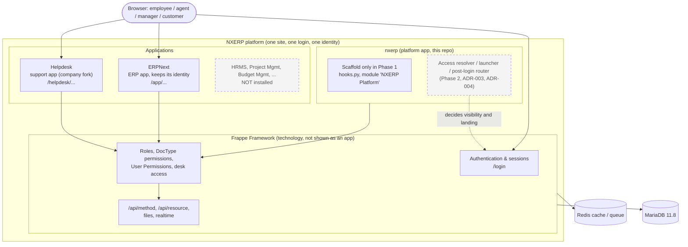

# NXERP architecture overview

Status: Phase 1. Solid boxes exist today; dashed boxes are Phase 2+ and are **not built**.

## Naming and boundaries

| Layer | Name | Rule |
| --- | --- | --- |
| Platform / brand | **NXERP** | Umbrella. Owns the shared shell only |
| ERP application | **ERPNext** | Keeps its technical identity; never renamed |
| Support application | **Helpdesk** | Separate app; never "NXERP" |
| Technology | **Frappe Framework** | Not shown to business users as an application |

## Rules this overview implies

1. One login (Frappe `/login`), one identity per person. Authentication, authorisation, application visibility and routing are four separate concerns.
2. The platform app does not import apps and apps do not import the platform (ADR-005).
3. Hiding an icon is not security: enforcement happens in Frappe on the server (`docs/research/frappe-access-and-routing.md` has the surface-by-surface coverage table).
4. A unified experience is not merged code: Frappe and ERPNext are pinned upstream tags, Helpdesk is a pinned company fork, `nxerp` is our own app.

## Where things live

| Concern | Today (Phase 1) | Target |
| --- | --- | --- |
| Login page | Helpdesk fork `helpdesk/www/login.*` | Platform app (ADR-005) |
| Branding assets | Helpdesk fork `helpdesk/public/nxerp_login/*` | Platform app, per-app theme where needed |
| Launcher tiles | Frappe `/apps` fed by each app's `add_to_apps_screen` hook | Same mechanism, filtered by the access resolver (ADR-003) |
| Version pins | `deploy/versions.env`, `deploy/apps.json` | Same |
