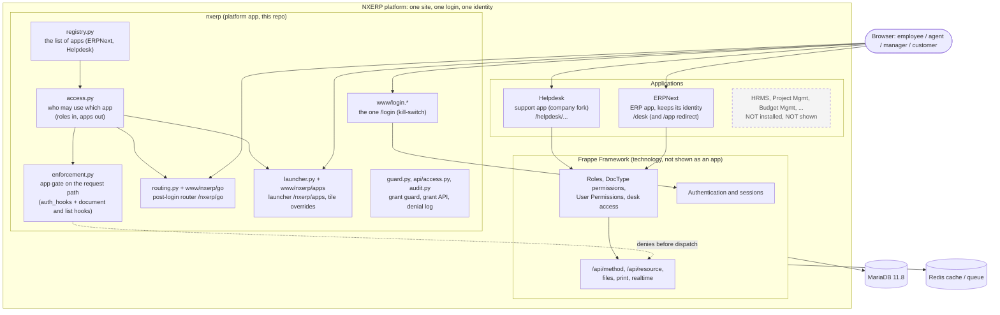
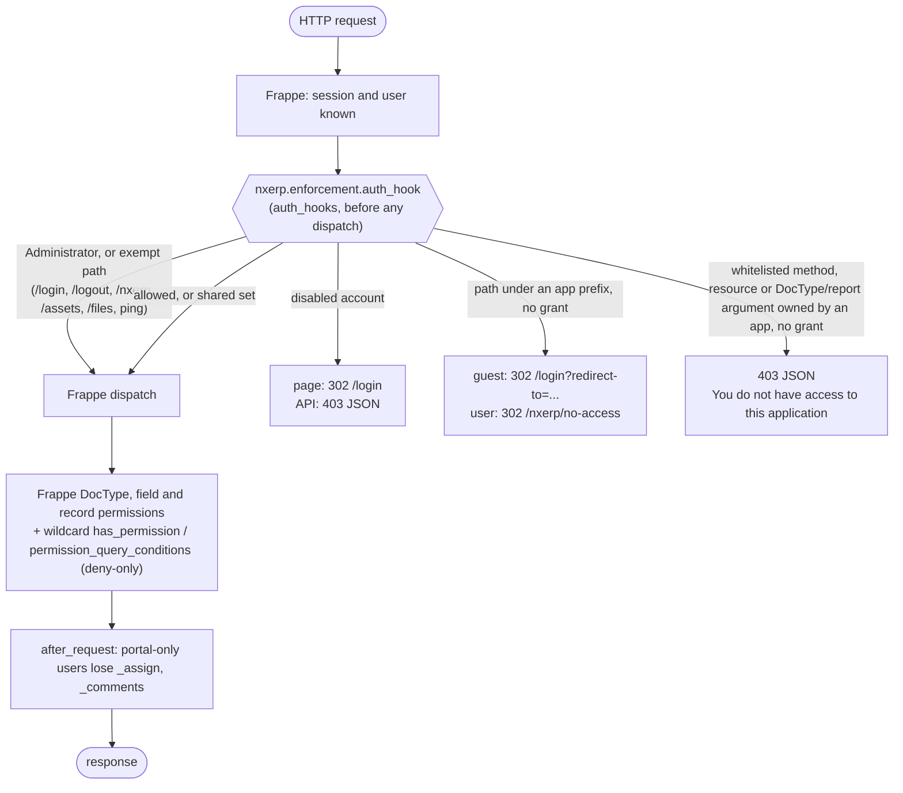

# NXERP architecture overview

Status: matches the code on branch `phase-4/release-readiness` (Phases 1 to 3 built; Phase 4 is release readiness).
Solid boxes exist and are covered by tests; dashed boxes are **not built**. Where this page says a thing works, the
test or document that shows it is named next to it. Decisions are in [`../adr/`](../adr/README.md); the URL-by-URL table is
[`routes.md`](routes.md); who may use which app is [`access-admin.md`](access-admin.md).

## Components

| Component | Where | Job |
| --- | --- | --- |
| Registry | `apps/nxerp_platform/nxerp/registry.py` | The one declarative list of apps (`AppEntry`): key, title, route, owning python packages, access role, URL prefixes, portal roles. Strings only: it never imports an app (ADR-005, ADR-003 amendment 1). A test-only entry can be declared through site config on a site with `allow_tests` |
| Resolver | `apps/nxerp_platform/nxerp/access.py` | `get_user_apps`, `can_access_app`, `can_use_portal`, `resolve_landing`. Derived from `frappe.get_roles`; keeps **no cache of its own**, so revocation applies on the next request |
| Gate | `apps/nxerp_platform/nxerp/enforcement.py` | Deny-only. `auth_hooks` classifies every request (page prefix, whitelisted method root, resource, DocType/report arguments) and answers 302 to `/nxerp/no-access` (pages) or a 403 JSON (API). Wildcard `has_permission` and `permission_query_conditions` hooks cover files, print, realtime rooms and lists. An `after_request` hook strips `_assign` / `_comments` from API responses to portal-only users. Fails closed for everyone except `Administrator` |
| Grant guard and API | `apps/nxerp_platform/nxerp/guard.py`, `apps/nxerp_platform/nxerp/api/access.py` | Only a platform administrator may change an `NXERP Access:` role; the last named System Manager cannot be removed, disabled or deleted |
| Denial log | `apps/nxerp_platform/nxerp/audit.py` | One JSON line per denial in `logs/<site>/nxerp.access.log`; the user is a salted hash, never an email |
| Router | `apps/nxerp_platform/nxerp/routing.py`, `www/nxerp/go.*` | `/nxerp/go`: the single post-login decision. `routing.safe_target` is the redirect validator |
| Launcher | `apps/nxerp_platform/nxerp/launcher.py`, `www/nxerp/apps.*` | `/nxerp/apps` (users with two or more apps), the `frappe.apps.get_apps` override and the Desk boot changes so every "Apps" menu agrees |
| Login | `apps/nxerp_platform/nxerp/www/login.*`, `public/nxerp_login/` | The only `/login`. Frappe's own authentication code runs underneath; the layout is NXERP's |
| No-access page | `www/nxerp/no-access.html` + `no_access.py` | A plain page that names no app |
| Install and migrate | `apps/nxerp_platform/nxerp/install.py`, `patches/create_access_roles.py` | Creates one access role per installed registry app (idempotent, `desk_access = 0`) and points `Portal Settings.default_portal_home` at the router |
| Migration helper | `apps/nxerp_platform/nxerp/migration.py` | Dry-run suggestion of access roles for users that existed before the layer (never applies unless asked) |
| Palette | `apps/nxerp_platform/nxerp/public/css/*` | Generated from the token source in the Helpdesk repo (`desk/src/theme`); never edited by hand |

## Request flow (what happens to one request)

The gate can only **deny**. It never grants: Frappe's own permissions always apply on top. Anything not owned by a
registered app (Frappe core DocTypes such as `User`, `File`, `ToDo`; `frappe.*` methods; custom modules) is the
"shared set" and is governed by Frappe alone ([`../security/shared-set.md`](../security/shared-set.md)). The surface-by-surface
list of what is enforced and by which test is [`../security/phase2-coverage.md`](../security/phase2-coverage.md).

## Sign-in flow (where a user lands)

1. `GET /login` is served by `apps/nxerp_platform/nxerp/www/login.*` (the kill-switch `nxerp_stock_login` serves Frappe's own page instead).
   A signed-in visitor is redirected to `/nxerp/go`. An unsafe `redirect-to` is dropped; a safe one is carried through the router.
2. Authentication is Frappe's (`/api/method/login`, 2FA, lockout, password reset are unchanged). `on_session_creation`
   sets the home page to `/nxerp/go`; the login page script does the same for website users, whose redirect Frappe computes elsewhere (ADR-004 amendment 1).
3. `/nxerp/go` runs `routing.route(user, redirect_to)`:
   an authorised, validated `redirect-to` wins; an Administrator on a site whose setup wizard is unfinished goes to `/desk`;
   otherwise the landing rule applies.

| User holds | Lands on |
| --- | --- |
| no app | `/nxerp/no-access` |
| exactly one app | that app (`/helpdesk/home`, `/desk`) |
| two or more apps (Administrator holds all installed apps) | `/nxerp/apps`, the launcher |
| only a customer or supplier portal role | the portal (`/helpdesk/my-tickets`) |

Routing is not security. The gate re-checks on every request, so a wrong route can never expose an app the user lacks.

## Login ownership and the kill-switch

`/login` belongs to `nxerp` (ADR-005). Frappe's template resolver picks the last installed app's `/login`, so **`nxerp` must
be the last entry of `deploy/apps.json`**; `deploy/check_pins.py` enforces this. The Helpdesk fork no longer ships a login.
The kill-switch is site config `nxerp_stock_login = 1` (`bench --site <site> set-config -p nxerp_stock_login 1`): it changes
only the page. Authentication, the router and the gate are unchanged. Site config is cached by each web worker for up to
60 seconds, so it takes effect within a minute without a restart. Procedure: [`../runbooks/login-recovery.md`](../runbooks/login-recovery.md).

## Hooks the platform registers

`apps/nxerp_platform/nxerp/hooks.py` registers the set below. `apps/nxerp_platform/nxerp/tests/test_scaffold.py` pins the request-path and routing hooks to exact values and asserts that
`before_request`, `on_login`, `on_logout`, `website_route_rules` and `get_website_user_home_page` are NOT used (a new hook must come with tests and a docs line):
`auth_hooks`, `after_request`, `has_permission["*"]`, `permission_query_conditions["*"]`, `on_session_creation`,
`override_whitelisted_methods` (`frappe.apps.get_apps`), `extend_bootinfo`, `standard_navbar_items` (the "All applications" row,
shown only to multi-app users), `website_redirects` (`/login/<x>` to `/login`), `doc_events` on `User` (grant guard), `after_install`,
`after_migrate`, and `app_include_css` for the Desk palette. `required_apps` is deliberately empty.

## Browser and integration test harness

- `apps/nxerp_platform/nxerp/tests/`: Frappe `IntegrationTestCase` suites run with `bench --site nxerp.localhost run-tests --app nxerp`
  (registry, resolver, enforcement, persona x surface matrix, routing and about 35 hostile redirect payloads, customer leaks, grant migration,
  HTTP tests of login/router/launcher/kill-switch, a test-only third app, the add-an-app checklist) plus `test_architecture.py` (plain unittest, no site needed).
- `e2e/`: Playwright (Chromium inside the bench container) on a **separate fresh site** `nxerp-e2e.localhost` served on port 8001, so the
  first-run setup wizard is real and the dev site is never touched. `e2e/site.sh` creates, snapshots and resets that site;
  `e2e/run.sh` runs the suites (`first-run`, `case3`, `journeys`, `flows`, `pages`, `recovery`). How to run each layer and what has and has not been
  verified: [`../guides/testing.md`](../guides/testing.md) and [`../PROGRESS.md`](../PROGRESS.md).

## Version matrix

Source of truth: `deploy/versions.env` and `deploy/apps.json`; the reasoning and evidence are in [ADR-002](../adr/ADR-002-version-matrix.md).

| Component | Pin |
| --- | --- |
| Frappe | `v16.53.0` (`e8d41dd0...`) |
| ERPNext | `v16.52.1` (`ade850bb...`) |
| payments, telephony | commit pins (`payments` is needed by ERPNext's DocTypes; `telephony` is a Helpdesk dependency) |
| Helpdesk | company fork, interim pin `1c6981cc5` in `apps.json`; the dev stack installs the branch checked out in the sibling `../helpdesk` folder instead (`deploy/README.md`) |
| `nxerp` | follows the platform repo (`main`); always last in install order |
| Python / Node | 3.14 / 24 |
| MariaDB / Redis | 11.8 / 8.6 |
| `frappe/bench` image | pinned by digest in `versions.env` |

## Repositories and branches (state on 2026-10-28)

| Repo | Purpose | State |
| --- | --- | --- |
| `Sria-Infotech-Pvt-Ltd/NxERP` (local clone `nxerp-platform/`) | `nxerp` app, `deploy/`, CI, docs | Local branches `phase-1/foundation` > `phase-2/access-layer` > `phase-3/unified-experience` > `phase-4/release-readiness` (stacked). **FACT** (`git ls-remote origin`, 2026-10-28): the remote holds only `main` (`c80531a`, "Initial commit") and PR #1's refs; none of the phase branches is pushed |
| Helpdesk fork `Sriainfotech/Frappe-Help-Desk` (local `helpdesk/`) | Helpdesk with the NXERP palette; login removed (it moved to `nxerp`) | Branch `feature/nxerp-platform-login` for Phase 3; remote `company`, upstream `origin` = `frappe/helpdesk`. See `docs/PROGRESS.md` for what is pushed |
| Frappe, ERPNext, payments, telephony | upstream | Never vendored; pinned |

CI (`.github/workflows/ci.yml`) is authored but, per `docs/PROGRESS.md`, has not been run on GitHub from this machine. Treat any "CI is green" claim as unverified until a run on GitHub exists.

## Naming and boundaries

| Layer | Name | Rule |
| --- | --- | --- |
| Platform / brand | **NXERP** | Umbrella. Owns the shared shell only (login, router, launcher, no-access, branding, access resolver) |
| ERP application | **ERPNext** | Keeps its technical identity; never renamed |
| Support application | **Helpdesk** | Separate app; never "NXERP" |
| Technology | **Frappe Framework** | Not shown to business users as an application |

## Rules this overview implies

1. One login (Frappe `/login`), one identity per person. Authentication, authorisation, application visibility and routing are four separate concerns.
2. The platform app does not import apps and apps do not import the platform (ADR-005). Enforced by `scripts/check_architecture.py` and `apps/nxerp_platform/nxerp/tests/test_architecture.py`.
3. Hiding an icon is not security: enforcement happens on the server ([`../research/frappe-access-and-routing.md`](../research/frappe-access-and-routing.md) has the surface-by-surface table).
4. A unified experience is not merged code: Frappe and ERPNext are pinned upstream tags, Helpdesk is a pinned company fork, `nxerp` is our own app.

## Where things live

| Concern | Lives in |
| --- | --- |
| Login page and its assets | `nxerp` (`www/login.*`, `public/nxerp_login/`); Helpdesk keeps only the logo images its own SPA uses |
| Launcher, router, no-access, tiles | `nxerp` |
| Which apps exist and who may use them | `apps/nxerp_platform/nxerp/registry.py` + Frappe roles (`NXERP Access: <App>`) |
| Version pins | `deploy/versions.env`, `deploy/apps.json` (an ADR-002 update goes with any change) |
| App-specific screens and theming | that app's repo |

## Deliberately NOT built

- **Future apps** (HRMS, Project Management, Budget Management, ...): not installed, not registered, not shown, not mocked. Adding one is described in [`../guides/how-to-add-an-app.md`](../guides/how-to-add-an-app.md) and is exercised against a clearly marked dummy entry in tests only.
- **A custom RBAC engine or a grant table**: grants are Frappe roles (ADR-003); the resolver is derived from them.
- **A hook-based registry extension point**: the registry is one declarative list in `nxerp` (ADR-003 amendment A1); it can be added later without changing the resolver.
- **Gating of static assets, public files, `allow_guest` methods and non-document realtime rooms**: public by design or Frappe's own decision ([`../security/shared-set.md`](../security/shared-set.md)).
- **Validation of a User Invitation's `redirect_to_path`** and a "Keep me signed in" that lengthens the session: open items in ADR-004 amendment 1.
- **Branded outgoing email** (Frappe still titles login mail "Login To Frappe") and **a screen-reader accessibility audit** (only automated basics exist).
- **Production deployment**: a production image, registry, staging and secrets management are being added under `deploy/` in Phase 4 by their owners; this page does not claim they work. Nothing has been deployed anywhere.
- **Anything on GitHub**: no push, no PR, no branch protection and no CI run has been verified (see the owner action list in `docs/governance/owner-action-list.md`).
