# Frappe Helpdesk — Master Architecture, Pipeline & Developer Knowledge Map

> **The Definitive Engineering & Data Pipeline Manual for Frappe Helpdesk**  
> *Target Audience: Full-Stack Engineers, Backend (Python/Frappe) Developers, and Frontend (Vue 3/TypeScript) Developers.*

---

## Table of Contents
1. [Executive Overview & Philosophy](#1-executive-overview--philosophy)
2. [High-Level Architecture & Tech Stack](#2-high-level-architecture--tech-stack)
3. [The End-to-End System Pipeline (TCP Packets to DOM Patch)](#3-the-end-to-end-system-pipeline)
   - [3.1 The Scenario](#31-the-scenario)
   - [3.2 The Master Pipeline Diagram (1 Single Massive Diagram)](#32-the-master-pipeline-diagram)
   - [3.3 Detailed Hop-by-Hop Breakdown with Code Files](#33-detailed-hop-by-hop-breakdown-with-code-files)
4. [Comprehensive DocType Domain Model (All 36 DocTypes)](#4-comprehensive-doctype-domain-model)
5. [Core Lifecycles & State Machines](#5-core-lifecycles--state-machines)
   - [5.1 Ticket Ingestion & Creation Lifecycle](#51-ticket-ingestion--creation-lifecycle)
   - [5.2 Dynamic Routing & Auto-Assignment Engine](#52-dynamic-routing--auto-assignment-engine)
   - [5.3 SLA Mechanics, Working Hours & Breach Calculation](#53-sla-mechanics-working-hours--breach-calculation)
   - [5.4 Communication Threading & File Security](#54-communication-threading--file-security)
   - [5.5 Dynamic Fields & Permissions Pipeline (`ticket_fields.py`)](#55-dynamic-fields--permissions-pipeline)
   - [5.6 Knowledge Base & SQLite Full-Text Search](#56-knowledge-base--sqlite-full-text-search)
   - [5.7 Resolution, CSAT & Analytics Loop](#57-resolution-csat--analytics-loop)
6. [Backend Architecture & API Catalog](#6-backend-architecture--api-catalog)
7. [Frontend Architecture (Vue 3 + Pinia + Frappe UI)](#7-frontend-architecture)
8. [Realtime System (Socket.IO & WebSockets)](#8-realtime-system)
9. [Background Schedulers & Asynchronous Workers](#9-background-schedulers--asynchronous-workers)
10. [Developer Runbook & Common Recipes](#10-developer-runbook--common-recipes)

---

## 1. Executive Overview & Philosophy

**Frappe Helpdesk** is an enterprise-grade, open-source customer support platform built on top of the **Frappe Framework**. It was designed as a modern replacement for legacy ERP support modules, prioritizing real-time reactivity, clean user experience, and customizable workflow automations.

### Core Design Principles
* **Dual-Portal Paradigm**: A unified codebase delivers two distinct interfaces:
  * **Agent Desk**: High-density workstation for support agents with live SLA countdowns, queue filters, split views, keyboard shortcuts, and internal notes.
  * **Customer Portal**: Minimalist, frictionless self-service portal where customers can submit tickets, track status, view help articles, and provide CSAT ratings.
* **Metadata-Driven Customization**: Ticket forms, fields, statuses, priorities, and SLAs are not hardcoded; they are defined via Frappe DocTypes and dynamic templates.
* **Reactive Real-time First**: Every action (ticket updates, assignments, new comments, SLA shifts) publishes real-time WebSocket events to keep team members in sync without manual polling.

---

## 2. High-Level Architecture & Tech Stack

```
 ┌────────────────────────────────────────────────────────────────────────┐
 │                              CLIENT TIER                               │
 │                                                                        │
 │   ┌─────────────────────────────┐    ┌─────────────────────────────┐   │
 │   │     Agent Portal (SPA)      │    │    Customer Portal (SPA)    │   │
 │   │   Vue 3 Composition API     │    │   Vue 3 Composition API     │   │
 │   │   Pinia Stores + Tailwind   │    │   Pinia Stores + Tailwind   │   │
 │   └──────────────┬──────────────┘    └──────────────┬──────────────┘   │
 └──────────────────┼──────────────────────────────────┼──────────────────┘
                    │ REST / RPC API Calls             │ REST / RPC API Calls
                    │ WebSockets (Socket.IO)           │ WebSockets
 ┌──────────────────▼──────────────────────────────────▼──────────────────┐
 │                            APPLICATION TIER                            │
 │                                                                        │
 │   ┌────────────────────────────────────────────────────────────────┐   │
 │   │             Frappe Helpdesk Core (Python Backend)              │   │
 │   │                                                                │   │
 │   │  • REST Endpoints (`helpdesk/api/*`)                           │   │
 │   │  • Controllers & Models (`HDTicket`, `HDSettings`, etc.)       │   │
 │   │  • SLA Engine & Working Hours Calculator                       │   │
 │   │  • Assignment Rules Engine (Round-Robin, Load-Balancing)       │   │
 │   │  • Dynamic Field & Template Sanitizer (`ticket_fields.py`)     │   │
 │   │  • Ingestion Handlers (IMAP/Email Parsing, Webhooks)           │   │
 │   └────────────────────────┬───────────────────────┬───────────────┘   │
 └────────────────────────────┼───────────────────────┼───────────────────┘
                              │ ORM Queries           │ Cache / PubSub
 ┌────────────────────────────▼────────┐     ┌────────▼───────────────────┐
 │            DATA TIER                │     │     INFRASTRUCTURE TIER    │
 │                                     │     │                            │
 │  • MariaDB: Relational Storage      │     │  • Redis Queue (Background)│
 │  • SQLite: Full-Text Search Index   │     │  • Redis Cache             │
 │                                     │     │  • NodeJS Socket.IO Server │
 └─────────────────────────────────────┘     └────────────────────────────┘
```

---

## 3. The End-to-End System Pipeline

### 3.1 The Scenario
To follow the exact journey of a piece of data from the raw network layer to database storage and real-time frontend update:

> **The Event**: Customer **Sarah** (`sarah@acme.com`) is logged into the Customer Portal. She submits an urgent ticket:
> ```json
> {
>   "subject": "Production Payment Gateway 502 Error",
>   "ticket_type": "Technical Issue",
>   "priority": "Urgent",
>   "description": "Checkout API is failing for all European customers."
> }
> ```
> Meanwhile, Support Agent **Alex** is logged into the Agent Desk on another computer watching the live dashboard.

---

### 3.2 The Master Pipeline Diagram

```mermaid
flowchart TD
    %% CLIENT LAYER
    subgraph S1 ["1. CLIENT INGRESS (Browser - Sarah)"]
        A1["User Action: Clicks 'Submit Ticket'"] --> A2["hd-frontend/src/pages/ticket/TicketNew.vue"]
        A2 --> A3["frappe-ui createResource().submit()"]
        A3 --> A4["Browser HTTP Client serializes JSON & attaches Cookie 'sid=...'"]
    end

    %% NETWORK & REVERSE PROXY
    subgraph S2 ["2. NETWORK & REVERSE PROXY LAYER"]
        A4 -->|"TCP SYN/ACK -> Port 8000"| B1["docker-compose.yml: Port Mapping 8000:8000"]
        B1 --> B2["Reverse Proxy / Nginx Ingress"]
        B2 --> B3["Extracts Host Header: 'helpdesk.localhost'"]
    end

    %% WSGI APPLICATION LAYER
    subgraph S3 ["3. WSGI APPLICATION SERVER"]
        B3 -->|"WSGI Environ Dict"| C1["Gunicorn / Werkzeug Server"]
        C1 --> C2["frappe/app.py: application(environ, start_response)"]
        C2 --> C3["frappe/app.py: init_request(request)"]
        C3 --> C4["frappe/app.py: connect() to MariaDB & Redis"]
    end

    %% AUTHENTICATION & SESSION
    subgraph S4 ["4. AUTHENTICATION & SESSION PIPELINE"]
        C4 --> D1["frappe/auth.py: HTTPRequest.__init__()"]
        D1 --> D2["Extracts Session ID 'sid' from Cookie"]
        D2 --> D3["Query MariaDB tabSessions / Redis Cache for 'sid'"]
        D3 --> D4["Resolves session user: 'sarah@acme.com'"]
        D4 --> D5["frappe/auth.py: check_request_ip() & rate_limit()"]
    end

    %% API ROUTER & SECURITY BOUNDARY
    subgraph S5 ["5. API ROUTER & METADATA SANITIZER"]
        D5 --> E1["frappe/handler.py: handle()"]
        E1 -->|"Route: /api/method/helpdesk.api.doc.create_doc"| E2["helpdesk/helpdesk/api/doc.py: create_doc()"]
        E2 --> E3["helpdesk/helpdesk/ticket_fields.py: TicketFields()"]
        E3 --> E4["TicketFields.strip_hidden_fields(): Strips agent-only & workflow fields"]
        E4 --> E5["frappe.new_doc('HD Ticket')"]
    end

    %% CONTROLLER LIFECYCLE
    subgraph S6 ["6. CONTROLLER LIFECYCLE (helpdesk/doctype/hd_ticket/hd_ticket.py)"]
        E5 --> F1["HDTicket.before_insert(): generate_key() UUID4"]
        F1 --> F2["HDTicket.before_validate(): set_ticket_type(), set_raised_by()"]
        F2 --> F3["HDTicket.validate_portal_contact(): Ensures user owns the contact"]
        F3 --> F4["HDTicket.set_customer(): Links 'Acme Corp' from Contact"]
        F4 --> F5["hd_service_level_agreement/utils.py: get_sla() matches 'Enterprise SLA'"]
        F5 --> F6["HDTicket.apply_sla(): Sets response_by (1h) and resolution_by (4h)"]
        F6 --> F7["HDTicket.before_save(): Checks working hours & holidays"]
    end

    %% DATABASE PERSISTENCE
    subgraph S7 ["7. DATABASE PERSISTENCE (MariaDB)"]
        F7 --> G1["frappe.model.document.Document.save()"]
        G1 --> G2["frappe.qb (PyPika Query Builder) builds SQL INSERT"]
        G2 --> G3["MariaDB: INSERT INTO tabHD Ticket (name, subject, priority, sla, ...)"]
        G3 --> G4["frappe.db.commit(): Transaction Committed"]
    end

    %% POST-COMMIT AUTOMATIONS
    subgraph S8 ["8. POST-COMMIT HOOKS & ASYNC ENQUEUE"]
        G4 --> H1["HDTicket.after_insert()"]
        H1 --> H2["helpdesk/overrides/assignment_rule.py: Auto-assign to Agent Alex"]
        H1 --> H3["frappe.enqueue('frappe.sendmail'): Enqueues Ack Email"]
        H1 --> H4["helpdesk/utils.py: publish_event('helpdesk:new-ticket')"]
    end

    %% BACKGROUND WORKER
    subgraph S9 ["9. ASYNC BACKGROUND WORKER (Redis Queue)"]
        H3 --> I1["Redis Queue: redis-queue:6379"]
        I1 --> I2["Bench / RQ Worker Process picks up job"]
        I2 --> I3["Renders Jinja Email Template: 'Ticket #0042 Received'"]
        I3 --> I4["SMTP Server sends email to sarah@acme.com"]
    end

    %% REALTIME PUB/SUB
    subgraph S10 ["10. REALTIME PUB/SUB SYSTEM"]
        H4 --> J1["frappe.publish_realtime('helpdesk:new-ticket')"]
        J1 --> J2["Redis Pub/Sub Channel: 'redis-socketio'"]
        J2 --> J3["Node.js Socket.IO Server (realtime/index.js)"]
        J3 -->|"Emits WebSocket frame"| J4["WSS / WS Frame over network"]
    end

    %% AGENT FRONTEND
    subgraph S11 ["11. AGENT CLIENT (Browser - Alex)"]
        J4 --> K1["hd-frontend/src/socket.ts: socket.on('helpdesk:new-ticket')"]
        K1 --> K2["hd-frontend/src/stores/notification.ts: Increments unread badge"]
        K1 --> K3["hd-frontend/src/stores/docTickets.ts: ticketsListResource.reload()"]
        K3 --> K4["hd-frontend/src/stores/sla.ts: Computes countdown 'Response due in 59m'"]
        K4 --> K5["hd-frontend/src/pages/home/Home.vue & Tickets.vue Virtual DOM Diff"]
        K5 --> K6["Browser DOM Repaint: New Ticket #0042 appears instantly on Alex's screen!"]
    end
```



---

### 3.3 Detailed Hop-by-Hop Breakdown with Code Files

#### Hop 1: Client Ingress (Sarah's Browser)
* **File**: [hd-frontend/src/pages/ticket/TicketNew.vue](../../apps/helpdesk/hd-frontend/src/pages/ticket/TicketNew.vue)
* **What happens**:
  Sarah fills out the ticket form. The component binds inputs via `v-model`. Upon clicking "Submit", it calls `createResource` from `frappe-ui`.
* **Payload**:
  ```json
  POST /api/method/helpdesk.api.doc.create_doc HTTP/1.1
  Host: helpdesk.localhost:8000
  Content-Type: application/json
  Cookie: sid=a8f902b1c4d5e6...
  
  {
    "doctype": "HD Ticket",
    "subject": "Production Payment Gateway 502 Error",
    "ticket_type": "Technical Issue",
    "priority": "Urgent",
    "description": "Checkout API is failing for all European customers."
  }
  ```

#### Hop 2: Network & Docker Ingress
* **File**: `deploy/docker/helpdesk-local-dev/docker-compose.yml`
* **What happens**:
  The TCP packet arrives at the host's network interface on port `8000`. Docker port forwarding routes the packet into the `backend` container's Nginx/Gunicorn service. Nginx reads the `Host` header (`helpdesk.localhost`), sets WSGI proxy headers (`X-Forwarded-For`, `X-Real-IP`), and passes the request via UNIX socket/TCP to Python.

#### Hop 3: WSGI Application Layer
* **File**: `apps/frappe/frappe/app.py`
* **Function**: `application(environ, start_response)`
* **What happens**:
  Gunicorn hands the WSGI `environ` dictionary to Frappe's main WSGI entry point. Frappe initializes the request context:
  ```python
  frappe.init(site="helpdesk.localhost")
  frappe.connect()  # Opens MariaDB connection pool & Redis cache client
  ```

#### Hop 4: Authentication & Session Verification
* **File**: `apps/frappe/frappe/auth.py`
* **Class**: `HTTPRequest`, `LoginManager`
* **What happens**:
  1. Frappe parses the `Cookie: sid=...` header.
  2. It queries the `tabSessions` table (or Redis session store) to validate the session token.
  3. It sets `frappe.session.user = "sarah@acme.com"`.
  4. It loads Sarah's active roles (`HD Customer`, `Customer Member`).

#### Hop 5: API Routing & Schema Sanitization
* **Files**:
  - `apps/frappe/frappe/handler.py`: `handle()`
  - [helpdesk/helpdesk/api/doc.py](../../apps/helpdesk/helpdesk/api/doc.py): `create_doc()`
  - [helpdesk/helpdesk/ticket_fields.py](../../apps/helpdesk/helpdesk/ticket_fields.py): [TicketFields](../../apps/helpdesk/helpdesk/ticket_fields.py#L19-L119)
* **What happens**:
  Frappe's RPC router dispatches to `create_doc()`. Before creating the database object, Helpdesk passes the payload through `TicketFields.strip_hidden_fields()`.
  Because `frappe.session.user` is a customer (not an agent), the sanitizer automatically strips any restricted or agent-only fields (such as `_assign`, `sla`, `feedback_rating`, `resolution_by`) preventing client-side injection.

#### Hop 6: Controller Lifecycle & SLA Evaluation
* **File**: [helpdesk/helpdesk/doctype/hd_ticket/hd_ticket.py](../../apps/helpdesk/helpdesk/doctype/hd_ticket/hd_ticket.py)
* **Methods executed in order**:
  1. `before_insert()`: Calls `generate_key()` to generate a unique UUID4 token (used for tokenized external CSAT feedback).
  2. `before_validate()`:
     - `set_raised_by()`: Sets `self.raised_by = "sarah@acme.com"`.
     - `set_default_status()`: Sets status to `"Open"` (status category: `Open`).
     - `validate_portal_contact()`: Verifies Sarah is not raising a ticket under someone else's contact record.
     - `set_customer()`: Identifies that Sarah belongs to customer `"Acme Corp"`.
     - `set_sla()`: Calls [get_sla(self)](../../apps/helpdesk/helpdesk/doctype/hd_service_level_agreement/utils.py#L12-L53) in `hd_service_level_agreement/utils.py`. The rule evaluator matches the "Enterprise Support SLA" because `priority == "Urgent"` and `customer == "Acme Corp"`.
  3. `before_save()`:
     - Calls `apply_sla()`: Reads working hours from [HD Service Day](../../apps/helpdesk/helpdesk/doctype/hd_service_day) and holidays from [HD Service Holiday List](../../apps/helpdesk/helpdesk/doctype/hd_service_holiday_list). Computes exact targets:
       - `response_by = 2026-10-12 17:26:00` (1 hour)
       - `resolution_by = 2026-10-12 20:26:00` (4 hours)

#### Hop 7: Database Persistence & Commit
* **Files**:
  - `apps/frappe/frappe/model/document.py`: `Document.save()`
  - `apps/frappe/frappe/database/mariadb/database.py`: `commit()`
* **What happens**:
  Frappe compiles the document dictionary into SQL statements using PyPika (`frappe.qb`):
  ```sql
  INSERT INTO `tabHD Ticket` (
    `name`, `subject`, `status`, `status_category`, `priority`,
    `raised_by`, `customer`, `sla`, `response_by`, `resolution_by`, `creation`
  ) VALUES (
    '0042', 'Production Payment Gateway 502 Error', 'Open', 'Open', 'Urgent',
    'sarah@acme.com', 'Acme Corp', 'SLA-001', '2026-10-12 17:26:00', '2026-10-12 20:26:00', NOW()
  );
  ```
  `frappe.db.commit()` commits the transaction to MariaDB.

#### Hop 8: Post-Commit Hooks & Auto-Assignment
* **Files**:
  - [helpdesk/helpdesk/doctype/hd_ticket/hd_ticket.py](../../apps/helpdesk/helpdesk/doctype/hd_ticket/hd_ticket.py): `after_insert()`
  - [helpdesk/overrides/assignment_rule.py](../../apps/helpdesk/overrides/assignment_rule.py): `HelpdeskAssignmentRule`
  - [helpdesk/helpdesk/utils.py](../../apps/helpdesk/helpdesk/utils.py): [publish_event()](../../apps/helpdesk/helpdesk/utils.py#L78-L96)
* **What happens**:
  1. **Auto-Assignment**: The assignment rule engine detects that `ticket_type == 'Technical Issue'`. It queries `HD Team` ("Tier 2 Engineering") and checks agent availability. Agent **Alex** is marked `Online` with the lowest workload. The rule assigns the ticket to Alex (`_assign = ["alex@company.com"]`).
  2. **Email Enqueue**: Calls `frappe.enqueue("frappe.sendmail")` with Sarah's acknowledgement email template.
  3. **Realtime Broadcast**: Calls `publish_event("helpdesk:new-ticket")`.

#### Hop 9: Asynchronous Email Worker
* **Infrastructure**: Redis Queue (`redis-queue:6379`) + Celery/RQ Background Worker
* **What happens**:
  The background worker process pops the email task off the Redis queue. It renders the Jinja email template (`Ticket #{doc.name}: We've received your request`) and connects via SMTP to send Sarah her confirmation email.

#### Hop 10: Realtime Pub/Sub & WebSocket Emission
* **Files**:
  - [helpdesk/helpdesk/utils.py](../../apps/helpdesk/helpdesk/utils.py): `frappe.publish_realtime()`
  - Node.js Realtime Server: `apps/frappe/realtime/index.js`
* **What happens**:
  Frappe pushes a message into Redis Pub/Sub channel `redis-socketio`. The Node.js Socket.IO daemon intercepts the event and broadcasts a WebSocket binary/text frame to all connected agents in the `helpdesk` room.

#### Hop 11: Agent Frontend Reactivity & Repaint (Alex's Browser)
* **Files**:
  - [hd-frontend/src/socket.ts](../../apps/helpdesk/hd-frontend/src/socket.ts): [initSocket()](../../apps/helpdesk/hd-frontend/src/socket.ts#L11-L24)
  - [hd-frontend/src/stores/notification.ts](../../apps/helpdesk/hd-frontend/src/stores/notification.ts): `useNotificationStore`
  - [hd-frontend/src/stores/docTickets.ts](../../apps/helpdesk/hd-frontend/src/stores/docTickets.ts): `getTicketListResource`
  - [hd-frontend/src/stores/sla.ts](../../apps/helpdesk/hd-frontend/src/stores/sla.ts): `useSlaStore`
  - [hd-frontend/src/pages/home/Home.vue](../../apps/helpdesk/hd-frontend/src/pages/home/Home.vue)
* **What happens**:
  1. `socket.ts` receives the event `"helpdesk:new-ticket"`.
  2. `notification.ts` plays an audio chime and increments Alex's notification badge.
  3. `docTickets.ts` executes `ticketsListResource.reload()`, fetching the new ticket row.
  4. `sla.ts` computes the remaining response time: `59m remaining`.
  5. Vue 3's reactivity system triggers a Virtual DOM diff.
  6. The browser renders Ticket `#0042` with an **Urgent** red badge under Alex's **SLA Alerts** table without requiring a page refresh.

---

## 4. Comprehensive DocType Domain Model

Frappe Helpdesk defines **36 custom DocTypes**. They form seven functional sub-domains:

```
┌────────────────────────────────────────────────────────────────────────────────────────┐
│                                   HD TICKET (Core Hub)                                  │
└───────┬──────────────┬──────────────┬──────────────┬──────────────┬──────────────┬─────┘
        │              │              │              │              │              │
        ▼              ▼              ▼              ▼              ▼              ▼
┌──────────────┐┌──────────────┐┌──────────────┐┌──────────────┐┌──────────────┐┌──────────────┐
│  Templates   ││  Customers   ││    Teams     ││     SLA      ││  Knowledge   ││  Automation  │
│  & Fields    ││  & Contacts  ││   & Agents   ││    Engine    ││     Base     ││ & Feedback   │
├──────────────┤├──────────────┤├──────────────┤├──────────────┤├──────────────┤├──────────────┤
│•HD Ticket    ││•HD Customer  ││•HD Agent     ││•HD Service   ││•HD Article   ││•HD Saved     │
│  Template    ││•HD Customer  ││•HD Agent     ││  Level       ││•HD Article   ││  Reply       │
│•HD Ticket    ││  Member      ││  Status      ││  Agreement   ││  Category    ││•HD Saved     │
│  Template    ││•Contact      ││•HD Team      ││•HD Service   ││•HD Article   ││  Reply Team  │
│  Field       ││  (Core)      ││•HD Team      ││  Level       ││  Feedback    ││•HD Notifica- │
│•HD Field     ││•User         ││  Member      ││  Priority    ││•HD Synonym   ││  tion        │
│  Layout      ││  (Core)      ││•Assignment   ││•HD Service   ││•HD Synonyms  ││•HD Email     │
│•HD Form      ││              ││  Rule        ││  Day         ││•HD Stopword  ││  Feedback    │
│  Script      ││              ││              ││•HD Service   ││              ││•HD Feedback  │
│•ticket_fields││              ││              ││  Holiday List││              ││  Option      │
│  .py         ││              ││              ││•HD Holiday   ││              ││•HD Settings  │
└──────────────┘└──────────────┘└──────────────┘└──────────────┘└──────────────┘└──────────────┘
```

### 1. Ticket Management Domain
1. **`HD Ticket`**: The primary document. Tracks ticket status, category, customer, contact, priority, SLA deadline, assignment, channel, and feedback.
2. **`HD Ticket Status`**: Configurable statuses (e.g., *Open*, *Replied*, *Waiting on Customer*, *Resolved*, *Closed*). Each belongs to a status category: `Open`, `Paused`, or `Resolved`.
3. **`HD Ticket Priority`**: Priority levels (e.g., *Low*, *Medium*, *High*, *Urgent*) with colors and weighting.
4. **`HD Ticket Type`**: Categorization tag (e.g., *Issue*, *Question*, *Bug*, *Feature Request*).
5. **`HD Ticket Activity`**: Automated audit trail logging events such as views, status changes, assignments, and escalations.
6. **`HD Ticket Comment`**: Discussions on a ticket. Can be public comments or private internal agent-only notes.
7. **`HD Comment Reaction`**: Emoji reactions attached to comments.
8. **`HD View`**: User-defined custom filtered views on the ticket list.

### 2. Forms, Templates & Layouts Domain
9. **`HD Ticket Template`**: Pre-configured form templates for different types of requests (e.g., *Hardware Replacement*, *Bug Report*).
10. **`HD Ticket Template Field`**: Child table defining which fields are required, placeholder texts, and role visibility (*Agents* vs *Everyone*).
11. **`HD Field Layout`**: Visual grid arrangement of ticket fields.
12. **`HD Form Script`**: Custom JavaScript executed dynamically on form events inside the Helpdesk UI.

### 3. Customer & Contact Domain
13. **`HD Customer`**: The organization or account receiving support (e.g., *Acme Corp*). Links to default SLAs and account tiers.
14. **`HD Customer Member`**: Child table linking individual users/contacts to an `HD Customer`.

### 4. Agent & Organization Domain
15. **`HD Agent`**: Agent profile linked to the core Frappe `User`. Stores presence (`Online`, `Offline`, `Busy`), assigned teams, and metrics.
16. **`HD Agent Status`**: Time-stamped history tracking agent presence state transitions.
17. **`HD Team`**: Departmental support teams (e.g., *L1 Support*, *Infrastructure*, *Billing*).
18. **`HD Team Member`**: Table mapping agents to teams.

### 5. Service Level Agreement (SLA) Engine
19. **`HD Service Level Agreement`**: SLA policy containing fulfillment criteria, start/end dates, conditions, and default assignment.
20. **`HD Service Level Priority`**: Target response and resolution times linked to priorities inside an SLA.
21. **`HD Service Day`**: Working hours per day of the week (e.g., *Monday: 09:00 - 18:00*).
22. **`HD Service Holiday List`**: Calendar of holidays that pause SLA countdown timers.
23. **`HD Holiday`**: Specific holiday dates inside a holiday list.

### 6. Knowledge Base & Search
24. **`HD Article`**: Knowledge base articles containing markdown/HTML body, view counters, publication state, and category.
25. **`HD Article Category`**: Hierarchical grouping for articles.
26. **`HD Article Feedback`**: Upvotes, downvotes, and written reviews on whether an article was helpful.
27. **`HD Synonym`**: Synonyms to expand search keyword queries.
28. **`HD Synonyms`**: Synonym group collections.
29. **`HD Stopword`**: Words omitted from full-text indexing to maintain performance.

### 7. Automation, Settings & Communication
30. **`HD Settings`**: Global single DocType holding helpdesk defaults: auto-assignment toggles, default SLA, email templates, customer portal access, and CSAT settings.
31. **`HD Saved Reply`**: Canned responses/macros with dynamic Jinja variables (e.g., `{{ doc.customer }}`).
32. **`HD Saved Reply Team`**: Team restrictions for saved replies.
33. **`HD Notification`**: System notifications for assignments, mentions, and SLA breaches.
34. **`HD Email Feedback`**: Outbound email tokens for one-click CSAT ratings.
35. **`HD Ticket Feedback Option`**: Rating scale options (1 to 5 stars, Good / Neutral / Bad).
36. **`erpnext_hd_settings`**: Two-way synchronization settings between ERPNext `Customer` / `Contact` and Helpdesk.

---

## 5. Core Lifecycles & State Machines

### 5.1 Ticket Ingestion & Creation Lifecycle
Tickets enter Helpdesk through email ingestion, customer portal forms, or direct agent creation:

```
[Customer Email to support@] ──────► IMAP Ingestion ──────┐
[Customer Portal Form]       ──────► Whitelisted API ─────┼──► HDTicket.before_insert()
[Agent Desk Form]            ──────► Desk API ────────────┘
```

#### Execution Sequence inside `HDTicket`:
```python
# 1. Before Insert:
generate_key()                  # Generates UUID for unauthenticated token access
apply_ticket_insert_rules()     # Evaluates intake rule overrides

# 2. Before Validate:
set_ticket_type()               # Applies default ticket type from HD Settings
set_raised_by()                 # Resolves author (session user or email sender)
set_priority()                  # Sets priority from Ticket Type or HD Settings
set_default_status()            # Sets initial status ("Open")
set_status_category()           # Resolves category ("Open", "Paused", "Resolved")
set_sla()                       # Evaluates all active SLA conditions
validate_portal_contact()       # Verifies customer cannot impersonate other contacts
set_contact() & set_customer()  # Auto-links Customer & Contact records

# 3. Before Save:
set_resolution_date()           # Records timestamp if ticket is resolved
apply_sla()                     # Calculates first response and resolution targets
handle_email_feedback()         # Prepares CSAT email if closing

# 4. After Insert:
publish_event("helpdesk:new-ticket") # Notifies agents via WebSockets
tag_first_ticket()              # Tags with "First Ticket" if user has no prior history
send_acknowledgement_email()    # Sends receipt confirmation to requester
```

---

### 5.2 Dynamic Routing & Auto-Assignment Engine
Frappe Helpdesk extends the core Frappe `Assignment Rule` engine:
1. **Rule Evaluation**: Triggered on `HD Ticket` insert/update.
2. **Conditions**: Evaluates matching ticket properties (`ticket_type`, `priority`, `customer_group`).
3. **Agent Pool Resolution**: Identifies eligible agents belonging to the specified `HD Team`.
4. **Availability & Load Check**: Filters agents who are marked `Online` in `HD Agent.availability`.
5. **Distribution Strategies**:
   * **Round Robin**: Assigns tickets cyclically among active team members.
   * **Load Balancing**: Assigns to the agent with the lowest number of currently open tickets.
6. **Notification**: Dispatches an in-app `HD Notification` and email to the assigned agent.

---

### 5.3 SLA Mechanics, Working Hours & Breach Calculation

```
              ┌──────────────────────────────────────────────┐
              │              Ticket Created                  │
              └──────────────────────┬───────────────────────┘
                                     │
                                     ▼
                      ┌─────────────────────────────┐
                      │    Evaluates Matching SLA   │
                      │  (Customer, Team, Priority) │
                      └──────────────┬──────────────┘
                                     │
                                     ▼
                      ┌─────────────────────────────┐
                      │ Computes Deadlines:         │
                      │ • Response Target           │
                      │ • Resolution Target         │
                      └──────────────┬──────────────┘
                                     │
                ┌────────────────────┴────────────────────┐
                │                                         │
                ▼                                         ▼
   [Status: Open]                           [Status: Paused (Waiting)]
   Clock is RUNNING                         Clock is PAUSED
   Checks Service Days & Holidays           Saves `on_hold_since`
                │                                         │
                │ Ticket status changed back to Open      │
                ├─────────────────────────────────────────┘
                │
                ▼
   Adjusts deadline by adding total paused duration
                │
     ┌──────────┴──────────┐
     ▼                     ▼
[Replied in time]    [Deadline passes]
SLA Succeeded        SLA Status -> "Failed" (Alerts Dashboard)
```

* **Working Hours**: Deadlines respect working schedules defined in `HD Service Day`. If raised outside working hours, the clock begins at the next working day's start time.
* **Holiday Protection**: Excludes dates defined in `HD Service Holiday List`.
* **Breach Scheduler**: An hourly job (`update_sla_status_in_ticket`) scans open tickets and marks `agreement_status = "Failed"` if deadlines have elapsed.

---

### 5.4 Communication Threading & File Security

#### Email Threading (IMAP / SMTP):
* Inbound customer emails and outbound agent replies are tracked via Frappe's `Communication` DocType.
* **Header Matching**: Helpdesk records `message_id` and tracks `in_reply_to`. When a customer responds to an email, the system matches the RFC-822 `In-Reply-To` / `References` headers directly to the parent ticket, reopening it if it was waiting on the customer.

#### File Claiming & Internal Note Security:
* When an agent uploads an image or attachment into a **Private Internal Note**, that file must **never** be accessible to the customer.
* In `hd_ticket.py`, the `claim_comment_files()` method explicitly reassigns the `attached_to_doctype` from `HD Ticket` to `Comment`. This guarantees that Frappe's permission engine blocks customer portal access to the private attachment.

---

### 5.5 Dynamic Fields & Permissions Pipeline (`ticket_fields.py`)

The file `ticket_fields.py` acts as a security boundary:

```
Frappe MariaDB Schema (All 80+ fields on HD Ticket)
                       │
                       ▼
           [ `TicketFields` Resolver ]
                       │
         ┌─────────────┴─────────────┐
         ▼                           ▼
[Agent Session]             [Customer Portal Session]
• Unrestricted fields       • Drops agent-only fields (_assign, _user_tags)
• Internal workflows        • Drops template rows where `visible_to == 'Agents'`
• Full layout metadata      • Drops unreadable fields per Frappe DocPerms
```

* Customers can **never** see internal fields, agent assignments, or private flags even if inspecting raw HTTP responses.
* Custom fields added to `HD Ticket Template` dynamically populate the Vue UI without requiring frontend redeployments.

---

### 5.6 Knowledge Base & SQLite Full-Text Search

1. **Content Authoring**: Agents publish help guides using `HD Article`, organized into hierarchical `HD Article Category` branches.
2. **SQLite Search Indexer**: Helpdesk runs a background worker (`helpdesk.search_sqlite.HelpdeskSearch`) that maintains an SQLite FTS (Full-Text Search) index of all articles.
3. **Deflection Flow**: When a customer starts typing a ticket subject in the portal, the frontend calls `/api/method/helpdesk.api.search.search`. Relevant KB articles are presented immediately.
4. **Article CSAT**: Readers submit thumbs up / down feedback (`HD Article Feedback`) to inform agents which articles need revision.

---

### 5.7 Resolution, CSAT & Analytics Loop

1. **Resolution**: Agent sets status categorized as `Resolved`.
2. **Resolution Timestamp**: `set_resolution_date()` records the exact datetime.
3. **Customer Feedback Trigger**: `handle_email_feedback()` generates a tokenized rating link:
   ```
   https://helpdesk.yourdomain.com/ticket-feedback/new?key=<UUID>
   ```
4. **CSAT Submission**: Customer rates 1–5 stars and writes feedback.
5. **Analytics Calculation**: The `dashboard.py` and `ticket_analytics.py` endpoints aggregate these metrics:
   * **Average First Response Time (MTTR)**
   * **Average Resolution Time**
   * **SLA Compliance Rate (%)**
   * **Customer Satisfaction Score (CSAT %)**

---

## 6. Backend Architecture & API Catalog

All Helpdesk endpoints reside in `helpdesk/api/`:

| Endpoint Module | Primary Methods | Description |
| :--- | :--- | :--- |
| `api.auth` | `get_user()`, `get_current_user_email_info()`, `set_user_email_accounts()` | Authenticates session, resolves Agent/Admin/Customer persona, gets email credentials. |
| `api.ticket` | `get_tickets()`, `assign_ticket_to_agent()`, `split_ticket()` | Handles ticket querying, manual agent assignments, and splitting child tickets. |
| `api.comment` | `add_comment()`, `edit_comment()`, `delete_comment()` | Posts public ticket comments and private agent notes. |
| `api.timeline` | `get_timeline()` | Fetches unified chronological stream of communications, comments, and audit events. |
| `api.saved_replies`| `get_saved_replies()`, `apply_saved_reply()` | Retrieves canned responses and executes Jinja replacements. |
| `api.knowledge_base`| `get_categories()`, `get_articles()`, `vote_article()` | Powers the knowledge base directory and article ratings. |
| `api.dashboard` | `get_metrics()`, `get_sla_summary()`, `get_ticket_trends()` | Feeds the charts and widgets on the Agent Home dashboard. |
| `api.contact` | `get_contact_tickets()`, `create_contact()` | Manages customer contact profiles and past ticket history. |

### Backend Controller Rules:
* **Hook Purity**: Document lifecycle hooks (`before_insert`, `validate`, `on_update`) contain **zero inline logic**; they must strictly call dedicated class methods (`self.method()`).
* **Minimal Saves**: Mutate all fields in memory and let the framework commit once. Never invoke `doc.save()` inside internal helper methods.
* **Permission Strictness**: Use `frappe.get_list()` instead of `frappe.get_all()` so Frappe's role permissions apply automatically.

---

## 7. Frontend Architecture (Vue 3 + Pinia + Frappe UI)

The frontend is a single-page application (SPA) located in `helpdesk/desk/`.

### 1. Dual-Portal Routing Guards (`hd-frontend/src/router/index.ts`)
* `/tickets`: Agent Ticket Queue (Agents and Admins only).
* `/my-tickets`: Customer Portal Queue (Customers only).
* If a Customer attempts to open `/tickets/0001`, the router guard detects `!authStore.isAgent` and automatically rewrites the destination to `/my-tickets/0001`.
* If unauthenticated, redirected to the login screen.

### 2. State Stores (Pinia in `hd-frontend/src/stores/`)
* **`useAuthStore`**: Holds current user profile, roles, presence status, and team memberships.
* **`useSlaStore`**: Drives the live countdown timer seen on ticket cards. Recalculates remaining time every minute.
* **`useDocTicketsStore`**: Cache layer for tickets currently open in tabs or list views.
* **`useAgentStatusStore`**: Manages the agent's live availability toggle (`Online`, `Busy`, `Offline`).

### 3. Data Fetching via `frappe-ui`
```typescript
// 1. Fetching a single document with live reactivity
const ticket = createDocumentResource({
  doctype: "HD Ticket",
  name: ticketId,
  auto: true,
});

// 2. Fetching a filtered list
const tickets = createListResource({
  doctype: "HD Ticket",
  filters: { status: "Open" },
  fields: ["name", "subject", "priority", "sla"],
  auto: true,
});

// 3. Invoking a whitelisted Python API
const assignApi = createResource({
  url: "helpdesk.api.ticket.assign_ticket_to_agent",
  onSuccess() {
    ticket.reload();
  },
});
```

### 4. UI Guidelines
* **Tailwind Semantic Classes**: Uses design tokens (`bg-surface-white`, `text-ink-gray-9`, `border-outline-gray-2`).
* **Icons**: Uses **Lucide icons** exclusively (e.g., `<LucideTicket class="size-4" />`).

---

## 8. Realtime System

Helpdesk delivers live updates using **Socket.IO** connected to Redis Pub/Sub:

```
[Backend Action (e.g., ticket.save())]
                 │
                 ▼
     publish_event("helpdesk:ticket-update", room=doc_room)
                 │
                 ▼
       [Redis Pub/Sub Channel]
                 │
                 ▼
     [Node.js Socket.IO Server]
                 │
                 ▼
[Frontend: hd-frontend/src/socket.ts listens]
                 │
                 ▼
Trigger `ticket.reload()` or push notification to user
```

* **Doc Rooms**: When an agent views a ticket, their browser joins a room (`HD Ticket/<ticket_id>`). When another agent adds a comment, only users in that room receive the live update.
* **Global Channel**: New tickets broadcast to `helpdesk:new-ticket` so all agents' list views refresh immediately.

---

## 9. Background Schedulers & Asynchronous Workers

Defined in `helpdesk/hooks.py`:

1. **`hourly_long` -> `update_sla_status_in_ticket`**:
   * Scans all open tickets.
   * Compares the current timestamp against `response_by` and `resolution_by`.
   * Flags `agreement_status = 'Failed'` if breached.
2. **`daily` -> `close_tickets_after_n_days`**:
   * Finds tickets in `Resolved` status where customer activity has ceased for $N$ days.
   * Automatically shifts status to `Closed`.
3. **`all` -> `build_index_if_not_exists`**:
   * Verifies the SQLite Knowledge Base search index is intact and updates indexed article vectors.
4. **`frappe.sendmail` (Worker Queue)**:
   * Outbound emails and auto-replies are queued into Redis and sent asynchronously.

---

## 10. Developer Runbook & Common Recipes

### 10.1 Environment Commands
* **Start Containerized App**:
  ```powershell
  cd deploy/docker/helpdesk-local-dev
  docker compose start
  ```
* **Run Frontend Dev Server** (with hot reload):
  ```bash
  cd apps/helpdesk/hd-frontend
  yarn install
  yarn dev
  ```

### 10.2 Safe Read-Only Database Queries via Python
```python
import frappe
frappe.init(site="helpdesk.localhost", sites_path="sites")
frappe.connect()

# Query tickets
tickets = frappe.get_list("HD Ticket", fields=["name", "subject", "status", "sla"])
print(tickets)

frappe.destroy()
```

### 10.3 Adding a New Custom Field to Tickets
1. **Define the Field**: Open Frappe Desk (`/desk`) -> **DocType** -> **HD Ticket** -> Add your field (e.g., `device_serial_number`).
2. **Expose in Template**: Open **HD Ticket Template** -> Add a row in `HD Ticket Template Field` pointing to `device_serial_number`.
3. **Configure Visibility**: Set `Visible To` to either *Agents* or *Everyone*.
4. **Result**: `ticket_fields.py` automatically picks up the schema and makes it accessible in both the backend and frontend forms without modifying codebase routing.

### 10.4 Adding a New Whitelisted API Endpoint
1. Create or open a file in `helpdesk/helpdesk/api/`.
2. Annotate your function with `@frappe.whitelist()` and role guards:
   ```python
   import frappe
   from helpdesk.utils import agent_only

   @frappe.whitelist()
   @agent_only
   def get_team_workload(team_name: str):
       return frappe.db.count("HD Ticket", {
           "agent_group": team_name,
           "status_category": "Open"
       })
   ```
3. Call it from the frontend:
   ```typescript
   const workload = createResource({
     url: "helpdesk.api.custom.get_team_workload",
     params: { team_name: "L1 Support" },
     auto: true,
   });
   ```

---

*This guide serves as the definitive architecture manual for Frappe Helpdesk development. Keep this document as a primary reference for module dependencies, lifecycle hooks, and architectural boundaries.*
